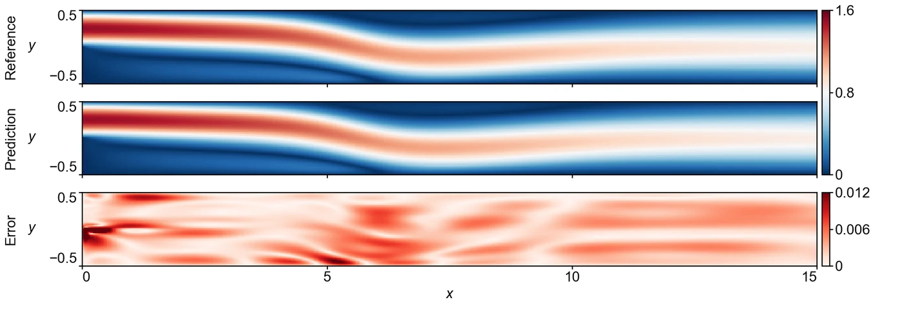

<section class="hero" style="padding-bottom:28px">

<a href="../problems.html">18 problems</a> / BFS

<h1>BFS Backward-facing step flow</h1>

Training time per solver

180 s

Discovered PINN solver, five seeds

0.0229 ± 0.0061

</section>
<section>

<h2>Problem definition</h2>

The steady incompressible Navier–Stokes equations for the velocity $(u,v)$ and the pressure $p$,
\[
\begin{aligned}
u\,\pd{u}{x}+v\,\pd{u}{y}&amp;=-\pd{p}{x}+\nu\left(\pdn{2}{u}{x}+\pdn{2}{u}{y}\right),\\
u\,\pd{v}{x}+v\,\pd{v}{y}&amp;=-\pd{p}{y}+\nu\left(\pdn{2}{v}{x}+\pdn{2}{v}{y}\right),\\
\pd{u}{x}+\pd{v}{y}&amp;=0,
\end{aligned}
\]
with $\nu=1/\mathit{Re}$ and $\mathit{Re}=800$, based on the channel height and the mean inlet velocity, hold in the channel $(x,y)\in[0,15]\times[-0.5,0.5]$ downstream of a backward-facing step. The flow enters through the upper half of the plane $x=0$, and the lower half of that plane is the face of the step, which gives an expansion ratio of 2. The boundary conditions are
\[
\begin{aligned}
&amp;u(0,y)=\begin{cases}24\,y\,(0.5-y), &amp; 0&lt;y\le0.5,\\ 0, &amp; -0.5\le y\le0,\end{cases}\qquad v(0,y)=0,\\[2pt]
&amp;u(x,\pm0.5)=v(x,\pm0.5)=0,\qquad p(15,y)=0.
\end{aligned}
\]
The error is measured on $(u,v)$ at the points of a uniform $481\times65$ grid over the channel. The problem and its reference solution follow APTS (<a class="cite" href="https://arxiv.org/abs/2604.23528" title="When PINNs Go Wrong: Pseudo-Time Stepping against Spurious Solutions" target="_blank" rel="noopener noreferrer">Wang et al., 2026</a>), which computes the solution with the finite-volume code SU2 (<a class="cite" href="https://doi.org/10.2514/1.J053813" title="SU2: An Open-Source Suite for Multiphysics Simulation and Design" target="_blank" rel="noopener noreferrer">Economon et al., 2016</a>), and the scoring points are the nodes of its mesh.

</section>
<section>

<h2>Fields of the discovered solver</h2>
<figure class="panel">
<figcaption><strong>Supplementary Fig. 6. BFS.</strong> Speed and the magnitude of the velocity error on the scoring grid. The solver has a relative $L^2$ error of 0.0054.</figcaption></figure>

</section>
<section id="discovery">

<h2>Discovery process</h2>

Diamonds mark where the main techniques of the discovered solver enter, listed below the chart. Hover over a round to see the predicted field and the error field of the best solver after it.

<i class="dot"></i>evaluated solver<i class="line"></i>best so far
<i class="dia" style="background:#F3C49C;border-color:#D29466"></i>technique as in a note<i class="dia" style="background:#E8743B"></i>adapted from a note<i class="dia" style="background:#4A443C"></i>not from the literature base

All evaluated solvers as a table

<table><thead><tr><th>Round</th><th>Candidate</th><th>Seed</th><th>Relative <i>L</i>2 error</th><th>Steps</th><th>Training (s)</th></tr></thead><tbody id="eval-rows"></tbody></table>

</section>
<section>

<h2>Error against four state-of-the-art methods</h2>

Mean over five seeds with the range. The discovery run is a single training. Hatched bars use twice the training time (360 s).

</section>
<section>

<h2>Files</h2>

Discovered PINN solver

The solver of Table 1, from discovery run <code>bfs_1_0.005355</code> (<code>blocks/b10/b10_lin1375.py</code>).

<a class="dl" href="../files/solvers/bfs.py">bfs.py</a> view or save

<nav class="pager"><a href="ldc.html">&larr; LDC</a><a href="../problems.html">All problems</a><a href="heatlt.html">Heat-LT &rarr;</a></nav>

</section>

