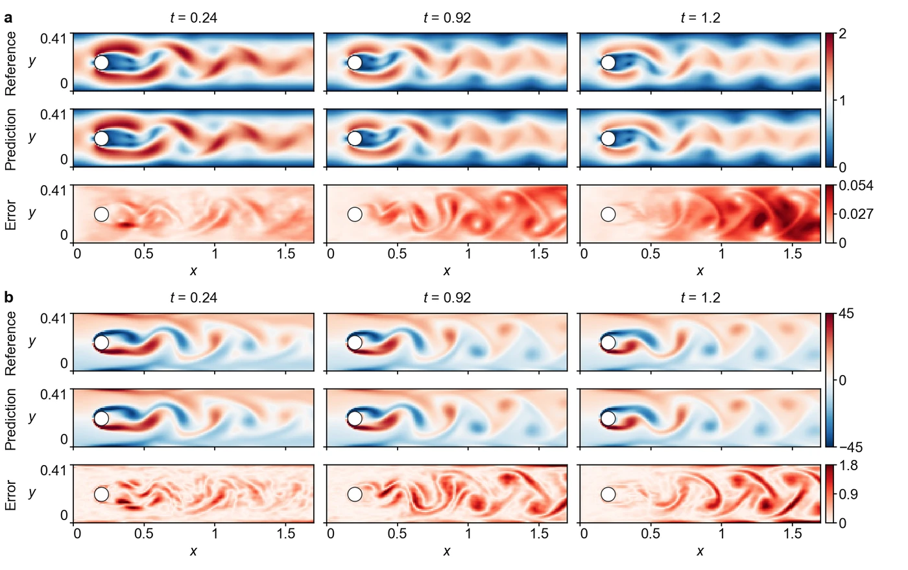

<section class="hero" style="padding-bottom:28px">

<a href="../problems.html">18 problems</a> / Cyl

<h1>Cyl Cylinder vortex street</h1>

Training time per solver

300 s

Discovered PINN solver, five seeds

0.0226 ± 0.0029

</section>
<section>

<h2>Problem definition</h2>

The unsteady incompressible Navier–Stokes equations for the velocity $(u,v)$ and the pressure $p$,
\[
\begin{aligned}
\pd{u}{t}+u\,\pd{u}{x}+v\,\pd{u}{y}&amp;=-\pd{p}{x}+\nu\left(\pdn{2}{u}{x}+\pdn{2}{u}{y}\right),\\
\pd{v}{t}+u\,\pd{v}{x}+v\,\pd{v}{y}&amp;=-\pd{p}{y}+\nu\left(\pdn{2}{v}{x}+\pdn{2}{v}{y}\right),\\
\pd{u}{x}+\pd{v}{y}&amp;=0,
\end{aligned}
\]
with $\nu=10^{-3}$, hold for $t\in[0,1.2]$ in a channel of height $H=0.41$ around a circular cylinder of diameter $d=0.1$,
\[
\Omega=\Bigl\{(x,y)\in[0,2.2]\times[0,H]\Bigm|(x-0.2)^2+(y-0.2)^2&gt;0.05^2\Bigr\}.
\]
The centre of the cylinder lies 0.005 below the mid-height of the channel, which breaks the symmetry of the flow. The inflow has the mean velocity $\bar{U}(t)=\sin\bigl(\pi(t+4.8)/8\bigr)$, and the boundary conditions are
\[
\begin{aligned}
&amp;u(t,0,y)=\frac{6\,\bar{U}(t)\,y\,(H-y)}{H^2},\quad v(t,0,y)=0 &amp;&amp;\text{at the inlet } x=0,\\
&amp;u=v=0 &amp;&amp;\text{on the walls } y=0,\ y=H \text{ and on the cylinder},\\
&amp;p(t,2.2,y)=0 &amp;&amp;\text{at the outlet } x=2.2.
\end{aligned}
\]
The problem is the interval $[4.8,6]$ of the flow in Cyl-LT, the DFG 2D-3 benchmark (<a class="cite" href="https://doi.org/10.1007/978-3-322-89849-4_39" title="Benchmark Computations of Laminar Flow around a Cylinder" target="_blank" rel="noopener noreferrer">Schafer et al., 1996</a>), shifted to start at $t=0$, over which the Reynolds number $\bar{U}d/\nu$ falls from 95 to 71. The initial velocity $u(0,x,y)$, $v(0,x,y)$ is the reference solution at $t=0$, in which vortex shedding is already established. The error is measured on $(u,v)$ at the 31 times $t=0,0.04,\ldots,1.2$ and the 7,113 points of a uniform grid with spacing 0.01 that satisfy $x\le1.7$ and lie in the fluid or on the cylinder surface. We compute the reference solution of Cyl and Cyl-LT in one run from rest with COMSOL Multiphysics 5.6, using Taylor–Hood finite elements of second order for the velocity and first order for the pressure without stabilization, on 48,408 elements refined in the wake and with eight boundary layers on the cylinder, and the second-order backward differentiation formula with a fixed time step of 0.00125. The maximum lift coefficient of this solution and the time at which it occurs agree to within 0.03% with the published benchmark solution that the developers of FEATFLOW (<a class="cite" href="https://doi.org/10.1007/978-3-642-58393-3" title="Efficient Solvers for Incompressible Flow Problems: An Algorithmic and Computational Approach" target="_blank" rel="noopener noreferrer">Turek, 1999</a>) compute on their finest mesh. Over the interval of Cyl, the relative error of this solution, estimated against a solution on 115,624 elements and one with half the time step, is $7\times10^{-4}$ from the mesh and $2.8\times10^{-3}$ from the time step.

</section>
<section>

<h2>Fields of the discovered solver</h2>
<figure class="panel">
<figcaption><strong>Supplementary Fig. 10. Cyl.</strong> <strong>a</strong>, Speed and the magnitude of the velocity error at $t=0.24$, $0.92$ and $1.2$ on the scoring grid. <strong>b</strong>, Vorticity $\omega=\partial v/\partial x-\partial u/\partial y$ and its absolute error at the same times, computed by central differences on the scoring grid. Values of $|\omega|$ above 45, up to 131 at the cylinder wall, take the darkest colours. The solver has a relative $L^2$ error of 0.015.</figcaption></figure>
<figure class="panel" style="margin-top:16px"><video class="anim-tall" controls loop muted playsinline preload="metadata" poster="../assets/media/field_cyl_poster.webp?v=b5792fde" width="970" height="848">
<source src="../assets/media/field_cyl.mp4?v=b68b2596" type="video/mp4"></video>
<figcaption><strong>Animation.</strong> Reference solution, discovered PINN solver and absolute error of the vorticity <i>ω</i>, from <i>t</i> = 0 to 1.2.</figcaption></figure>

</section>
<section id="discovery">

<h2>Discovery process</h2>

Diamonds mark where the main techniques of the discovered solver enter, listed below the chart. Hover over a round to see the predicted field and the error field of the best solver after it.

<i class="dot"></i>evaluated solver<i class="line"></i>best so far
<i class="dia" style="background:#F3C49C;border-color:#D29466"></i>technique as in a note<i class="dia" style="background:#E8743B"></i>adapted from a note<i class="dia" style="background:#4A443C"></i>not from the literature base

All evaluated solvers as a table

<table><thead><tr><th>Round</th><th>Candidate</th><th>Seed</th><th>Relative <i>L</i>2 error</th><th>Steps</th><th>Training (s)</th></tr></thead><tbody id="eval-rows"></tbody></table>

</section>
<section>

<h2>Error against four state-of-the-art methods</h2>

Mean over five seeds with the range. The discovery run is a single training. Hatched bars use twice the training time (600 s).

</section>
<section>

<h2>Files</h2>

Discovered PINN solver

The solver of Table 1, from discovery run <code>cyl_1_0.01531</code> (<code>blocks/b08/b08_ta08b4.py</code>).

<a class="dl" href="../files/solvers/cyl.py">cyl.py</a> view or save

<nav class="pager"><a href="smoke.html">&larr; Smoke</a><a href="../problems.html">All problems</a><a href="gl.html">GL &rarr;</a></nav>

</section>

