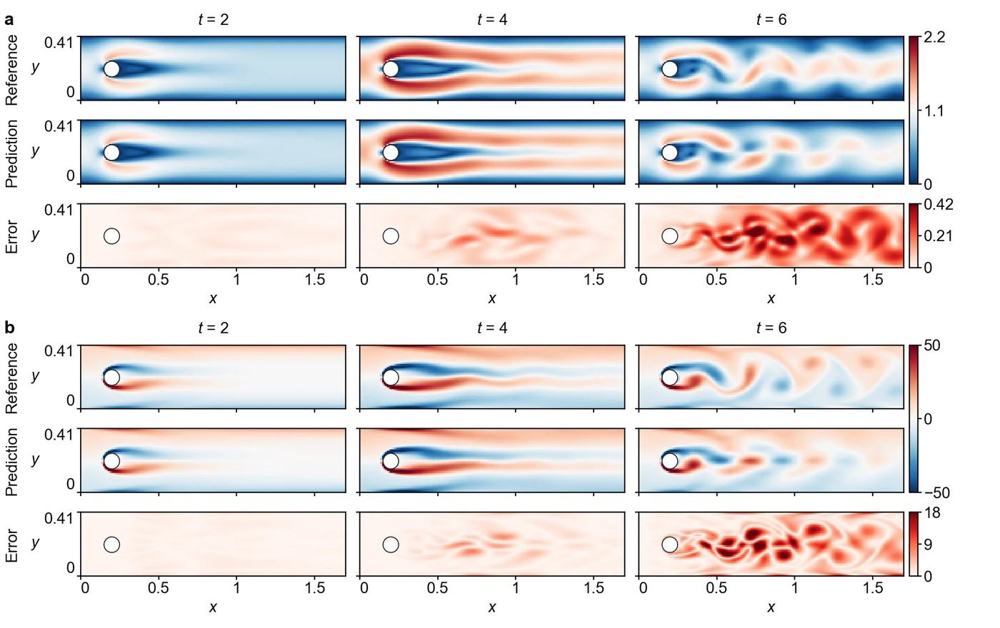

<section class="hero" style="padding-bottom:28px">

<a href="../problems.html">18 problems</a> / Cyl-LT

<h1>Cyl-LT Long-time vortex street</h1>

Training time per solver

480 s

Discovered PINN solver, five seeds

0.101 ± 0.001

</section>
<section>

<h2>Problem definition</h2>

The Navier–Stokes equations, the channel and the boundary conditions of Cyl hold for $t\in[0,6]$ with the mean inflow velocity $\bar{U}(t)=\sin(\pi t/8)$. The fluid starts at rest, $u(0,x,y)=v(0,x,y)=0$, and the Reynolds number $\bar{U}d/\nu$ rises from 0 to 100 at $t=4$ and falls to 71 at $t=6$. The error is measured on $(u,v)$ at the 61 times $t=0,0.1,\ldots,6$ and the 7,113 points of Cyl. The problem is the DFG 2D-3 benchmark (<a class="cite" href="https://doi.org/10.1007/978-3-322-89849-4_39" title="Benchmark Computations of Laminar Flow around a Cylinder" target="_blank" rel="noopener noreferrer">Schafer et al., 1996</a>), which runs to $t=8$, cut at $t=6$. Its reference solution is the COMSOL solution described for Cyl, at every 0.1 in time.

</section>
<section>

<h2>Fields of the discovered solver</h2>
<figure class="panel">
<figcaption><strong>Supplementary Fig. 16. Cyl-LT.</strong> <strong>a</strong>, Speed and the magnitude of the velocity error. <strong>b</strong>, Vorticity $\omega=\partial v/\partial x-\partial u/\partial y$, computed by central differences, and its absolute error. Values of $|\omega|$ above 50 take the darkest colour. The solver has a relative $L^2$ error of 0.1003.</figcaption></figure>
<figure class="panel" style="margin-top:16px"><video class="anim-tall" controls loop muted playsinline preload="metadata" poster="../assets/media/field_cyl2_poster.webp?v=859b8228" width="970" height="848">
<source src="../assets/media/field_cyl2.mp4?v=c483cad2" type="video/mp4"></video>
<figcaption><strong>Animation.</strong> Reference solution, discovered PINN solver and absolute error of the vorticity <i>ω</i>, from <i>t</i> = 0 to 6.</figcaption></figure>

</section>
<section id="discovery">

<h2>Discovery process</h2>

Diamonds mark where the main techniques of the discovered solver enter, listed below the chart. Hover over a round to see the predicted field and the error field of the best solver after it.

<i class="dot"></i>evaluated solver<i class="line"></i>best so far
<i class="dia" style="background:#F3C49C;border-color:#D29466"></i>technique as in a note<i class="dia" style="background:#E8743B"></i>adapted from a note<i class="dia" style="background:#4A443C"></i>not from the literature base

All evaluated solvers as a table

<table><thead><tr><th>Round</th><th>Candidate</th><th>Seed</th><th>Relative <i>L</i>2 error</th><th>Steps</th><th>Training (s)</th></tr></thead><tbody id="eval-rows"></tbody></table>

</section>
<section>

<h2>Error against four state-of-the-art methods</h2>

Mean over five seeds with the range. The discovery run is a single training. Hatched bars use twice the training time (960 s).

</section>
<section>

<h2>Files</h2>

Discovered PINN solver

The solver of Table 1, from discovery run <code>cyl2_1_0.1001</code> (<code>blocks/b10/b10_v02.py</code>).

<a class="dl" href="../files/solvers/cyl2.py">cyl2.py</a> view or save

<nav class="pager"><a href="ns4d.html">&larr; NS4D</a><a href="../problems.html">All problems</a><a href="rt.html">RT &rarr;</a></nav>

</section>

