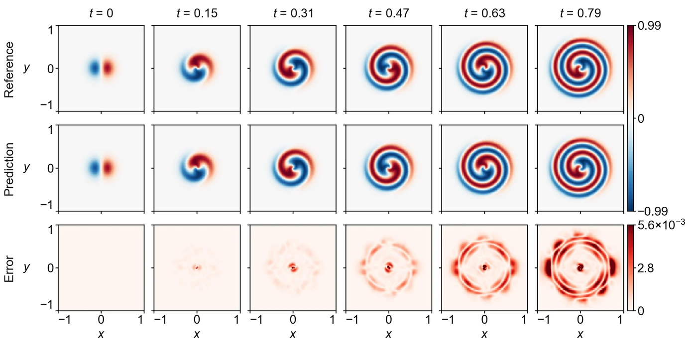

<section class="hero" style="padding-bottom:28px">

<a href="../problems.html">18 problems</a> / GL

<h1>GL Ginzburg–Landau</h1>

Training time per solver

300 s

Discovered PINN solver, five seeds

0.00702 ± 0.00124

</section>
<section>

<h2>Problem definition</h2>

The complex Ginzburg–Landau equation for the amplitude $A=u+\mathrm{i}v$,
\[
\pd{A}{t}=\epsilon\left(\pdn{2}{A}{x}+\pdn{2}{A}{y}\right)+k\bigl(A-(1+\mathrm{i}c)|A|^2A\bigr),
\]
reads for its real part $u(t,x,y)$ and imaginary part $v(t,x,y)$
\[
\begin{aligned}
\pd{u}{t}&amp;=\epsilon\left(\pdn{2}{u}{x}+\pdn{2}{u}{y}\right)+k\bigl[u-(u^2+v^2)(u-c\,v)\bigr],\\
\pd{v}{t}&amp;=\epsilon\left(\pdn{2}{v}{x}+\pdn{2}{v}{y}\right)+k\bigl[v-(u^2+v^2)(v+c\,u)\bigr],
\end{aligned}
\]
with $\epsilon=0.004$, $k=10$ and $c=1.5$. It holds on $(t,x,y)\in[0,0.79]\times[-1,1]^2$ with the periodic boundary conditions
\[
\pdn{n}{q}{x}(t,-1,y)=\pdn{n}{q}{x}(t,1,y),\qquad \pdn{n}{q}{y}(t,x,-1)=\pdn{n}{q}{y}(t,x,1),\qquad q\in\{u,v\},\ n=0,1,2,\ldots,
\]
and the initial conditions
\[
u(0,x,y)=10\,x\,e^{-25(x^2+y^2)},\qquad v(0,x,y)=10\,y\,e^{-25(x^2+y^2)}.
\]
The error is measured on $(u,v)$ at the 80 times $t=0,0.01,\ldots,0.79$ on a $100\times100$ subsample of a uniform $200\times200$ grid over $[-1,1]^2$. The problem follows APTS (<a class="cite" href="https://arxiv.org/abs/2604.23528" title="When PINNs Go Wrong: Pseudo-Time Stepping against Spurious Solutions" target="_blank" rel="noopener noreferrer">Wang et al., 2026</a>), and its reference solution is the one released with APTS, computed with Chebfun (<a class="cite" href="https://www.chebfun.org/docs/guide/" title="Chebfun Guide" target="_blank" rel="noopener noreferrer">Driscoll et al., 2014</a>).

</section>
<section>

<h2>Fields of the discovered solver</h2>
<figure class="panel">
<figcaption><strong>Supplementary Fig. 11. GL.</strong> The real part $u=\mathrm{Re}\,A$ and its absolute error at $t=0$, $0.15$, $0.31$, $0.47$, $0.63$ and $0.79$ on the scoring grid. The solver has a relative $L^2$ error of 0.0037.</figcaption></figure>
<figure class="panel" style="margin-top:16px"><video controls loop muted playsinline preload="metadata" poster="../assets/media/field_gl_poster.webp?v=60b59be8" width="1486" height="516">
<source src="../assets/media/field_gl.mp4?v=5daef79d" type="video/mp4"></video>
<figcaption><strong>Animation.</strong> Reference solution, discovered PINN solver and absolute error of the real part <i>u</i> = Re <i>A</i>, from <i>t</i> = 0 to 0.79.</figcaption></figure>

</section>
<section id="discovery">

<h2>Discovery process</h2>

Diamonds mark where the main techniques of the discovered solver enter, listed below the chart. Hover over a round to see the predicted field and the error field of the best solver after it.

<i class="dot"></i>evaluated solver<i class="line"></i>best so far
<i class="dia" style="background:#F3C49C;border-color:#D29466"></i>technique as in a note<i class="dia" style="background:#E8743B"></i>adapted from a note<i class="dia" style="background:#4A443C"></i>not from the literature base

All evaluated solvers as a table

<table><thead><tr><th>Round</th><th>Candidate</th><th>Seed</th><th>Relative <i>L</i>2 error</th><th>Steps</th><th>Training (s)</th></tr></thead><tbody id="eval-rows"></tbody></table>

</section>
<section>

<h2>Error against four state-of-the-art methods</h2>

Mean over five seeds with the range. The discovery run is a single training. Hatched bars use twice the training time (600 s).

</section>
<section>

<h2>Files</h2>

Discovered PINN solver

The solver of Table 1, from discovery run <code>gl_1_0.003662</code> (<code>blocks/b05/b05_scan.py</code>).

<a class="dl" href="../files/solvers/gl.py">gl.py</a> view or save

<nav class="pager"><a href="cyl.html">&larr; Cyl</a><a href="../problems.html">All problems</a><a href="gs.html">GS &rarr;</a></nav>

</section>

