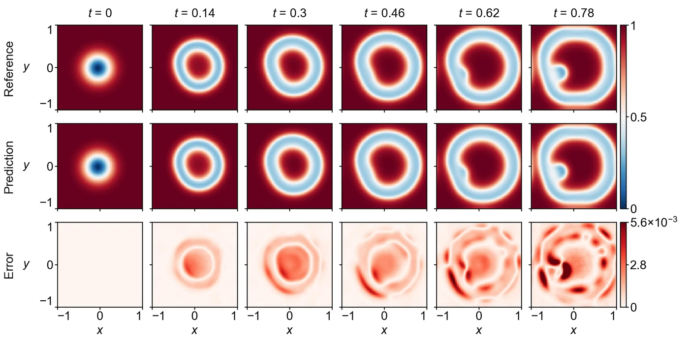

<section class="hero" style="padding-bottom:28px">

<a href="../problems.html">18 problems</a> / GS

<h1>GS Gray–Scott</h1>

Training time per solver

300 s

Discovered PINN solver, five seeds

0.00212 ± 0.00088

</section>
<section>

<h2>Problem definition</h2>

The Gray–Scott reaction-diffusion system for the concentrations $u(t,x,y)$ and $v(t,x,y)$,
\[
\begin{aligned}
\pd{u}{t}&amp;=\epsilon_1\left(\pdn{2}{u}{x}+\pdn{2}{u}{y}\right)+b_1(1-u)-c_1\,u\,v^2,\\
\pd{v}{t}&amp;=\epsilon_2\left(\pdn{2}{v}{x}+\pdn{2}{v}{y}\right)-b_2\,v+c_2\,u\,v^2,
\end{aligned}
\]
with $\epsilon_1=0.2$, $\epsilon_2=0.1$, $b_1=40$, $b_2=100$ and $c_1=c_2=1000$, holds on $(t,x,y)\in[0,0.78]\times[-1,1]^2$ with the periodic boundary conditions
\[
\pdn{n}{q}{x}(t,-1,y)=\pdn{n}{q}{x}(t,1,y),\qquad \pdn{n}{q}{y}(t,x,-1)=\pdn{n}{q}{y}(t,x,1),\qquad q\in\{u,v\},\ n=0,1,2,\ldots,
\]
and the initial conditions
\[
u(0,x,y)=1-e^{-10\left[(x+0.05)^2+(y+0.02)^2\right]},\qquad v(0,x,y)=e^{-10\left[(x-0.05)^2+(y-0.02)^2\right]}.
\]
The error is measured on $(u,v)$ at the 40 times $t=0,0.02,\ldots,0.78$ on a $100\times100$ subsample of a uniform $200\times200$ grid over $[-1,1]^2$. The problem follows APTS (<a class="cite" href="https://arxiv.org/abs/2604.23528" title="When PINNs Go Wrong: Pseudo-Time Stepping against Spurious Solutions" target="_blank" rel="noopener noreferrer">Wang et al., 2026</a>), and its reference solution is the one released with APTS, computed with Chebfun (<a class="cite" href="https://www.chebfun.org/docs/guide/" title="Chebfun Guide" target="_blank" rel="noopener noreferrer">Driscoll et al., 2014</a>).

</section>
<section>

<h2>Fields of the discovered solver</h2>
<figure class="panel">
<figcaption><strong>Supplementary Fig. 12. GS.</strong> The concentration $u$ and its absolute error at $t=0$, $0.14$, $0.3$, $0.46$, $0.62$ and $0.78$ on the scoring grid. The solver has a relative $L^2$ error of 0.0017.</figcaption></figure>
<figure class="panel" style="margin-top:16px"><video controls loop muted playsinline preload="metadata" poster="../assets/media/field_gs_poster.webp?v=06412ecd" width="1486" height="516">
<source src="../assets/media/field_gs.mp4?v=9a3105ce" type="video/mp4"></video>
<figcaption><strong>Animation.</strong> Reference solution, discovered PINN solver and absolute error of the concentration <i>u</i>, from <i>t</i> = 0 to 0.78.</figcaption></figure>

</section>
<section id="discovery">

<h2>Discovery process</h2>

Diamonds mark where the main techniques of the discovered solver enter, listed below the chart. Hover over a round to see the predicted field and the error field of the best solver after it.

<i class="dot"></i>evaluated solver<i class="line"></i>best so far
<i class="dia" style="background:#F3C49C;border-color:#D29466"></i>technique as in a note<i class="dia" style="background:#E8743B"></i>adapted from a note<i class="dia" style="background:#4A443C"></i>not from the literature base

All evaluated solvers as a table

<table><thead><tr><th>Round</th><th>Candidate</th><th>Seed</th><th>Relative <i>L</i>2 error</th><th>Steps</th><th>Training (s)</th></tr></thead><tbody id="eval-rows"></tbody></table>

</section>
<section>

<h2>Error against four state-of-the-art methods</h2>

Mean over five seeds with the range. The discovery run is a single training. Hatched bars use twice the training time (600 s).

</section>
<section>

<h2>Files</h2>

Discovered PINN solver

The solver of Table 1, from discovery run <code>gs_1_0.001683</code> (<code>blocks/b10/b10_tsm3.py</code>).

<a class="dl" href="../files/solvers/gs.py">gs.py</a> view or save

<nav class="pager"><a href="gl.html">&larr; GL</a><a href="../problems.html">All problems</a><a href="kf.html">KF &rarr;</a></nav>

</section>

