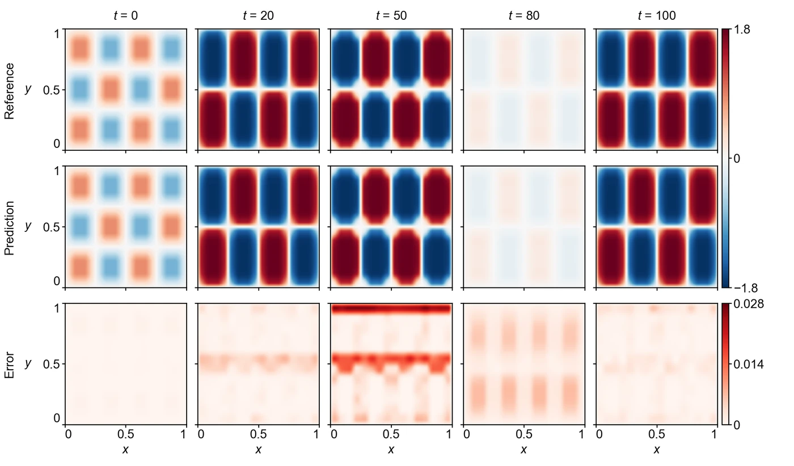

<section class="hero" style="padding-bottom:28px">

<a href="../problems.html">18 problems</a> / Heat-LT

<h1>Heat-LT Long-time heat equation</h1>

Training time per solver

180 s

Discovered PINN solver, five seeds

0.220 ± 0.252

</section>
<section>

<h2>Problem definition</h2>

The heat equation for $u(t,x,y)$ with a source that is nonlinear in $u$,
\[
\pd{u}{t}=D\left(\pdn{2}{u}{x}+\pdn{2}{u}{y}\right)+A\sin\bigl(u^2\bigr)\left(1+2\sin\frac{\pi t}{4}\right)\sin(4\pi x)\sin(2\pi y),
\]
with $D=0.001$ and $A=5$, holds on $(t,x,y)\in[0,100]\times[0,1]^2$. The time factor of the source has period 8, so the time interval covers 12.5 periods. The Dirichlet condition $u=0$ holds on the four sides, and the initial condition is
\[
u(0,x,y)=\sin(4\pi x)\sin(3\pi y).
\]
The error is measured on $u$ at the 501 times $t=0,0.2,\ldots,100$ and the $16\times12$ points $x=(2i-1)/32$, $y=(2j-1)/24$, $i=1,\ldots,16$, $j=1,\ldots,12$. The problem is Heat2d-LT of PINNacle (<a class="cite" href="https://doi.org/10.52202/079017-2442" title="PINNacle: A Comprehensive Benchmark of Physics-Informed Neural Networks for Solving PDEs" target="_blank" rel="noopener noreferrer">Hao et al., 2024</a>), and its reference solution is the one released with PINNacle, which computes it with the finite-element solver of COMSOL Multiphysics 6.0 and exports it at these 192 points. Finite-difference solutions of the problem with fourth-order Runge–Kutta time stepping, converged in grid and time step, differ from this reference by a relative error of 0.036.

</section>
<section>

<h2>Fields of the discovered solver</h2>
<figure class="panel">
<figcaption><strong>Supplementary Fig. 7. Heat-LT.</strong> The field $u$ at $t=0$, $20$, $50$, $80$ and $100$. The solver has a relative $L^2$ error of 0.035.</figcaption></figure>
<figure class="panel" style="margin-top:16px"><video controls loop muted playsinline preload="metadata" poster="../assets/media/field_heatlt_poster.webp?v=11afc775" width="1486" height="516">
<source src="../assets/media/field_heatlt.mp4?v=4aff2d9e" type="video/mp4"></video>
<figcaption><strong>Animation.</strong> Reference solution, discovered PINN solver and absolute error of the field <i>u</i>, from <i>t</i> = 0 to 100.</figcaption></figure>

</section>
<section id="discovery">

<h2>Discovery process</h2>

Diamonds mark where the main techniques of the discovered solver enter, listed below the chart. Hover over a round to see the predicted field and the error field of the best solver after it.

<i class="dot"></i>evaluated solver<i class="line"></i>best so far
<i class="dia" style="background:#F3C49C;border-color:#D29466"></i>technique as in a note<i class="dia" style="background:#E8743B"></i>adapted from a note<i class="dia" style="background:#4A443C"></i>not from the literature base

All evaluated solvers as a table

<table><thead><tr><th>Round</th><th>Candidate</th><th>Seed</th><th>Relative <i>L</i>2 error</th><th>Steps</th><th>Training (s)</th></tr></thead><tbody id="eval-rows"></tbody></table>

</section>
<section>

<h2>Error against four state-of-the-art methods</h2>

Mean over five seeds with the range. The discovery run is a single training. Hatched bars use twice the training time (360 s).

</section>
<section>

<h2>Files</h2>

Discovered PINN solver

The solver of Table 1, from discovery run <code>heatlt_1_0.03522</code> (<code>blocks/b10/b10_s1m.py</code>).

<a class="dl" href="../files/solvers/heatlt.py">heatlt.py</a> view or save

<nav class="pager"><a href="bfs.html">&larr; BFS</a><a href="../problems.html">All problems</a><a href="naca.html">NACA &rarr;</a></nav>

</section>

