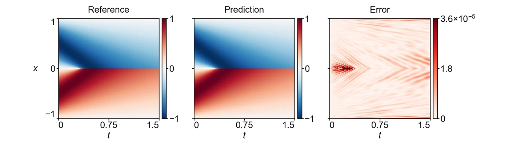

<section class="hero" style="padding-bottom:28px">

<a href="../problems.html">18 problems</a> / IB

<h1>IB Inviscid Burgers</h1>

Training time per solver

100 s

Discovered PINN solver, five seeds

(1.79 ± 0.48) × 10−5

</section>
<section>

<h2>Problem definition</h2>

The inviscid Burgers equation for $u(t,x)$,
\[
\pd{u}{t}+u\,\pd{u}{x}=0,
\]
holds on $(t,x)\in[0,1.5]\times[-1,1]$ with the periodic boundary conditions
\[
\pdn{n}{u}{x}(t,-1)=\pdn{n}{u}{x}(t,1),\qquad n=0,1,2,\ldots,
\]
and the initial condition $u(0,x)=-\sin(\pi x)$. The characteristics steepen into a stationary shock at $x=0$, which forms at $t=1/\pi\approx0.318$ and persists to the final time. The reference values are those of the exact entropy solution, which follows the characteristics $x=x_0-t\sin(\pi x_0)$ up to the shock at $x=0$, and an independent evaluation of this solution agrees with them to a relative error of $10^{-8}$. The error is measured on $u$ at the 101 times $t=0,0.015,\ldots,1.5$ and the 512 points $x=-1+(2j+1)/512$, $j=0,\ldots,511$.

</section>
<section>

<h2>Fields of the discovered solver</h2>
<figure class="panel">
<figcaption><strong>Supplementary Fig. 2. IB.</strong> The field $u(t,x)$ on the scoring grid. The solver has a relative $L^2$ error of $1.3\times10^{-5}$.</figcaption></figure>
<figure class="panel" style="margin-top:16px"><video class="anim-1d" controls loop muted playsinline preload="metadata" poster="../assets/media/field_ib_poster.webp?v=b7e9b54c" width="960" height="520">
<source src="../assets/media/field_ib.mp4?v=3d89c5f5" type="video/mp4"></video>
<figcaption><strong>Animation.</strong> Reference solution, discovered PINN solver and absolute error of the field <i>u</i>, from <i>t</i> = 0 to 1.5.</figcaption></figure>

</section>
<section id="discovery">

<h2>Discovery process</h2>

Diamonds mark where the main techniques of the discovered solver enter, listed below the chart. Hover over a round to see the predicted field and the error field of the best solver after it.

<i class="dot"></i>evaluated solver<i class="line"></i>best so far
<i class="dia" style="background:#F3C49C;border-color:#D29466"></i>technique as in a note<i class="dia" style="background:#E8743B"></i>adapted from a note<i class="dia" style="background:#4A443C"></i>not from the literature base

All evaluated solvers as a table

<table><thead><tr><th>Round</th><th>Candidate</th><th>Seed</th><th>Relative <i>L</i>2 error</th><th>Steps</th><th>Training (s)</th></tr></thead><tbody id="eval-rows"></tbody></table>

</section>
<section>

<h2>Error against four state-of-the-art methods</h2>

Mean over five seeds with the range. The discovery run is a single training. Hatched bars use twice the training time (200 s).

</section>
<section>

<h2>Files</h2>

Discovered PINN solver

The solver of Table 1, from discovery run <code>ib_1_1.348e-05</code> (<code>blocks/b05/b05_e10.py</code>).

<a class="dl" href="../files/solvers/ib.py">ib.py</a> view or save

<nav class="pager"><a href="poissoncg.html">&larr; Poisson-CG</a><a href="../problems.html">All problems</a><a href="kdv.html">KdV &rarr;</a></nav>

</section>

