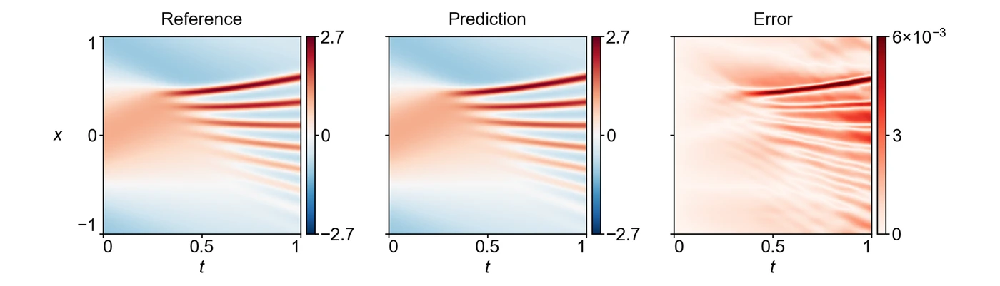

<section class="hero" style="padding-bottom:28px">

<a href="../problems.html">18 problems</a> / KdV

<h1>KdV Korteweg–de Vries</h1>

Training time per solver

100 s

Discovered PINN solver, five seeds

0.00204 ± 0.00025

</section>
<section>

<h2>Problem definition</h2>

The Korteweg–de Vries equation for $u(t,x)$,
\[
\pd{u}{t}+u\,\pd{u}{x}+\delta^2\,\pdn{3}{u}{x}=0,\qquad \delta=0.022,
\]
holds on $(t,x)\in[0,1]\times[-1,1]$ with the periodic boundary conditions
\[
\pdn{n}{u}{x}(t,-1)=\pdn{n}{u}{x}(t,1),\qquad n=0,1,2,\ldots,
\]
and the initial condition $u(0,x)=\cos(\pi x)$. The error is measured on $u$ at the 201 times $t=0,0.005,\ldots,1$ and the 511 points $x=-1+2j/511$, $j=0,\ldots,510$. The problem is the classical setting of Zabusky and Kruskal (<a class="cite" href="https://doi.org/10.1103/PhysRevLett.15.240" title="Interaction of “Solitons&#x27;&#x27; in a Collisionless Plasma and the Recurrence of Initial States" target="_blank" rel="noopener noreferrer">Zabusky and Kruskal, 1965</a>), and its reference solution is the one released with PirateNets (<a class="cite" href="https://arxiv.org/abs/2402.00326" title="PirateNets: Physics-Informed Deep Learning with Residual Adaptive Networks" target="_blank" rel="noopener noreferrer">Wang et al., 2024</a>), which computes it with Chebfun (<a class="cite" href="https://www.chebfun.org/docs/guide/" title="Chebfun Guide" target="_blank" rel="noopener noreferrer">Driscoll et al., 2014</a>) using 512 Fourier modes and the fourth-order exponential time-differencing scheme ETDRK4 (<a class="cite" href="https://doi.org/10.1006/jcph.2002.6995" title="Exponential Time Differencing for Stiff Systems" target="_blank" rel="noopener noreferrer">Cox and Matthews, 2002</a>) with a time step of $10^{-5}$.

</section>
<section>

<h2>Fields of the discovered solver</h2>
<figure class="panel">
<figcaption><strong>Supplementary Fig. 3. KdV.</strong> The field $u(t,x)$ on the scoring grid. The solver has a relative $L^2$ error of 0.0017.</figcaption></figure>
<figure class="panel" style="margin-top:16px"><video class="anim-1d" controls loop muted playsinline preload="metadata" poster="../assets/media/field_kdv_poster.webp?v=3f0e9e0f" width="960" height="520">
<source src="../assets/media/field_kdv.mp4?v=65ceb503" type="video/mp4"></video>
<figcaption><strong>Animation.</strong> Reference solution, discovered PINN solver and absolute error of the field <i>u</i>, from <i>t</i> = 0 to 1.</figcaption></figure>

</section>
<section id="discovery">

<h2>Discovery process</h2>

Diamonds mark where the main techniques of the discovered solver enter, listed below the chart. Hover over a round to see the predicted field and the error field of the best solver after it.

<i class="dot"></i>evaluated solver<i class="line"></i>best so far
<i class="dia" style="background:#F3C49C;border-color:#D29466"></i>technique as in a note<i class="dia" style="background:#E8743B"></i>adapted from a note<i class="dia" style="background:#4A443C"></i>not from the literature base

All evaluated solvers as a table

<table><thead><tr><th>Round</th><th>Candidate</th><th>Seed</th><th>Relative <i>L</i>2 error</th><th>Steps</th><th>Training (s)</th></tr></thead><tbody id="eval-rows"></tbody></table>

</section>
<section>

<h2>Error against four state-of-the-art methods</h2>

Mean over five seeds with the range. The discovery run is a single training. Hatched bars use twice the training time (200 s).

</section>
<section>

<h2>Files</h2>

Discovered PINN solver

The solver of Table 1, from discovery run <code>kdv_1_0.001731</code> (<code>blocks/b05/b05_bal05.py</code>).

<a class="dl" href="../files/solvers/kdv.py">kdv.py</a> view or save

<nav class="pager"><a href="ib.html">&larr; IB</a><a href="../problems.html">All problems</a><a href="wavems.html">Wave-HM &rarr;</a></nav>

</section>

