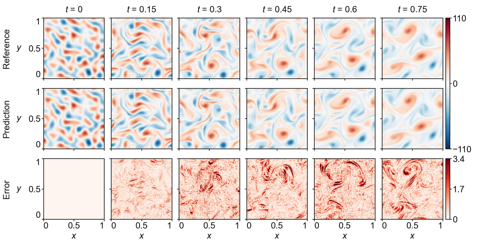

<section class="hero" style="padding-bottom:28px">

<a href="../problems.html">18 problems</a> / KF

<h1>KF Kolmogorov flow</h1>

Training time per solver

300 s

Discovered PINN solver, five seeds

0.0152 ± 0.0002

</section>
<section>

<h2>Problem definition</h2>

The unsteady incompressible Navier–Stokes equations with the Kolmogorov forcing $2\sin(4\pi y)$ on the $x$-momentum,
\[
\begin{aligned}
\pd{u}{t}+u\,\pd{u}{x}+v\,\pd{u}{y}&amp;=-\pd{p}{x}+\nu\left(\pdn{2}{u}{x}+\pdn{2}{u}{y}\right)+2\sin(4\pi y),\\
\pd{v}{t}+u\,\pd{v}{x}+v\,\pd{v}{y}&amp;=-\pd{p}{y}+\nu\left(\pdn{2}{v}{x}+\pdn{2}{v}{y}\right),\\
\pd{u}{x}+\pd{v}{y}&amp;=0,
\end{aligned}
\]
with $\nu=1/\mathit{Re}$ and $\mathit{Re}=2000$, hold on $(t,x,y)\in[0,0.75]\times[0,1]^2$ with the periodic boundary conditions
\[
\pdn{n}{q}{x}(t,0,y)=\pdn{n}{q}{x}(t,1,y),\qquad \pdn{n}{q}{y}(t,x,0)=\pdn{n}{q}{y}(t,x,1),\qquad q\in\{u,v,p\},\ n=0,1,2,\ldots,
\]
and the reference solution at $t=0$ on a uniform $256\times256$ grid as the initial velocity $u(0,x,y)$, $v(0,x,y)$. The error is measured on $(u,v)$ at the 16 times $t=0,0.05,\ldots,0.75$ on a $128\times128$ subsample of that grid. The problem and its reference solution follow APTS (<a class="cite" href="https://arxiv.org/abs/2604.23528" title="When PINNs Go Wrong: Pseudo-Time Stepping against Spurious Solutions" target="_blank" rel="noopener noreferrer">Wang et al., 2026</a>), and the problem uses the times $t=0.01,0.06,\ldots,0.76$ of that solution, shifted to start at $t=0$. A pseudo-spectral solution from the same initial velocity, converged in grid and time step to a relative error of $10^{-4}$, differs from it by a relative error of 0.016.

</section>
<section>

<h2>Fields of the discovered solver</h2>
<figure class="panel">
<figcaption><strong>Supplementary Fig. 13. KF.</strong> Vorticity $\omega=\partial v/\partial x-\partial u/\partial y$ and its absolute error at $t=0$, $0.15$, $0.3$, $0.45$, $0.6$ and $0.75$, computed by central differences on the periodic scoring grid. The solver has a relative $L^2$ error of 0.015 in velocity and 0.035 in vorticity at these times.</figcaption></figure>
<figure class="panel" style="margin-top:16px"><video controls loop muted playsinline preload="metadata" poster="../assets/media/field_kf_poster.webp?v=b3e4c33f" width="1486" height="516">
<source src="../assets/media/field_kf.mp4?v=d1b23a85" type="video/mp4"></video>
<figcaption><strong>Animation.</strong> Reference solution, discovered PINN solver and absolute error of the vorticity <i>ω</i>, from <i>t</i> = 0 to 0.75.</figcaption></figure>

</section>
<section id="discovery">

<h2>Discovery process</h2>

Diamonds mark where the main techniques of the discovered solver enter, listed below the chart. Hover over a round to see the predicted field and the error field of the best solver after it.

<i class="dot"></i>evaluated solver<i class="line"></i>best so far
<i class="dia" style="background:#F3C49C;border-color:#D29466"></i>technique as in a note<i class="dia" style="background:#E8743B"></i>adapted from a note<i class="dia" style="background:#4A443C"></i>not from the literature base

All evaluated solvers as a table

<table><thead><tr><th>Round</th><th>Candidate</th><th>Seed</th><th>Relative <i>L</i>2 error</th><th>Steps</th><th>Training (s)</th></tr></thead><tbody id="eval-rows"></tbody></table>

</section>
<section>

<h2>Error against four state-of-the-art methods</h2>

Mean over five seeds with the range. The discovery run is a single training. Hatched bars use twice the training time (600 s).

</section>
<section>

<h2>Files</h2>

Discovered PINN solver

The solver of Table 1, from discovery run <code>kf_1_0.01489</code> (<code>blocks/b06/b06_lr45.py</code>).

<a class="dl" href="../files/solvers/kf.py">kf.py</a> view or save

<nav class="pager"><a href="gs.html">&larr; GS</a><a href="../problems.html">All problems</a><a href="ks.html">KS &rarr;</a></nav>

</section>

