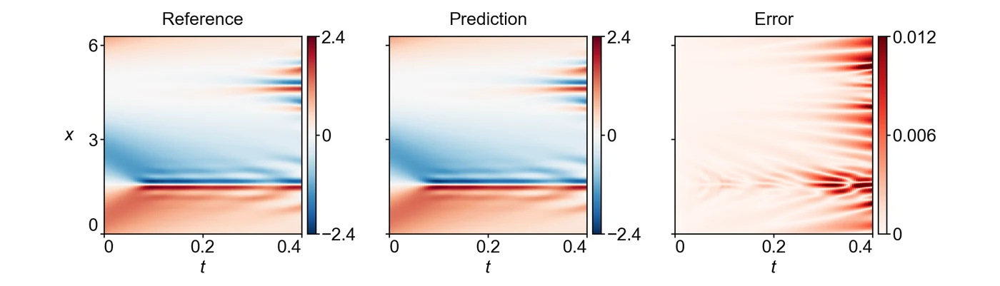

<section class="hero" style="padding-bottom:28px">

<a href="../problems.html">18 problems</a> / KS

<h1>KS Kuramoto–Sivashinsky</h1>

Training time per solver

300 s

Discovered PINN solver, five seeds

0.00854 ± 0.00450

</section>
<section>

<h2>Problem definition</h2>

The Kuramoto–Sivashinsky equation for $u(t,x)$,
\[
\pd{u}{t}+\nu_1\,u\,\pd{u}{x}+\nu_2\,\pdn{2}{u}{x}+\nu_3\,\pdn{4}{u}{x}=0,
\]
with $\nu_1=100/16=6.25$, $\nu_2=100/16^2=0.390625$ and $\nu_3=100/16^4\approx1.526\times10^{-3}$, holds on $(t,x)\in[0,0.4]\times[0,2\pi]$ with the periodic boundary conditions
\[
\pdn{n}{u}{x}(t,0)=\pdn{n}{u}{x}(t,2\pi),\qquad n=0,1,2,\ldots,
\]
and the initial condition $u(0,x)=\cos x\,(1+\sin x)$. The error is measured on $u$ at the 101 times $t=0,0.004,\ldots,0.4$ and the 512 points $x=2\pi j/511$, $j=0,\ldots,511$. The problem and its reference solution, computed with Chebfun (<a class="cite" href="https://www.chebfun.org/docs/guide/" title="Chebfun Guide" target="_blank" rel="noopener noreferrer">Driscoll et al., 2014</a>) and ETDRK4 (<a class="cite" href="https://doi.org/10.1006/jcph.2002.6995" title="Exponential Time Differencing for Stiff Systems" target="_blank" rel="noopener noreferrer">Cox and Matthews, 2002</a>), follow Scale-PINN (<a class="cite" href="https://arxiv.org/abs/2602.19475" title="Scale-PINN: Learning Efficient Physics-Informed Neural Networks through Sequential Correction" target="_blank" rel="noopener noreferrer">Chiu et al., 2026</a>), and the problem uses the first 101 times of that solution.

</section>
<section>

<h2>Fields of the discovered solver</h2>
<figure class="panel">
<figcaption><strong>Supplementary Fig. 14. KS.</strong> The field $u(t,x)$ on the scoring grid of run 3, as in Fig. 4e. The solver has a relative $L^2$ error of 0.0034.</figcaption></figure>
<figure class="panel" style="margin-top:16px"><video class="anim-1d" controls loop muted playsinline preload="metadata" poster="../assets/media/field_ks_poster.webp?v=1dcec02d" width="960" height="520">
<source src="../assets/media/field_ks.mp4?v=241f2580" type="video/mp4"></video>
<figcaption><strong>Animation.</strong> Reference solution, discovered PINN solver and absolute error of the field <i>u</i>, from <i>t</i> = 0 to 0.4.</figcaption></figure>

</section>
<section id="discovery">

<h2>Discovery process</h2>

Diamonds mark where the main techniques of the discovered solver enter, listed below the chart. Hover over a round to see the predicted field and the error field of the best solver after it.

<button type="button" data-run="0" aria-pressed="false">Run 1 best 0.00951</button><button type="button" data-run="1" aria-pressed="false">Run 2 best 0.0116</button><button type="button" data-run="2" aria-pressed="true">Run 3 best 0.00336</button>

<i class="dot"></i>evaluated solver<i class="line"></i>best so far
<i class="dia" style="background:#F3C49C;border-color:#D29466"></i>technique as in a note<i class="dia" style="background:#E8743B"></i>adapted from a note<i class="dia" style="background:#4A443C"></i>not from the literature base

All evaluated solvers as a table

<table><thead><tr><th>Round</th><th>Candidate</th><th>Seed</th><th>Relative <i>L</i>2 error</th><th>Steps</th><th>Training (s)</th></tr></thead><tbody id="eval-rows"></tbody></table>

<script type="application/json" id="discovery-data">{"case":"ks","runs":[{"case":"ks","run":"ks_1_0.009508","rounds":10,"points":[{"x":0.0,"e":0.7295689681873874,"c":"b00/b00_v01.py","r":0,"s":0,"n":50144,"t":295.5,"b":1},{"x":0.0407,"e":0.2760060282961006,"c":"b01/b01_causal_periodic.py","r":1,"s":0,"n":50239,"t":292.6,"b":1},{"x":0.1229,"e":0.8365080098838569,"c":"b01/b01_soap.py","r":1,"s":0,"n":30927,"t":292.4},{"x":0.1219,"e":0.2737197397856134,"c":"b01/b01_finegrid.py","r":1,"s":0,"n":13051,"t":292.8,"b":1},{"x":0.204,"e":0.2755672426674677,"c":"b01/b01_lbfgs.py","r":1,"s":0,"n":30822,"t":290.9},{"x":0.2029,"e":0.29694902903792236,"c":"b01/b01_soap_lr.py","r":1,"s":0,"n":30843,"t":292.4},{"x":0.285,"e":0.28376035872516053,"c":"b01/b01_march.py","r":1,"s":0,"n":61886,"t":290.4},{"x":0.2836,"e":0.18818686902042248,"c":"b01/b01_march8.py","r":1,"s":0,"n":61975,"t":290.6,"b":1},{"x":0.3657,"e":0.27669131807780356,"c":"b01/b01_march12.py","r":1,"s":0,"n":61046,"t":290.5},{"x":0.3643,"e":0.6638566707925292,"c":"b01/b01_march16.py","r":1,"s":0,"n":61901,"t":290.6},{"x":0.4464,"e":0.2993927199568099,"c":"b01/b01_march8_fast.py","r":1,"s":0,"n":125130,"t":290.4},{"x":0.445,"e":0.3065810749035834,"c":"b01/b01_march8_ic.py","r":1,"s":0,"n":61094,"t":290.6},{"x":0.5271,"e":0.22559192411212656,"c":"b01/b01_march10.py","r":1,"s":0,"n":61469,"t":290.4},{"x":0.5258,"e":0.6607601324363286,"c":"b01/b01_march8_lb.py","r":1,"s":0,"n":30026,"t":291.4},{"x":0.6065,"e":0.2389961437945472,"c":"b01/b01_march8_dense.py","r":1,"s":0,"n":35116,"t":290.5},{"x":0.6078,"e":0.24792448101645706,"c":"b01/b01_march8_wide.py","r":1,"s":0,"n":45884,"t":290.5},{"x":0.6885,"e":1.550352367815267,"c":"b01/b01_march8_prog.py","r":1,"s":0,"n":61843,"t":290.4},{"x":0.6872,"e":0.2673731491966276,"c":"b01/b01_march8_warm.py","r":1,"s":0,"n":62046,"t":290.6},{"x":0.7692,"e":0.2882907477886985,"c":"b01/b01_march8_front.py","r":1,"s":0,"n":61866,"t":290.5},{"x":0.7679,"e":0.276232774669254,"c":"b01/b01_march8_lr1.py","r":1,"s":0,"n":62045,"t":290.6},{"x":0.85,"e":0.4130681340004625,"c":"b01/b01_march8_ic512.py","r":1,"s":0,"n":62942,"t":290.5},{"x":0.8486,"e":0.34022408512138824,"c":"b01/b01_march8.py","r":1,"s":0,"n":62061,"t":290.5},{"x":0.9307,"e":0.33735351013672515,"c":"b01/b01_march8_r2.py","r":1,"s":0,"n":61890,"t":290.4},{"x":0.9293,"e":0.3150532741891226,"c":"b01/b01_march8_r3.py","r":1,"s":0,"n":61781,"t":290.5},{"x":0.9696,"e":0.27356781193451984,"c":"b01/b01_march8_r4.py","r":1,"s":0,"n":62765,"t":290.5},{"x":1.0819,"e":0.220943857576351,"c":"b02/b02_ema.py","r":2,"s":0,"n":61048,"t":290.5},{"x":1.0807,"e":0.20188634064344155,"c":"b02/b02_fixedgrid.py","r":2,"s":0,"n":62316,"t":290.6},{"x":1.1628,"e":0.2095430762456167,"c":"b02/b02_ema.py","r":2,"s":1,"n":61790,"t":290.5},{"x":1.1614,"e":0.17719058924303804,"c":"b02/b02_fixedgrid.py","r":2,"s":1,"n":61850,"t":290.6,"b":1},{"x":1.2435,"e":0.1891872330471857,"c":"b02/b02_fg_ema.py","r":2,"s":0,"n":62027,"t":290.6},{"x":1.2421,"e":0.20575123550042496,"c":"b02/b02_fg_nt36.py","r":2,"s":0,"n":36546,"t":290.7},{"x":1.3242,"e":0.18213256074927048,"c":"b02/b02_fg_ema.py","r":2,"s":2,"n":60799,"t":290.5},{"x":1.3229,"e":0.14791761366119244,"c":"b02/b02_fg_ema.py","r":2,"s":1,"n":61797,"t":290.6,"b":1},{"x":1.4049,"e":0.6385935386069705,"c":"b02/b02_fg_ema995.py","r":2,"s":0,"n":61182,"t":290.5},{"x":1.4036,"e":0.5412873812768976,"c":"b02/b02_fg_ema995.py","r":2,"s":1,"n":62047,"t":290.6},{"x":1.4856,"e":0.2934849253069499,"c":"b02/b02_fg_ema.py","r":2,"s":3,"n":62180,"t":290.6},{"x":1.4843,"e":0.2515423172916018,"c":"b02/b02_fg_ema.py","r":2,"s":4,"n":62048,"t":290.6},{"x":1.5663,"e":0.15546609365944256,"c":"b02/b02_fg_ema_rep.py","r":2,"s":1,"n":61142,"t":290.5},{"x":1.565,"e":0.28202517998525634,"c":"b02/b02_fg_ema.py","r":2,"s":5,"n":61267,"t":290.6},{"x":1.6471,"e":0.21046117988089683,"c":"b02/b02_fg_ema_w9.py","r":2,"s":1,"n":62127,"t":290.5},{"x":1.6457,"e":0.1500024360643037,"c":"b02/b02_fg_ema_w7.py","r":2,"s":1,"n":61170,"t":290.6},{"x":1.7278,"e":0.15116486330603887,"c":"b02/b02_fg_ema.py","r":2,"s":6,"n":61998,"t":290.5},{"x":1.7264,"e":0.23566739648019597,"c":"b02/b02_fg_ema.py","r":2,"s":7,"n":61911,"t":290.6},{"x":1.8085,"e":0.269819406766654,"c":"b02/b02_fg_ema.py","r":2,"s":9,"n":61964,"t":290.5},{"x":1.8071,"e":0.22055623590012344,"c":"b02/b02_fg_ema.py","r":2,"s":8,"n":62248,"t":290.6},{"x":1.8892,"e":0.21386089000683842,"c":"b02/b02_fg_ema.py","r":2,"s":10,"n":62077,"t":290.5},{"x":1.8878,"e":0.2613179529091264,"c":"b02/b02_fg_ema.py","r":2,"s":11,"n":61936,"t":290.6},{"x":1.9699,"e":0.24887511780868782,"c":"b02/b02_fg_ema.py","r":2,"s":12,"n":60637,"t":290.6},{"x":1.9686,"e":0.2263379565977429,"c":"b02/b02_fg_ema.py","r":2,"s":13,"n":62016,"t":290.6},{"x":2.0404,"e":0.3412118577372021,"c":"b03/b03_pirate.py","r":3,"s":0,"n":52980,"t":290.6},{"x":2.0807,"e":0.3399164340792608,"c":"b03/b03_pirate.py","r":3,"s":1,"n":52892,"t":290.6},{"x":2.1211,"e":0.2380545255957131,"c":"b03/b03_lsinit.py","r":3,"s":0,"n":63988,"t":290.6},{"x":2.1614,"e":0.1871309709620682,"c":"b03/b03_overlap.py","r":3,"s":0,"n":52158,"t":290.6},{"x":2.2018,"e":0.21362080045827025,"c":"b03/b03_overlap.py","r":3,"s":1,"n":51930,"t":290.6},{"x":2.2422,"e":0.1553848787249185,"c":"b03/b03_rwf.py","r":3,"s":0,"n":62195,"t":290.6},{"x":2.2825,"e":1.2314948751231547,"c":"b03/b03_rwf.py","r":3,"s":1,"n":62195,"t":290.6},{"x":2.3229,"e":0.208777077015643,"c":"b03/b03_rwf.py","r":3,"s":2,"n":62090,"t":290.6},{"x":2.3632,"e":0.18141069078357497,"c":"b03/b03_rwf05.py","r":3,"s":0,"n":62071,"t":290.6},{"x":2.4036,"e":0.19395577141308232,"c":"b03/b03_rwf05.py","r":3,"s":1,"n":61780,"t":290.6},{"x":2.444,"e":0.34521709002463413,"c":"b03/b03_rwfclip.py","r":3,"s":1,"n":60576,"t":290.6},{"x":2.4843,"e":0.2532021455876621,"c":"b03/b03_rwfclip.py","r":3,"s":0,"n":60554,"t":290.6},{"x":2.5247,"e":0.138539335784309,"c":"b03/b03_rwf.py","r":3,"s":3,"n":61993,"t":290.6,"b":1},{"x":2.565,"e":0.1420174893267861,"c":"b03/b03_rwf.py","r":3,"s":4,"n":62027,"t":290.6},{"x":2.6054,"e":0.327347224449247,"c":"b03/b03_rwf.py","r":3,"s":5,"n":62004,"t":290.5},{"x":2.6457,"e":0.2285373544657152,"c":"b03/b03_rwf.py","r":3,"s":6,"n":61727,"t":290.5},{"x":2.6861,"e":0.1841784435438736,"c":"b03/b03_rwf.py","r":3,"s":7,"n":61649,"t":290.5},{"x":2.7264,"e":0.3019291555813501,"c":"b03/b03_rwf.py","r":3,"s":8,"n":61823,"t":290.6},{"x":2.7668,"e":0.1818230627724874,"c":"b03/b03_rwf.py","r":3,"s":9,"n":61833,"t":290.6},{"x":2.8072,"e":0.21100050462603856,"c":"b03/b03_rwf.py","r":3,"s":10,"n":62042,"t":290.6},{"x":2.8475,"e":0.1405640429924528,"c":"b03/b03_rwf.py","r":3,"s":11,"n":61670,"t":290.6},{"x":2.8879,"e":0.17096476696052865,"c":"b03/b03_rwf.py","r":3,"s":12,"n":61877,"t":290.6},{"x":2.9282,"e":0.26068438828034507,"c":"b03/b03_rwf.py","r":3,"s":13,"n":61989,"t":290.6},{"x":2.9686,"e":0.2474893733964513,"c":"b03/b03_rwf.py","r":3,"s":14,"n":61997,"t":290.6},{"x":3.0807,"e":0.2290790137691777,"c":"b04/b04_rwfhid.py","r":4,"s":0,"n":62621,"t":290.6},{"x":3.0821,"e":0.40251884709342844,"c":"b04/b04_nx64.py","r":4,"s":0,"n":117651,"t":290.5},{"x":3.1628,"e":0.3309803122791894,"c":"b04/b04_nx192.py","r":4,"s":0,"n":44557,"t":290.6},{"x":3.1614,"e":0.6121095089074395,"c":"b04/b04_nx256.py","r":4,"s":0,"n":27195,"t":290.8},{"x":3.2435,"e":0.3631843037739912,"c":"b04/b04_kx8.py","r":4,"s":0,"n":60219,"t":290.4},{"x":3.2422,"e":0.27258022729836073,"c":"b04/b04_kx10.py","r":4,"s":0,"n":60369,"t":290.6},{"x":3.3242,"e":0.23878527765789762,"c":"b04/b04_rwf085.py","r":4,"s":3,"n":60953,"t":290.6},{"x":3.3229,"e":0.23307534219529963,"c":"b04/b04_rwf07.py","r":4,"s":3,"n":60987,"t":290.7},{"x":3.4049,"e":0.14295339956971087,"c":"b04/b04_rwf.py","r":4,"s":3,"n":61137,"t":290.6},{"x":3.4036,"e":0.2454317842128054,"c":"b04/b04_rwf.py","r":4,"s":15,"n":60919,"t":290.7},{"x":3.4857,"e":0.4286136041195926,"c":"b04/b04_rwf.py","r":4,"s":16,"n":61146,"t":290.6},{"x":3.4843,"e":0.22475785004290966,"c":"b04/b04_rwf.py","r":4,"s":17,"n":60913,"t":290.7},{"x":3.5664,"e":0.19936266352501664,"c":"b04/b04_rwf.py","r":4,"s":19,"n":60863,"t":290.6},{"x":3.5651,"e":0.3720195732600843,"c":"b04/b04_rwf.py","r":4,"s":18,"n":60698,"t":290.7},{"x":3.7304,"e":0.22598971597539005,"c":"b04/b04_rwf.py","r":4,"s":21,"n":60957,"t":290.6},{"x":3.7292,"e":0.2626448632963465,"c":"b04/b04_rwf.py","r":4,"s":20,"n":60818,"t":290.7},{"x":3.8113,"e":0.19804823516517728,"c":"b04/b04_rwf.py","r":4,"s":22,"n":60364,"t":290.6},{"x":3.8099,"e":0.22510436373067758,"c":"b04/b04_rwf.py","r":4,"s":23,"n":60851,"t":290.7},{"x":3.8919,"e":0.18071530646105452,"c":"b04/b04_rwf.py","r":4,"s":24,"n":60771,"t":290.6},{"x":3.8906,"e":0.2512268213383441,"c":"b04/b04_rwf.py","r":4,"s":25,"n":60882,"t":290.6},{"x":3.9726,"e":0.23314978051984428,"c":"b04/b04_rwf.py","r":4,"s":27,"n":60921,"t":290.5},{"x":3.9714,"e":0.23699981581082138,"c":"b04/b04_rwf.py","r":4,"s":26,"n":60640,"t":290.7},{"x":4.0821,"e":0.3720965394308292,"c":"b05/b05_lbfgs.py","r":5,"s":3,"n":29265,"t":291.3},{"x":4.081,"e":0.41389816806483654,"c":"b05/b05_lbfgs.py","r":5,"s":0,"n":29771,"t":291.3},{"x":4.1629,"e":0.15870938161277787,"c":"b05/b05_spinn.py","r":5,"s":0,"n":583712,"t":290.4},{"x":4.1615,"e":0.13962196833386917,"c":"b05/b05_spinn.py","r":5,"s":3,"n":585520,"t":290.4},{"x":4.2436,"e":0.16698525144667442,"c":"b05/b05_spinn.py","r":5,"s":1,"n":580272,"t":290.4},{"x":4.2422,"e":0.20416804830664792,"c":"b05/b05_spinn.py","r":5,"s":2,"n":579479,"t":290.5},{"x":4.3243,"e":0.10628385230528929,"c":"b05/b05_spinn.py","r":5,"s":5,"n":583431,"t":290.4,"b":1},{"x":4.3229,"e":0.14418415223827166,"c":"b05/b05_spinn.py","r":5,"s":4,"n":580679,"t":290.4},{"x":4.405,"e":0.24028446742128481,"c":"b05/b05_spinn_rwf.py","r":5,"s":0,"n":442931,"t":290.4},{"x":4.4036,"e":0.2076295890926691,"c":"b05/b05_spinn_rwf.py","r":5,"s":2,"n":442674,"t":290.5},{"x":4.4856,"e":0.20378371325895323,"c":"b05/b05_spinn_w16.py","r":5,"s":0,"n":581748,"t":290.4},{"x":4.4843,"e":0.21627349298193865,"c":"b05/b05_spinn_w16.py","r":5,"s":5,"n":583146,"t":290.5},{"x":4.5663,"e":0.025235976817727702,"c":"b05/b05_spinn_hifi.py","r":5,"s":5,"n":402284,"t":290.4,"b":1},{"x":4.565,"e":0.21019368357498389,"c":"b05/b05_spinn_hifi.py","r":5,"s":0,"n":400000,"t":290.5},{"x":4.6469,"e":0.10960343915401302,"c":"b05/b05_spinn_hifi.py","r":5,"s":3,"n":398300,"t":290.4},{"x":4.6457,"e":0.049020688177824824,"c":"b05/b05_spinn_hifi.py","r":5,"s":4,"n":399700,"t":290.5},{"x":4.7276,"e":0.09910503774723174,"c":"b05/b05_spinn_hifi.py","r":5,"s":1,"n":398109,"t":290.4},{"x":4.7264,"e":0.07551242385595922,"c":"b05/b05_spinn_hifi.py","r":5,"s":2,"n":401391,"t":290.5},{"x":4.8083,"e":0.03581524578281041,"c":"b05/b05_spinn_hifi2.py","r":5,"s":5,"n":406427,"t":290.4},{"x":4.8069,"e":0.042598686247130604,"c":"b05/b05_spinn_hifi2.py","r":5,"s":4,"n":404724,"t":290.5},{"x":4.889,"e":0.03917772278389201,"c":"b05/b05_spinn_hifi.py","r":5,"s":6,"n":398246,"t":290.5},{"x":4.8878,"e":0.06598781602752839,"c":"b05/b05_spinn_hifi.py","r":5,"s":7,"n":399858,"t":290.5},{"x":4.9697,"e":0.03383807154183239,"c":"b05/b05_spinn_hifi.py","r":5,"s":9,"n":398747,"t":290.4},{"x":4.9683,"e":0.023666843712615803,"c":"b05/b05_spinn_hifi.py","r":5,"s":8,"n":395232,"t":290.5,"b":1},{"x":5.0819,"e":0.07481843746654646,"c":"b06/b06_r384.py","r":6,"s":8,"n":382280,"t":290.4},{"x":5.0807,"e":52.70108390687897,"c":"b06/b06_h192.py","r":6,"s":8,"n":339499,"t":290.5,"o":1},{"x":5.1626,"e":0.28459195350962935,"c":"b06/b06_sched.py","r":6,"s":8,"n":399384,"t":290.4},{"x":5.1614,"e":5.909471637020475,"c":"b06/b06_lr3.py","r":6,"s":8,"n":402568,"t":290.5,"o":1},{"x":5.2433,"e":0.05970856669072045,"c":"b06/b06_nx512.py","r":6,"s":8,"n":284147,"t":290.4},{"x":5.2421,"e":0.11843405905466964,"c":"b06/b06_champ.py","r":6,"s":10,"n":401026,"t":290.5},{"x":5.324,"e":0.03575088854167526,"c":"b06/b06_champ.py","r":6,"s":11,"n":398222,"t":290.4},{"x":5.3228,"e":0.09369166358326703,"c":"b06/b06_champ.py","r":6,"s":12,"n":401176,"t":290.5},{"x":5.4047,"e":0.11901747343785843,"c":"b06/b06_champ.py","r":6,"s":13,"n":397692,"t":290.4},{"x":5.4033,"e":0.022656389543699165,"c":"b06/b06_champ.py","r":6,"s":14,"n":399463,"t":290.5,"b":1},{"x":5.5687,"e":0.06440475550133518,"c":"b06/b06_champ.py","r":6,"s":15,"n":398471,"t":290.5},{"x":5.5674,"e":0.02726307015110875,"c":"b06/b06_champ.py","r":6,"s":16,"n":401189,"t":290.5},{"x":5.6494,"e":0.03763508812803844,"c":"b06/b06_champ.py","r":6,"s":18,"n":398622,"t":290.4},{"x":5.6481,"e":0.06985810577534995,"c":"b06/b06_champ.py","r":6,"s":17,"n":396808,"t":290.5},{"x":5.7301,"e":0.019955303680487577,"c":"b06/b06_champ.py","r":6,"s":19,"n":397129,"t":290.4,"b":1},{"x":5.7287,"e":0.04255799929261946,"c":"b06/b06_champ.py","r":6,"s":20,"n":400152,"t":290.5},{"x":5.8094,"e":0.08907366468706078,"c":"b06/b06_champ.py","r":6,"s":21,"n":397116,"t":290.5},{"x":5.8108,"e":0.17854824810235626,"c":"b06/b06_champ.py","r":6,"s":22,"n":400558,"t":290.4},{"x":5.8901,"e":0.06809447148354768,"c":"b06/b06_champ.py","r":6,"s":23,"n":396050,"t":290.5},{"x":5.8915,"e":0.030458421850176835,"c":"b06/b06_champ.py","r":6,"s":24,"n":399107,"t":290.4},{"x":5.9721,"e":0.08764674130952499,"c":"b06/b06_champ.py","r":6,"s":25,"n":399473,"t":290.4},{"x":5.9708,"e":0.04835113905410066,"c":"b06/b06_champ.py","r":6,"s":26,"n":400755,"t":290.5},{"x":6.2486,"e":0.01980306805201706,"c":"b07/b07_champ.py","r":7,"s":0,"n":398092,"t":290.4,"b":1},{"x":6.2474,"e":0.017670956153586107,"c":"b07/b07_polish.py","r":7,"s":0,"n":399075,"t":290.5,"b":1},{"x":6.3293,"e":0.08400852340706694,"c":"b07/b07_polish.py","r":7,"s":1,"n":399782,"t":290.4},{"x":6.3281,"e":0.04010859340335717,"c":"b07/b07_champ.py","r":7,"s":1,"n":398413,"t":290.5},{"x":6.41,"e":0.09774972055221445,"c":"b07/b07_champ.py","r":7,"s":2,"n":397183,"t":290.4},{"x":6.4088,"e":0.08651634999878027,"c":"b07/b07_polish.py","r":7,"s":2,"n":396887,"t":290.5},{"x":6.4907,"e":0.19769605635285167,"c":"b07/b07_polish200.py","r":7,"s":1,"n":400435,"t":290.4},{"x":6.4894,"e":0.03831203147722311,"c":"b07/b07_polish200.py","r":7,"s":0,"n":397141,"t":290.5},{"x":6.57,"e":0.031023546267791864,"c":"b07/b07_polish.py","r":7,"s":3,"n":395631,"t":290.4},{"x":6.5714,"e":0.1024384223043633,"c":"b07/b07_polish.py","r":7,"s":4,"n":396658,"t":290.4},{"x":6.6521,"e":0.04715008004224019,"c":"b07/b07_champ.py","r":7,"s":3,"n":397726,"t":290.4},{"x":6.6507,"e":0.05273332975381279,"c":"b07/b07_polish.py","r":7,"s":5,"n":400569,"t":290.5},{"x":6.7328,"e":0.08507414787748785,"c":"b07/b07_champ.py","r":7,"s":4,"n":396017,"t":290.4},{"x":6.7314,"e":0.04438376348535298,"c":"b07/b07_polish.py","r":7,"s":6,"n":397355,"t":290.5},{"x":6.8135,"e":0.0594671875659512,"c":"b07/b07_champ.py","r":7,"s":5,"n":400376,"t":290.4},{"x":6.8121,"e":0.026641459202422724,"c":"b07/b07_polish.py","r":7,"s":7,"n":397308,"t":290.5},{"x":6.894,"e":0.023514718013061216,"c":"b07/b07_polish.py","r":7,"s":8,"n":394911,"t":290.4},{"x":6.8928,"e":0.031594827776060035,"c":"b07/b07_polish.py","r":7,"s":9,"n":397099,"t":290.5},{"x":6.9747,"e":0.07331204619500493,"c":"b07/b07_champ.py","r":7,"s":6,"n":398192,"t":290.4},{"x":6.9735,"e":0.08230571552875911,"c":"b07/b07_polish.py","r":7,"s":10,"n":397278,"t":290.4},{"x":7.0821,"e":0.10204508630309758,"c":"b08/b08_overlap.py","r":8,"s":0,"n":399241,"t":290.4},{"x":7.164,"e":0.13856106558476847,"c":"b08/b08_gpinn.py","r":8,"s":0,"n":372702,"t":290.4},{"x":7.1626,"e":0.018337849993209712,"c":"b08/b08_champ.py","r":8,"s":11,"n":404193,"t":290.5},{"x":7.2447,"e":0.12256121117197286,"c":"b08/b08_champ.py","r":8,"s":12,"n":398237,"t":290.5},{"x":7.2433,"e":0.05029230825733043,"c":"b08/b08_champ.py","r":8,"s":13,"n":399358,"t":290.5},{"x":7.3254,"e":0.14580633023613146,"c":"b08/b08_champ.py","r":8,"s":14,"n":397615,"t":290.5},{"x":7.3242,"e":0.02348472986036499,"c":"b08/b08_champ.py","r":8,"s":15,"n":399748,"t":290.5},{"x":7.4061,"e":0.03004267807608604,"c":"b08/b08_champ.py","r":8,"s":16,"n":397461,"t":290.4},{"x":7.4047,"e":0.060441958959183036,"c":"b08/b08_champ.py","r":8,"s":17,"n":398268,"t":290.4},{"x":7.4868,"e":0.09059536915888612,"c":"b08/b08_champ.py","r":8,"s":19,"n":396508,"t":290.4},{"x":7.4854,"e":0.11011128676672606,"c":"b08/b08_champ.py","r":8,"s":18,"n":395194,"t":290.4},{"x":7.5675,"e":0.03793192132589008,"c":"b08/b08_champ.py","r":8,"s":21,"n":397425,"t":290.4},{"x":7.5661,"e":0.07623573437763109,"c":"b08/b08_champ.py","r":8,"s":20,"n":397191,"t":290.5},{"x":7.6481,"e":0.038696006477590354,"c":"b08/b08_champ.py","r":8,"s":22,"n":396687,"t":290.4},{"x":7.6468,"e":0.02413886290437724,"c":"b08/b08_champ.py","r":8,"s":23,"n":397273,"t":290.6},{"x":7.7287,"e":0.25547984166710863,"c":"b08/b08_champ.py","r":8,"s":24,"n":394500,"t":290.4},{"x":7.7275,"e":0.04978621259416394,"c":"b08/b08_champ.py","r":8,"s":25,"n":398329,"t":290.5},{"x":7.8094,"e":0.05640739811170124,"c":"b08/b08_champ.py","r":8,"s":27,"n":399889,"t":290.4},{"x":7.8082,"e":0.08636934304058916,"c":"b08/b08_champ.py","r":8,"s":26,"n":397020,"t":290.5},{"x":7.8901,"e":0.06114763243239881,"c":"b08/b08_champ.py","r":8,"s":28,"n":394031,"t":290.4},{"x":7.8889,"e":0.04579045057943216,"c":"b08/b08_champ.py","r":8,"s":29,"n":395469,"t":290.5},{"x":7.9708,"e":0.05448224715427866,"c":"b08/b08_champ.py","r":8,"s":31,"n":400480,"t":290.4},{"x":7.9696,"e":0.15461186245728065,"c":"b08/b08_champ.py","r":8,"s":30,"n":396541,"t":290.5},{"x":8.0403,"e":0.014523479739556155,"c":"b09/b09_hardic.py","r":9,"s":0,"n":491772,"t":290.5,"b":1},{"x":8.1224,"e":0.3797886664467706,"c":"b09/b09_hardic_w12.py","r":9,"s":0,"n":486752,"t":290.5},{"x":8.1211,"e":0.313691571621717,"c":"b09/b09_hardic_w16.py","r":9,"s":0,"n":496366,"t":290.6},{"x":8.2031,"e":0.01999636151179839,"c":"b09/b09_hardic.py","r":9,"s":1,"n":482124,"t":290.5},{"x":8.2018,"e":0.05183188016733653,"c":"b09/b09_hardic.py","r":9,"s":2,"n":483502,"t":290.6},{"x":8.2837,"e":0.03926734934835313,"c":"b09/b09_hardic.py","r":9,"s":4,"n":479769,"t":290.5},{"x":8.2825,"e":0.029276915915728282,"c":"b09/b09_hardic.py","r":9,"s":3,"n":477272,"t":290.6},{"x":8.3644,"e":0.02332545351737172,"c":"b09/b09_hardic.py","r":9,"s":5,"n":478168,"t":290.5},{"x":8.3632,"e":0.029493569143044848,"c":"b09/b09_hardic.py","r":9,"s":6,"n":479604,"t":290.6},{"x":8.4451,"e":0.01548615506989469,"c":"b09/b09_hardic.py","r":9,"s":8,"n":479144,"t":290.5},{"x":8.4439,"e":0.05890523884297728,"c":"b09/b09_hardic.py","r":9,"s":7,"n":475529,"t":290.7},{"x":8.526,"e":0.017928565792966908,"c":"b09/b09_hardic.py","r":9,"s":9,"n":478663,"t":290.5},{"x":8.5246,"e":0.012274278370744025,"c":"b09/b09_hardic.py","r":9,"s":10,"n":479056,"t":290.6,"b":1},{"x":8.6067,"e":0.02575558051110614,"c":"b09/b09_hardic.py","r":9,"s":12,"n":474700,"t":290.5},{"x":8.6053,"e":0.02117559989696602,"c":"b09/b09_hardic.py","r":9,"s":11,"n":472494,"t":290.6},{"x":8.6874,"e":0.014581028689727908,"c":"b09/b09_hardic.py","r":9,"s":14,"n":479888,"t":290.5},{"x":8.686,"e":0.22632382995910486,"c":"b09/b09_hardic.py","r":9,"s":13,"n":479735,"t":290.6},{"x":8.7681,"e":0.0136197083467044,"c":"b09/b09_hardic.py","r":9,"s":16,"n":478993,"t":290.5},{"x":8.7668,"e":0.013264861755715548,"c":"b09/b09_hardic.py","r":9,"s":15,"n":476629,"t":290.6},{"x":8.8488,"e":0.016871207062246603,"c":"b09/b09_hardic.py","r":9,"s":18,"n":478185,"t":290.5},{"x":8.8475,"e":0.14436218319129812,"c":"b09/b09_hardic.py","r":9,"s":17,"n":475145,"t":290.6},{"x":8.9294,"e":0.0095081303092793,"c":"b09/b09_hardic.py","r":9,"s":19,"n":474003,"t":290.5,"b":1},{"x":8.9282,"e":0.030110964689159,"c":"b09/b09_hardic.py","r":9,"s":20,"n":475722,"t":290.6},{"x":8.9685,"e":0.016327099060251916,"c":"b09/b09_hardic.py","r":9,"s":21,"n":487311,"t":290.5},{"x":9.0819,"e":0.5593230166554725,"c":"b10/b10_hardic0.py","r":10,"s":0,"n":497471,"t":290.4},{"x":9.0807,"e":0.6803220975650387,"c":"b10/b10_hardic0.py","r":10,"s":1,"n":498076,"t":290.5},{"x":9.1626,"e":0.0435916988644602,"c":"b10/b10_champ.py","r":10,"s":22,"n":482949,"t":290.4},{"x":9.1614,"e":0.01391801899085537,"c":"b10/b10_champ.py","r":10,"s":23,"n":485983,"t":290.5},{"x":9.2433,"e":0.023217050801424693,"c":"b10/b10_champ.py","r":10,"s":24,"n":480726,"t":290.4},{"x":9.2421,"e":0.03527517077192842,"c":"b10/b10_champ.py","r":10,"s":25,"n":484903,"t":290.5},{"x":9.324,"e":0.19204539928667863,"c":"b10/b10_champ.py","r":10,"s":27,"n":483463,"t":290.4},{"x":9.3228,"e":0.012072578509611725,"c":"b10/b10_champ.py","r":10,"s":26,"n":479965,"t":290.5},{"x":9.4047,"e":0.020684429422770767,"c":"b10/b10_champ.py","r":10,"s":29,"n":482272,"t":290.4},{"x":9.4035,"e":0.13848155520058011,"c":"b10/b10_champ.py","r":10,"s":28,"n":480148,"t":290.5},{"x":9.4854,"e":0.1286747343878917,"c":"b10/b10_champ.py","r":10,"s":31,"n":483173,"t":290.4},{"x":9.484,"e":0.0163738920765651,"c":"b10/b10_champ.py","r":10,"s":30,"n":479971,"t":290.5},{"x":9.5661,"e":0.014878381915732946,"c":"b10/b10_champ.py","r":10,"s":33,"n":480159,"t":290.4},{"x":9.5647,"e":0.013275033246846646,"c":"b10/b10_champ.py","r":10,"s":32,"n":476413,"t":290.5},{"x":9.6468,"e":0.012104210070386255,"c":"b10/b10_champ.py","r":10,"s":35,"n":483101,"t":290.4},{"x":9.6454,"e":0.012246483113771087,"c":"b10/b10_champ.py","r":10,"s":34,"n":479973,"t":290.5},{"x":9.7275,"e":0.07127683669730538,"c":"b10/b10_champ.py","r":10,"s":36,"n":478259,"t":290.4},{"x":9.7261,"e":0.022727510113030223,"c":"b10/b10_champ.py","r":10,"s":37,"n":480632,"t":290.5},{"x":9.8082,"e":0.0633389526003097,"c":"b10/b10_champ.py","r":10,"s":38,"n":480932,"t":290.4},{"x":9.8068,"e":0.019588225121590027,"c":"b10/b10_champ.py","r":10,"s":39,"n":482991,"t":290.5},{"x":9.8887,"e":0.013806852366219483,"c":"b10/b10_champ.py","r":10,"s":40,"n":477539,"t":290.4},{"x":9.8875,"e":0.01922607838622662,"c":"b10/b10_champ.py","r":10,"s":41,"n":479841,"t":290.5},{"x":9.9694,"e":0.07197857627765562,"c":"b10/b10_champ.py","r":10,"s":43,"n":482655,"t":290.4},{"x":9.9682,"e":0.01715936370619328,"c":"b10/b10_champ.py","r":10,"s":42,"n":479016,"t":290.4}],"best":[[0.0,0.7295689681873874],[0.0407,0.2760060282961006],[0.1219,0.2737197397856134],[0.2836,0.18818686902042248],[1.1614,0.17719058924303804],[1.3229,0.14791761366119244],[2.5247,0.138539335784309],[4.3243,0.10628385230528929],[4.5663,0.025235976817727702],[4.9683,0.023666843712615803],[5.4033,0.022656389543699165],[5.7301,0.019955303680487577],[6.2486,0.01980306805201706],[6.2474,0.017670956153586107],[8.0403,0.014523479739556155],[8.5246,0.012274278370744025],[8.9294,0.0095081303092793]],"nodes":[],"ylim":[0.0052822946162662775,1.6],"above":2,"round_nodes":[{"round":1,"label":"Time marching [084, 029]","categories":["as_in_note"]},{"round":5,"label":"SPINN [070]","categories":["as_in_note"]},{"round":9,"label":"Exact window handoff [059, 037, 036]","categories":["adapted"]}],"summaries":[0,1,2,3,4,5,6,7,8,9,10],"missing_code":[],"failed":0,"source":null,"frames":{"img":{"b00":["../assets/fields/ks/ks_1_0.009508/b00_p.webp","../assets/fields/ks/ks_1_0.009508/b00_e.webp"],"b01":["../assets/fields/ks/ks_1_0.009508/b01_p.webp","../assets/fields/ks/ks_1_0.009508/b01_e.webp"],"b02":["../assets/fields/ks/ks_1_0.009508/b02_p.webp","../assets/fields/ks/ks_1_0.009508/b02_e.webp"],"b03":["../assets/fields/ks/ks_1_0.009508/b03_p.webp","../assets/fields/ks/ks_1_0.009508/b03_e.webp"],"b05":["../assets/fields/ks/ks_1_0.009508/b05_p.webp","../assets/fields/ks/ks_1_0.009508/b05_e.webp"],"b06":["../assets/fields/ks/ks_1_0.009508/b06_p.webp","../assets/fields/ks/ks_1_0.009508/b06_e.webp"],"b07":["../assets/fields/ks/ks_1_0.009508/b07_p.webp","../assets/fields/ks/ks_1_0.009508/b07_e.webp"],"b09":["../assets/fields/ks/ks_1_0.009508/b09_p.webp","../assets/fields/ks/ks_1_0.009508/b09_e.webp"]},"of":["b00","b01","b02","b03","b03","b05","b06","b07","b07","b09","b09"],"info":{"b00":{"c":"b00/b00_v01.py","e":0.7295689681873874,"chk":0.738945},"b01":{"c":"b01/b01_march10.py","e":0.22559192411212656,"chk":0.225592},"b02":{"c":"b02/b02_fg_ema.py","e":0.14791761366119244,"chk":0.147918},"b03":{"c":"b03/b03_rwf.py","e":0.138539335784309,"chk":0.138539},"b05":{"c":"b05/b05_spinn_hifi.py","e":0.023666843712615803,"chk":0.023667},"b06":{"c":"b06/b06_champ.py","e":0.019955303680487577,"chk":0.019955},"b07":{"c":"b07/b07_polish.py","e":0.017670956153586107,"chk":0.017671},"b09":{"c":"b09/b09_hardic.py","e":0.0095081303092793,"chk":0.009508}},"label":"u, t across, x up","w":230,"h":115,"wide":true,"st":true,"p":[-2.01,2.01],"pc":["#053061","#2a71b2","#6bacd1","#c2ddec","#f7f6f6","#fbccb4","#e48066","#ba2832","#67001f"],"e":[0.001,10.0],"ec":["#fff5f0","#fee0d2","#fcbba1","#fc9272","#fb694a","#ee3a2c","#ca181d","#a30f15","#67000d"]}},{"case":"ks","run":"ks_2_0.01159","rounds":10,"points":[{"x":0.0,"e":0.7295689681873874,"c":"b00/b00_v01.py","r":0,"s":0,"n":50144,"t":295.5,"b":1},{"x":0.0411,"e":0.31006477403801935,"c":"b01/b01_causal_mmlp.py","r":1,"s":0,"n":8605,"t":295.6,"b":1},{"x":0.1237,"e":0.302744510274478,"c":"b01/b01_fwd_deriv.py","r":1,"s":0,"n":17795,"t":295.0,"b":1},{"x":0.1231,"e":0.3216591858123821,"c":"b01/b01_fwd_big.py","r":1,"s":0,"n":7342,"t":295.8},{"x":0.2058,"e":0.3110915971049699,"c":"b01/b01_adam_lbfgs_lo.py","r":1,"s":0,"n":7345,"t":295.5},{"x":0.2053,"e":0.30485757830709564,"c":"b01/b01_adam_lbfgs.py","r":1,"s":0,"n":10630,"t":295.7},{"x":0.2889,"e":0.28656726755405343,"c":"b01/b01_mx12.py","r":1,"s":0,"n":17341,"t":295.1,"b":1},{"x":0.2882,"e":0.2844271465696818,"c":"b01/b01_mx16.py","r":1,"s":0,"n":17229,"t":295.2,"b":1},{"x":0.3708,"e":0.2958449144254813,"c":"b01/b01_dense.py","r":1,"s":0,"n":8001,"t":294.9},{"x":0.3701,"e":0.3176001833039924,"c":"b01/b01_nocausal.py","r":1,"s":0,"n":17259,"t":295.2},{"x":0.4528,"e":0.6539434204935366,"c":"b01/b01_rba.py","r":1,"s":0,"n":17864,"t":295.0},{"x":0.4521,"e":0.27998495533824685,"c":"b01/b01_lr.py","r":1,"s":0,"n":17310,"t":295.2,"b":1},{"x":0.5347,"e":0.2808858233310084,"c":"b01/b01_lr3.py","r":1,"s":0,"n":17241,"t":295.1},{"x":0.534,"e":0.2775119915370382,"c":"b01/b01_cos.py","r":1,"s":0,"n":17299,"t":295.2,"b":1},{"x":0.6176,"e":0.27750298811089363,"c":"b01/b01_softcausal.py","r":1,"s":0,"n":17315,"t":295.0,"b":1},{"x":0.6169,"e":0.2892724580111601,"c":"b01/b01_nt48.py","r":1,"s":0,"n":9145,"t":295.5},{"x":0.6996,"e":0.2767231650511813,"c":"b01/b01_march2.py","r":1,"s":0,"n":17233,"t":294.9,"b":1},{"x":0.6989,"e":0.27615351940643157,"c":"b01/b01_march.py","r":1,"s":0,"n":17294,"t":295.1,"b":1},{"x":0.7815,"e":1.0333094472144297,"c":"b01/b01_rwf_nc.py","r":1,"s":0,"n":17097,"t":294.9},{"x":0.7808,"e":1.0586323976629497,"c":"b01/b01_rwf.py","r":1,"s":0,"n":17126,"t":295.0},{"x":0.8635,"e":0.2803207561116227,"c":"b01/b01_mx20.py","r":1,"s":0,"n":17446,"t":294.9},{"x":0.8628,"e":0.2764369081599448,"c":"b01/b01_w160.py","r":1,"s":0,"n":11434,"t":295.1},{"x":0.9454,"e":0.27660041365293686,"c":"b01/b01_combo_b.py","r":1,"s":0,"n":17300,"t":294.9},{"x":0.9447,"e":0.27494233506227544,"c":"b01/b01_combo.py","r":1,"s":0,"n":13197,"t":295.1,"b":1},{"x":0.9857,"e":0.27507924486068647,"c":"b01/b01_final.py","r":1,"s":0,"n":13365,"t":295.0},{"x":1.041,"e":0.38383628476659304,"c":"b02/b02_pirate.py","r":2,"s":0,"n":8380,"t":295.2},{"x":1.0818,"e":0.27572936375574075,"c":"b02/b02_march.py","r":2,"s":0,"n":13311,"t":293.8},{"x":1.1638,"e":0.28326881840409934,"c":"b02/b02_lbfgs.py","r":2,"s":0,"n":10188,"t":295.1},{"x":1.1644,"e":0.7913678459528566,"c":"b02/b02_rwf.py","r":2,"s":0,"n":13295,"t":295.0},{"x":1.2463,"e":0.28856903346564033,"c":"b02/b02_march2.py","r":2,"s":0,"n":11791,"t":293.8},{"x":1.2456,"e":0.2792277119750968,"c":"b02/b02_mt.py","r":2,"s":0,"n":13119,"t":295.0},{"x":1.3282,"e":0.2880540002499173,"c":"b02/b02_bal.py","r":2,"s":0,"n":13483,"t":294.9},{"x":1.3275,"e":0.2745494419139995,"c":"b02/b02_ntnx.py","r":2,"s":0,"n":12928,"t":295.0,"b":1},{"x":1.4101,"e":0.2780584177515154,"c":"b02/b02_fast.py","r":2,"s":0,"n":21803,"t":294.7},{"x":1.4094,"e":0.28171275180893857,"c":"b02/b02_nt64.py","r":2,"s":0,"n":6975,"t":295.3},{"x":1.4921,"e":1.0885139611986618,"c":"b02/b02_laaf.py","r":2,"s":0,"n":9124,"t":295.1},{"x":1.4914,"e":1.1666745503060356,"c":"b02/b02_ntnx_laaf.py","r":2,"s":0,"n":8460,"t":295.3},{"x":1.574,"e":0.2769464527529174,"c":"b02/b02_anneal.py","r":2,"s":0,"n":13484,"t":294.9},{"x":1.5733,"e":0.2766546998723291,"c":"b02/b02_ntnx_anneal.py","r":2,"s":0,"n":12922,"t":295.0},{"x":1.6558,"e":0.2770649457891401,"c":"b02/b02_ng.py","r":2,"s":0,"n":6715,"t":293.6},{"x":1.6549,"e":0.27803679660081554,"c":"b02/b02_ng2.py","r":2,"s":0,"n":6722,"t":293.7},{"x":1.7375,"e":0.28416633578009876,"c":"b02/b02_tbias06.py","r":2,"s":0,"n":12980,"t":294.9},{"x":1.7368,"e":0.27582036976377317,"c":"b02/b02_tbias08.py","r":2,"s":0,"n":12923,"t":295.0},{"x":1.8194,"e":0.2756767876730112,"c":"b02/b02_floor005.py","r":2,"s":0,"n":12992,"t":295.0},{"x":1.8188,"e":0.2739583952137225,"c":"b02/b02_floor002.py","r":2,"s":0,"n":12931,"t":295.0,"b":1},{"x":1.9014,"e":0.27259699525619346,"c":"b02/b02_floor003.py","r":2,"s":0,"n":12916,"t":294.9,"b":1},{"x":1.9007,"e":0.27286937353169016,"c":"b02/b02_floor001.py","r":2,"s":0,"n":12992,"t":295.0},{"x":1.9833,"e":0.27359148469853534,"c":"b02/b02_nx88.py","r":2,"s":0,"n":14291,"t":294.9},{"x":1.9826,"e":0.2741216195754246,"c":"b02/b02_nx112.py","r":2,"s":0,"n":11073,"t":295.1},{"x":2.041,"e":0.2732044739640031,"c":"b03/b03_spinn.py","r":3,"s":0,"n":276407,"t":294.6},{"x":2.0817,"e":0.2732105757756647,"c":"b03/b03_spinn_gn.py","r":3,"s":0,"n":132099,"t":293.2},{"x":2.1886,"e":0.27539769301355504,"c":"b03/b03_te.py","r":3,"s":0,"n":273186,"t":294.6},{"x":2.1893,"e":0.2784662809821764,"c":"b03/b03_hardic.py","r":3,"s":0,"n":332101,"t":294.6},{"x":2.2713,"e":0.273746734791633,"c":"b03/b03_big.py","r":3,"s":0,"n":224535,"t":294.6},{"x":2.2704,"e":0.2731966091771664,"c":"b03/b03_dense.py","r":3,"s":0,"n":222454,"t":294.7},{"x":2.3531,"e":0.2766352792983519,"c":"b03/b03_sched1.py","r":3,"s":0,"n":273333,"t":294.6},{"x":2.3524,"e":0.2761216156559953,"c":"b03/b03_sched2.py","r":3,"s":0,"n":276502,"t":294.7},{"x":2.4349,"e":0.27348650065608726,"c":"b03/b03_f01.py","r":3,"s":0,"n":273198,"t":294.6},{"x":2.4342,"e":0.27324629026428243,"c":"b03/b03_f02.py","r":3,"s":0,"n":276285,"t":294.7},{"x":2.5168,"e":0.4039727663323641,"c":"b03/b03_energy.py","r":3,"s":0,"n":271464,"t":294.6},{"x":2.516,"e":0.30180876792641004,"c":"b03/b03_energy2.py","r":3,"s":0,"n":276141,"t":294.7},{"x":2.5983,"e":0.27319106094270806,"c":"b03/b03_lbfgs.py","r":3,"s":0,"n":141013,"t":293.0},{"x":2.5976,"e":0.2730790922119297,"c":"b03/b03_spinn.py","r":3,"s":1,"n":276839,"t":294.6},{"x":2.6803,"e":0.27432616728910775,"c":"b03/b03_mx24.py","r":3,"s":0,"n":248369,"t":294.6},{"x":2.6794,"e":0.2732344508824364,"c":"b03/b03_deep.py","r":3,"s":0,"n":169592,"t":294.7},{"x":2.7621,"e":0.273420467536789,"c":"b03/b03_spinn.py","r":3,"s":2,"n":275911,"t":294.6},{"x":2.7612,"e":0.2733107665456267,"c":"b03/b03_rank192.py","r":3,"s":0,"n":252350,"t":294.7},{"x":2.8439,"e":0.2733454517402041,"c":"b03/b03_spinn.py","r":3,"s":3,"n":275748,"t":294.6},{"x":2.8432,"e":0.27338189628627346,"c":"b03/b03_nocausal.py","r":3,"s":0,"n":272413,"t":294.7},{"x":2.9257,"e":0.27345393620407915,"c":"b03/b03_spinn.py","r":3,"s":5,"n":276001,"t":294.6},{"x":2.925,"e":0.2731741808391378,"c":"b03/b03_spinn.py","r":3,"s":4,"n":272986,"t":294.7},{"x":2.966,"e":0.273347866489605,"c":"b03/b03_dense.py","r":3,"s":1,"n":223360,"t":294.6},{"x":3.0594,"e":0.2735252669066567,"c":"b04/b04_x64polish.py","r":4,"s":0,"n":163827,"t":293.0},{"x":3.1,"e":0.08051910316574633,"c":"b04/b04_march.py","r":4,"s":0,"n":282056,"t":292.5,"b":1},{"x":3.1824,"e":0.39406690879921125,"c":"b04/b04_march12.py","r":4,"s":0,"n":279432,"t":292.5},{"x":3.1812,"e":0.9725746442936973,"c":"b04/b04_march16.py","r":4,"s":0,"n":284088,"t":292.5},{"x":3.2636,"e":0.03133559728396226,"c":"b04/b04_mt6.py","r":4,"s":0,"n":279985,"t":292.4,"b":1},{"x":3.2625,"e":0.046843990873594754,"c":"b04/b04_mt.py","r":4,"s":0,"n":283875,"t":292.5},{"x":3.3438,"e":0.10520399744647013,"c":"b04/b04_mt4.py","r":4,"s":0,"n":279288,"t":292.5},{"x":3.3449,"e":0.034814156528560465,"c":"b04/b04_mt5.py","r":4,"s":0,"n":282324,"t":292.5},{"x":3.4261,"e":0.01244865421690039,"c":"b04/b04_mtc.py","r":4,"s":0,"n":279476,"t":292.5,"b":1},{"x":3.425,"e":0.23939435401399423,"c":"b04/b04_mtw.py","r":4,"s":0,"n":283437,"t":292.5},{"x":3.5074,"e":0.016904839073422256,"c":"b04/b04_mtc5.py","r":4,"s":0,"n":278718,"t":292.4},{"x":3.5063,"e":0.05168883911094575,"c":"b04/b04_mtc7.py","r":4,"s":0,"n":281684,"t":292.5},{"x":3.5885,"e":0.041979047524996586,"c":"b04/b04_mtc_c2.py","r":4,"s":0,"n":279167,"t":292.4},{"x":3.5875,"e":0.01993958370655719,"c":"b04/b04_mtc_ew.py","r":4,"s":0,"n":282126,"t":292.5},{"x":3.6697,"e":0.035958911356225254,"c":"b04/b04_mtc_nt.py","r":4,"s":0,"n":286183,"t":292.5},{"x":3.6688,"e":0.023508370353303755,"c":"b04/b04_mtc_c3.py","r":4,"s":0,"n":281918,"t":292.5},{"x":3.751,"e":0.01557089596791666,"c":"b04/b04_mtc_ic.py","r":4,"s":0,"n":279606,"t":292.4},{"x":3.75,"e":0.02307289509076285,"c":"b04/b04_mtc_nx.py","r":4,"s":0,"n":243850,"t":292.5},{"x":3.8322,"e":0.03319676715725164,"c":"b04/b04_mtc.py","r":4,"s":2,"n":281975,"t":292.5},{"x":3.8312,"e":0.018473147028391503,"c":"b04/b04_mtc.py","r":4,"s":1,"n":279283,"t":292.5},{"x":3.9135,"e":0.03723293773102214,"c":"b04/b04_mtc.py","r":4,"s":3,"n":278790,"t":292.5},{"x":3.9125,"e":0.03018764010030973,"c":"b04/b04_mtc.py","r":4,"s":4,"n":281946,"t":292.5},{"x":3.9947,"e":0.044984253895787356,"c":"b04/b04_mtc.py","r":4,"s":6,"n":281692,"t":292.5},{"x":3.9937,"e":0.021223404420485238,"c":"b04/b04_mtc.py","r":4,"s":5,"n":278515,"t":292.5},{"x":4.0407,"e":0.04006340813706911,"c":"b05/b05_polish.py","r":5,"s":0,"n":199089,"t":293.0},{"x":4.1229,"e":0.053346076343964724,"c":"b05/b05_geom16.py","r":5,"s":0,"n":283535,"t":292.4},{"x":4.1219,"e":0.03750422268516393,"c":"b05/b05_geom.py","r":5,"s":0,"n":280489,"t":292.5},{"x":4.2043,"e":0.21877806808480307,"c":"b05/b05_ep1.py","r":5,"s":0,"n":252019,"t":292.7},{"x":4.2033,"e":0.33805086528884004,"c":"b05/b05_epolish.py","r":5,"s":0,"n":201250,"t":293.1},{"x":4.244,"e":0.0977117924568639,"c":"b05/b05_vpolish.py","r":5,"s":0,"n":224105,"t":293.0},{"x":4.2846,"e":0.01716720938218922,"c":"b05/b05_laaf.py","r":5,"s":0,"n":188116,"t":292.5},{"x":4.3669,"e":0.043236483562180794,"c":"b05/b05_march.py","r":5,"s":0,"n":279943,"t":292.5},{"x":4.3658,"e":0.051299566936965975,"c":"b05/b05_laaf2.py","r":5,"s":0,"n":189480,"t":292.5},{"x":4.4482,"e":0.033034493576603464,"c":"b05/b05_march.py","r":5,"s":0,"n":279750,"t":292.5},{"x":4.4471,"e":0.04510496607484915,"c":"b05/b05_laaf.py","r":5,"s":0,"n":188805,"t":292.5},{"x":4.6117,"e":0.023437895934387033,"c":"b05/b05_march.py","r":5,"s":0,"n":280320,"t":292.5},{"x":4.6128,"e":0.03004919439541843,"c":"b05/b05_k8.py","r":5,"s":0,"n":283095,"t":292.5},{"x":4.694,"e":0.0283814964480335,"c":"b05/b05_march.py","r":5,"s":0,"n":281919,"t":292.4},{"x":4.6929,"e":0.061615323529694864,"c":"b05/b05_laaf.py","r":5,"s":0,"n":187346,"t":292.5},{"x":4.7753,"e":0.021335730835139455,"c":"b05/b05_march.py","r":5,"s":0,"n":278326,"t":292.4},{"x":4.7742,"e":0.024788492933763465,"c":"b05/b05_mb.py","r":5,"s":0,"n":281704,"t":292.5},{"x":4.8564,"e":0.034467363640985016,"c":"b05/b05_mb.py","r":5,"s":0,"n":282156,"t":292.4},{"x":4.8554,"e":0.03796140452198903,"c":"b05/b05_march.py","r":5,"s":0,"n":278635,"t":292.5},{"x":4.9376,"e":0.021160805103062653,"c":"b05/b05_march.py","r":5,"s":0,"n":278539,"t":292.4},{"x":4.9367,"e":0.025504597156355988,"c":"b05/b05_mb.py","r":5,"s":0,"n":280924,"t":292.5},{"x":4.9772,"e":0.022748821712614893,"c":"b05/b05_march.py","r":5,"s":0,"n":280059,"t":292.5},{"x":5.0822,"e":0.0171765208641747,"c":"b06/b06_march.py","r":6,"s":0,"n":280193,"t":292.5},{"x":5.0812,"e":0.021274692625096868,"c":"b06/b06_p0.py","r":6,"s":0,"n":254561,"t":292.7},{"x":5.1636,"e":0.024376272916682457,"c":"b06/b06_march.py","r":6,"s":1,"n":278704,"t":292.5},{"x":5.1625,"e":0.04316838995891828,"c":"b06/b06_p0.py","r":6,"s":1,"n":253221,"t":292.8},{"x":5.2449,"e":0.04318500578738037,"c":"b06/b06_march.py","r":6,"s":2,"n":278562,"t":292.5},{"x":5.2439,"e":0.030353677492683855,"c":"b06/b06_p0.py","r":6,"s":2,"n":253136,"t":292.8},{"x":5.3261,"e":0.058640355692905426,"c":"b06/b06_gf.py","r":6,"s":0,"n":250623,"t":292.4},{"x":5.3251,"e":0.04692606247736225,"c":"b06/b06_gf.py","r":6,"s":1,"n":252588,"t":292.5},{"x":5.4074,"e":0.034585869603247714,"c":"b06/b06_gf3.py","r":6,"s":0,"n":251820,"t":292.4},{"x":5.4064,"e":0.027851106579411998,"c":"b06/b06_gf4.py","r":6,"s":0,"n":249969,"t":292.5},{"x":5.4886,"e":0.03503365388066468,"c":"b06/b06_gf3.py","r":6,"s":1,"n":252017,"t":292.4},{"x":5.4876,"e":0.02599852822720627,"c":"b06/b06_gf4.py","r":6,"s":1,"n":249873,"t":292.5},{"x":5.5699,"e":0.021331424066987657,"c":"b06/b06_gf4.py","r":6,"s":2,"n":252546,"t":292.4},{"x":5.5689,"e":0.025834407901131798,"c":"b06/b06_gfp.py","r":6,"s":0,"n":223827,"t":292.8},{"x":5.6511,"e":0.038102405339513014,"c":"b06/b06_gf5.py","r":6,"s":1,"n":251371,"t":292.4},{"x":5.6501,"e":0.02100347730835067,"c":"b06/b06_gf5.py","r":6,"s":0,"n":249661,"t":292.5},{"x":5.7324,"e":0.022255435945500213,"c":"b06/b06_gfp.py","r":6,"s":2,"n":223342,"t":292.7},{"x":5.7314,"e":0.10155656246948448,"c":"b06/b06_gfp.py","r":6,"s":1,"n":221353,"t":292.8},{"x":5.8137,"e":0.03150043265736768,"c":"b06/b06_gf4.py","r":6,"s":3,"n":249804,"t":292.4},{"x":5.8126,"e":0.02419356324353245,"c":"b06/b06_gf4.py","r":6,"s":4,"n":252693,"t":292.5},{"x":5.8949,"e":0.025954139605973807,"c":"b06/b06_gf4.py","r":6,"s":6,"n":250967,"t":292.4},{"x":5.8939,"e":0.02257444154959278,"c":"b06/b06_gf4.py","r":6,"s":5,"n":249605,"t":292.5},{"x":5.9761,"e":0.02457099109448689,"c":"b06/b06_gf4.py","r":6,"s":8,"n":251029,"t":292.4},{"x":5.9751,"e":0.03703825902088656,"c":"b06/b06_gf4.py","r":6,"s":7,"n":249726,"t":292.5},{"x":6.0812,"e":0.03000391113063852,"c":"b07/b07_gf4.py","r":7,"s":0,"n":252081,"t":292.5},{"x":6.0822,"e":0.025184030152680142,"c":"b07/b07_gfa4.py","r":7,"s":0,"n":243068,"t":292.4},{"x":6.1635,"e":0.04092083929446471,"c":"b07/b07_gfa3.py","r":7,"s":0,"n":239825,"t":292.5},{"x":6.1625,"e":0.34681651961697857,"c":"b07/b07_gfa3c.py","r":7,"s":0,"n":180895,"t":292.5},{"x":6.2447,"e":0.023492553222045468,"c":"b07/b07_gfa4e.py","r":7,"s":0,"n":242173,"t":292.4},{"x":6.2438,"e":0.02992669453425433,"c":"b07/b07_gfa4.py","r":7,"s":1,"n":239559,"t":292.6},{"x":6.326,"e":0.019620977526467947,"c":"b07/b07_gfa4e.py","r":7,"s":2,"n":241095,"t":292.4},{"x":6.325,"e":0.01420327487530158,"c":"b07/b07_gfa4e.py","r":7,"s":1,"n":238971,"t":292.5},{"x":6.4072,"e":0.031013482971813416,"c":"b07/b07_gfa4e2.py","r":7,"s":0,"n":241208,"t":292.5},{"x":6.4062,"e":0.0216249146706173,"c":"b07/b07_gfa4e.py","r":7,"s":3,"n":239040,"t":292.5},{"x":6.4875,"e":0.025607117727912895,"c":"b07/b07_gfa4e.py","r":7,"s":4,"n":239098,"t":292.5},{"x":6.4885,"e":0.027535937013393606,"c":"b07/b07_gfa4e.py","r":7,"s":5,"n":241539,"t":292.5},{"x":6.5697,"e":0.021914301626701615,"c":"b07/b07_gfa4e.py","r":7,"s":7,"n":242376,"t":292.4},{"x":6.5687,"e":0.02567415510457536,"c":"b07/b07_gfa4e.py","r":7,"s":6,"n":239163,"t":292.5},{"x":6.651,"e":0.07126820555841476,"c":"b07/b07_gfa4e3.py","r":7,"s":0,"n":239784,"t":292.5},{"x":6.65,"e":0.020353443020334115,"c":"b07/b07_gfa4e3.py","r":7,"s":1,"n":242338,"t":292.6},{"x":6.7322,"e":0.024099073251641387,"c":"b07/b07_gfa4e.py","r":7,"s":8,"n":239246,"t":292.4},{"x":6.7313,"e":0.03099280858213476,"c":"b07/b07_gfa4e.py","r":7,"s":9,"n":241655,"t":292.5},{"x":6.8135,"e":0.02953461987757055,"c":"b07/b07_gfa4e.py","r":7,"s":11,"n":241384,"t":292.5},{"x":6.8125,"e":0.038726221796754695,"c":"b07/b07_gfa4e.py","r":7,"s":10,"n":239075,"t":292.6},{"x":6.8947,"e":0.020034976626556886,"c":"b07/b07_gfa4e.py","r":7,"s":12,"n":239260,"t":292.4},{"x":6.8937,"e":0.024234937953986926,"c":"b07/b07_gfa4e.py","r":7,"s":13,"n":241127,"t":292.5},{"x":6.976,"e":0.028664059457187335,"c":"b07/b07_gfa4e.py","r":7,"s":14,"n":238535,"t":292.4},{"x":6.975,"e":0.01998259861319731,"c":"b07/b07_gfa4e.py","r":7,"s":15,"n":240151,"t":292.5},{"x":7.1656,"e":0.01993307828605893,"c":"b08/b08_control.py","r":8,"s":0,"n":239279,"t":292.5},{"x":7.1647,"e":0.03846813383665808,"c":"b08/b08_gn0.py","r":8,"s":0,"n":194527,"t":293.2},{"x":7.2864,"e":0.02225072072734412,"c":"b08/b08_eb.py","r":8,"s":0,"n":239714,"t":292.5},{"x":7.2853,"e":0.0285891758447046,"c":"b08/b08_eb.py","r":8,"s":1,"n":243087,"t":292.5},{"x":7.3678,"e":0.019314596585261436,"c":"b08/b08_ebgn.py","r":8,"s":1,"n":193974,"t":293.1},{"x":7.3668,"e":0.03669405046619713,"c":"b08/b08_ebgn.py","r":8,"s":0,"n":191616,"t":293.3},{"x":7.449,"e":0.015654503459338293,"c":"b08/b08_lr0.py","r":8,"s":1,"n":242037,"t":292.4},{"x":7.4481,"e":0.016691924071469657,"c":"b08/b08_lr0.py","r":8,"s":0,"n":239684,"t":292.6},{"x":7.5303,"e":0.017015029462232316,"c":"b08/b08_lr0.py","r":8,"s":2,"n":239185,"t":292.4},{"x":7.5293,"e":0.02550390416476404,"c":"b08/b08_lr0.py","r":8,"s":3,"n":242067,"t":292.5},{"x":7.6115,"e":0.025103611029825557,"c":"b08/b08_lr0.py","r":8,"s":5,"n":241213,"t":292.5},{"x":7.6106,"e":0.026906548797569353,"c":"b08/b08_lr0.py","r":8,"s":4,"n":239550,"t":292.6},{"x":7.6928,"e":0.020816336353603738,"c":"b08/b08_control.py","r":8,"s":1,"n":240688,"t":292.4},{"x":7.6918,"e":0.023751987819583507,"c":"b08/b08_lr0.py","r":8,"s":6,"n":239436,"t":292.5},{"x":7.774,"e":0.03011855866200007,"c":"b08/b08_control.py","r":8,"s":2,"n":239056,"t":292.4},{"x":7.7731,"e":0.023925458336788,"c":"b08/b08_control.py","r":8,"s":3,"n":240685,"t":292.5},{"x":7.8553,"e":0.024932564024223655,"c":"b08/b08_lr0.py","r":8,"s":8,"n":241192,"t":292.4},{"x":7.8543,"e":0.02403466670497939,"c":"b08/b08_lr0.py","r":8,"s":7,"n":239102,"t":292.6},{"x":7.9365,"e":0.0229384104613455,"c":"b08/b08_control.py","r":8,"s":4,"n":241390,"t":292.5},{"x":7.9356,"e":0.033426136438657855,"c":"b08/b08_lr0.py","r":8,"s":9,"n":238978,"t":292.5},{"x":7.9761,"e":0.03966464794641336,"c":"b08/b08_lr0.py","r":8,"s":10,"n":240245,"t":292.5},{"x":8.0822,"e":0.029209381354118057,"c":"b09/b09_control.py","r":9,"s":0,"n":240277,"t":292.5},{"x":8.0813,"e":0.030170800131919043,"c":"b09/b09_cheap0.py","r":9,"s":0,"n":249183,"t":292.5},{"x":8.1635,"e":0.023176188283200675,"c":"b09/b09_control.py","r":9,"s":1,"n":242716,"t":292.4},{"x":8.1625,"e":0.0355509129416945,"c":"b09/b09_fused.py","r":9,"s":0,"n":214204,"t":292.7},{"x":8.2449,"e":0.01963732379527624,"c":"b09/b09_small.py","r":9,"s":0,"n":271422,"t":292.4},{"x":8.2438,"e":0.026299353502948854,"c":"b09/b09_control.py","r":9,"s":2,"n":241810,"t":292.5},{"x":8.326,"e":0.02562058038861676,"c":"b09/b09_small.py","r":9,"s":1,"n":270472,"t":292.4},{"x":8.325,"e":0.027029269907537967,"c":"b09/b09_small2.py","r":9,"s":0,"n":261942,"t":292.5},{"x":8.4072,"e":0.014100354544422726,"c":"b09/b09_small.py","r":9,"s":2,"n":270510,"t":292.4},{"x":8.4062,"e":0.020020286634537875,"c":"b09/b09_small.py","r":9,"s":3,"n":274128,"t":292.5},{"x":8.4875,"e":0.022487254012740952,"c":"b09/b09_small.py","r":9,"s":4,"n":271313,"t":292.6},{"x":8.4885,"e":0.02460482548715444,"c":"b09/b09_small.py","r":9,"s":5,"n":273319,"t":292.4},{"x":8.5697,"e":0.022457663330584493,"c":"b09/b09_smallr.py","r":9,"s":1,"n":276477,"t":292.4},{"x":8.5687,"e":0.022641509184746358,"c":"b09/b09_smallr.py","r":9,"s":0,"n":274599,"t":292.5},{"x":8.651,"e":0.025322762976477953,"c":"b09/b09_small.py","r":9,"s":6,"n":271175,"t":292.4},{"x":8.65,"e":0.02288280949332312,"c":"b09/b09_small.py","r":9,"s":7,"n":274213,"t":292.5},{"x":8.7322,"e":0.0185611030271207,"c":"b09/b09_small.py","r":9,"s":8,"n":271380,"t":292.4},{"x":8.7312,"e":0.02212422074382267,"c":"b09/b09_control.py","r":9,"s":3,"n":241707,"t":292.5},{"x":8.8124,"e":0.028972631763839178,"c":"b09/b09_small.py","r":9,"s":9,"n":271355,"t":292.5},{"x":8.8135,"e":0.021662150662007666,"c":"b09/b09_control.py","r":9,"s":4,"n":242080,"t":292.4},{"x":8.8947,"e":0.01440123631276383,"c":"b09/b09_small.py","r":9,"s":10,"n":271138,"t":292.4},{"x":8.8936,"e":0.01926796660937705,"c":"b09/b09_control.py","r":9,"s":5,"n":240825,"t":292.5},{"x":8.976,"e":0.023165218050354944,"c":"b09/b09_small.py","r":9,"s":11,"n":271794,"t":292.4},{"x":8.9749,"e":0.022732195520514704,"c":"b09/b09_control.py","r":9,"s":6,"n":241259,"t":292.5},{"x":9.0822,"e":0.014016081700679887,"c":"b10/b10_control.py","r":10,"s":0,"n":272623,"t":292.4},{"x":9.0813,"e":0.02851207791242011,"c":"b10/b10_eq.py","r":10,"s":0,"n":276107,"t":292.5},{"x":9.1635,"e":0.10871601438711721,"c":"b10/b10_late.py","r":10,"s":0,"n":271667,"t":292.4},{"x":9.1625,"e":0.012222461600663818,"c":"b10/b10_control.py","r":10,"s":1,"n":274768,"t":292.5,"b":1},{"x":9.2447,"e":0.022722629237121404,"c":"b10/b10_eq.py","r":10,"s":1,"n":271981,"t":292.4},{"x":9.2438,"e":0.01451261755992967,"c":"b10/b10_control.py","r":10,"s":2,"n":274329,"t":292.5},{"x":9.326,"e":0.013091273952767896,"c":"b10/b10_seam.py","r":10,"s":1,"n":248006,"t":292.4},{"x":9.325,"e":0.013403761419947527,"c":"b10/b10_seam.py","r":10,"s":0,"n":244656,"t":292.5},{"x":9.4072,"e":0.017272082535195486,"c":"b10/b10_control.py","r":10,"s":3,"n":274275,"t":292.4},{"x":9.4062,"e":0.029058108705301205,"c":"b10/b10_seam.py","r":10,"s":2,"n":243963,"t":292.5},{"x":9.4885,"e":0.01476528830908036,"c":"b10/b10_control.py","r":10,"s":4,"n":274430,"t":292.4},{"x":9.4874,"e":0.012019974796731997,"c":"b10/b10_seam.py","r":10,"s":3,"n":245859,"t":292.6,"b":1},{"x":9.5697,"e":0.02199787682844519,"c":"b10/b10_control.py","r":10,"s":5,"n":274256,"t":292.4},{"x":9.5686,"e":0.020465485345711347,"c":"b10/b10_control.py","r":10,"s":0,"n":271308,"t":292.5},{"x":9.651,"e":0.02188439903723862,"c":"b10/b10_eb.py","r":10,"s":1,"n":274807,"t":292.4},{"x":9.6499,"e":0.011856688275877342,"c":"b10/b10_eb.py","r":10,"s":0,"n":271618,"t":292.5,"b":1},{"x":9.7322,"e":0.03002990471197667,"c":"b10/b10_control.py","r":10,"s":6,"n":271588,"t":292.4},{"x":9.7311,"e":0.021870672058251744,"c":"b10/b10_control.py","r":10,"s":7,"n":274043,"t":292.5},{"x":9.8135,"e":0.011594959228262054,"c":"b10/b10_control.py","r":10,"s":8,"n":271531,"t":292.5,"b":1},{"x":9.8124,"e":0.013731828536657277,"c":"b10/b10_seam.py","r":10,"s":4,"n":249094,"t":292.5},{"x":9.8947,"e":0.015224348449859908,"c":"b10/b10_eb.py","r":10,"s":3,"n":273725,"t":292.4},{"x":9.8936,"e":0.02944663013527758,"c":"b10/b10_eb.py","r":10,"s":2,"n":271267,"t":292.5},{"x":9.976,"e":0.015768511411047056,"c":"b10/b10_control.py","r":10,"s":9,"n":271102,"t":292.5},{"x":9.9749,"e":0.016958877771985903,"c":"b10/b10_seam.py","r":10,"s":5,"n":247589,"t":292.5}],"best":[[0.0,0.7295689681873874],[0.0411,0.31006477403801935],[0.1237,0.302744510274478],[0.2889,0.28656726755405343],[0.2882,0.2844271465696818],[0.4521,0.27998495533824685],[0.534,0.2775119915370382],[0.6176,0.27750298811089363],[0.6996,0.2767231650511813],[0.6989,0.27615351940643157],[0.9447,0.27494233506227544],[1.3275,0.2745494419139995],[1.8188,0.2739583952137225],[1.9014,0.27259699525619346],[3.1,0.08051910316574633],[3.2636,0.03133559728396226],[3.4261,0.01244865421690039],[9.1625,0.012222461600663818],[9.4874,0.012019974796731997],[9.6499,0.011856688275877342],[9.8135,0.011594959228262054]],"nodes":[],"ylim":[0.006441644015701141,1.6],"above":0,"round_nodes":[{"round":3,"label":"SPINN [070]","categories":["as_in_note"]},{"round":4,"label":"Time marching in short windows [029]","categories":["as_in_note"]},{"round":6,"label":"Growth-rate time basis","categories":["no_note"]}],"summaries":[0,1,2,3,4,5,6,7,8,9,10],"missing_code":[],"failed":0,"source":null,"frames":{"img":{"b00":["../assets/fields/ks/ks_2_0.01159/b00_p.webp","../assets/fields/ks/ks_2_0.01159/b00_e.webp"],"b01":["../assets/fields/ks/ks_2_0.01159/b01_p.webp","../assets/fields/ks/ks_2_0.01159/b01_e.webp"],"b04":["../assets/fields/ks/ks_2_0.01159/b04_p.webp","../assets/fields/ks/ks_2_0.01159/b04_e.webp"],"b10":["../assets/fields/ks/ks_2_0.01159/b10_p.webp","../assets/fields/ks/ks_2_0.01159/b10_e.webp"]},"of":["b00","b01","b01","b01","b04","b04","b04","b04","b04","b04","b10"],"info":{"b00":{"c":"b00/b00_v01.py","e":0.7295689681873874,"chk":0.738945},"b01":{"c":"b01/b01_combo.py","e":0.27494233506227544,"chk":0.274942},"b04":{"c":"b04/b04_mtc.py","e":0.01244865421690039,"chk":0.012449},"b10":{"c":"b10/b10_control.py","e":0.011594959228262054,"chk":0.011595}},"label":"u, t across, x up","w":230,"h":115,"wide":true,"st":true,"p":[-2.01,2.01],"pc":["#053061","#2a71b2","#6bacd1","#c2ddec","#f7f6f6","#fbccb4","#e48066","#ba2832","#67001f"],"e":[0.0001,10.0],"ec":["#fff5f0","#fee0d2","#fcbba1","#fc9272","#fb694a","#ee3a2c","#ca181d","#a30f15","#67000d"]}},{"case":"ks","run":"ks_3_0.003358","rounds":10,"points":[{"x":0.0,"e":0.7295689681873874,"c":"b00/b00_v01.py","r":0,"s":0,"n":50144,"t":295.5,"b":1},{"x":0.0408,"e":0.27603258847810375,"c":"b01/b01_pemb.py","r":1,"s":0,"n":51050,"t":294.5,"b":1},{"x":0.0825,"e":0.4349216906693336,"c":"b01/b01_causal.py","r":1,"s":0,"n":21907,"t":294.5},{"x":0.1233,"e":0.28506437656614103,"c":"b01/b01_sched.py","r":1,"s":0,"n":50665,"t":294.5},{"x":0.1642,"e":0.27564709270675875,"c":"b01/b01_soap.py","r":1,"s":0,"n":38262,"t":293.4,"b":1},{"x":0.2053,"e":0.3896085322204615,"c":"b01/b01_modmlp.py","r":1,"s":0,"n":9406,"t":294.6},{"x":0.2461,"e":0.2885144498152296,"c":"b01/b01_curric.py","r":1,"s":0,"n":50439,"t":294.5},{"x":0.3287,"e":0.2801325223903872,"c":"b01/b01_bigbatch.py","r":1,"s":0,"n":16973,"t":294.5},{"x":0.3279,"e":0.2801842410331401,"c":"b01/b01_cap.py","r":1,"s":0,"n":49692,"t":294.6},{"x":0.4106,"e":1.4487403771988816,"c":"b01/b01_causal2.py","r":1,"s":0,"n":29359,"t":294.5},{"x":0.4097,"e":0.27955399489169686,"c":"b01/b01_tff.py","r":1,"s":0,"n":50546,"t":294.5},{"x":0.4924,"e":2.186408527366606,"c":"b01/b01_scale_a.py","r":1,"s":0,"n":48861,"t":294.5,"o":1},{"x":0.4917,"e":2.4400042206722414,"c":"b01/b01_scale.py","r":1,"s":0,"n":48474,"t":294.6,"o":1},{"x":0.5742,"e":0.6894192674220282,"c":"b01/b01_scale_d.py","r":1,"s":0,"n":48357,"t":294.5},{"x":0.5735,"e":0.27315514994641454,"c":"b01/b01_scale_e.py","r":1,"s":0,"n":48718,"t":294.5,"b":1},{"x":0.656,"e":0.27547831891956065,"c":"b01/b01_scale_g.py","r":1,"s":0,"n":48720,"t":294.5},{"x":0.6553,"e":0.2762615106577551,"c":"b01/b01_scale_f.py","r":1,"s":0,"n":48454,"t":294.6},{"x":0.7378,"e":0.32430463579927443,"c":"b01/b01_tsamp.py","r":1,"s":0,"n":49962,"t":294.5},{"x":0.7371,"e":0.2727572610168031,"c":"b01/b01_scale_tsamp.py","r":1,"s":0,"n":49436,"t":294.6,"b":1},{"x":0.8196,"e":0.2759555465581636,"c":"b01/b01_sin.py","r":1,"s":0,"n":52503,"t":294.5},{"x":0.8189,"e":0.2767702662927358,"c":"b01/b01_scale_deep.py","r":1,"s":0,"n":36456,"t":294.5},{"x":0.9014,"e":0.2763470438110073,"c":"b01/b01_hardic_scale.py","r":1,"s":0,"n":43333,"t":294.5},{"x":0.9007,"e":0.2774205804468037,"c":"b01/b01_hardic.py","r":1,"s":0,"n":45038,"t":294.6},{"x":0.9832,"e":0.27208955277441216,"c":"b01/b01_scale_i.py","r":1,"s":0,"n":48588,"t":294.5,"b":1},{"x":0.9825,"e":0.2759790982009364,"c":"b01/b01_scale_h.py","r":1,"s":0,"n":48307,"t":294.6},{"x":1.0406,"e":0.29860701162347186,"c":"b02/b02_march.py","r":2,"s":0,"n":55507,"t":292.4},{"x":1.1238,"e":0.3011767243114247,"c":"b02/b02_march10.py","r":2,"s":0,"n":55348,"t":292.4},{"x":1.1231,"e":0.2733882139527626,"c":"b02/b02_apt.py","r":2,"s":0,"n":52438,"t":294.5},{"x":1.2046,"e":0.29641412774235476,"c":"b02/b02_scalepinn.py","r":2,"s":0,"n":49028,"t":293.7},{"x":1.2054,"e":0.8475371001567417,"c":"b02/b02_hybrid.py","r":2,"s":0,"n":60581,"t":293.6},{"x":1.2878,"e":0.36694676825163436,"c":"b02/b02_bigM.py","r":2,"s":0,"n":53420,"t":294.5},{"x":1.2871,"e":0.7268332612732643,"c":"b02/b02_specw.py","r":2,"s":0,"n":32160,"t":294.6},{"x":1.3696,"e":0.5999780431675859,"c":"b02/b02_mixed.py","r":2,"s":0,"n":142504,"t":294.5},{"x":1.3689,"e":0.27965792190443056,"c":"b02/b02_polish.py","r":2,"s":0,"n":54280,"t":294.5},{"x":1.4512,"e":0.27458985350565596,"c":"b02/b02_lbfgs.py","r":2,"s":0,"n":31839,"t":292.8},{"x":1.4504,"e":0.591903557163984,"c":"b02/b02_mixedt.py","r":2,"s":0,"n":142792,"t":294.5},{"x":1.5328,"e":0.27366258014127426,"c":"b02/b02_aptl.py","r":2,"s":0,"n":31987,"t":292.9},{"x":1.5321,"e":1.018291568070811,"c":"b02/b02_siren.py","r":2,"s":0,"n":63369,"t":294.5},{"x":1.6146,"e":0.2926386079488225,"c":"b02/b02_siren2.py","r":2,"s":0,"n":62967,"t":294.5},{"x":1.6139,"e":0.2782053860387205,"c":"b02/b02_energy.py","r":2,"s":0,"n":34987,"t":294.6},{"x":1.696,"e":0.27979947457237364,"c":"b02/b02_engd.py","r":2,"s":0,"n":25343,"t":291.7},{"x":1.6953,"e":0.2868620189597519,"c":"b02/b02_apt3.py","r":2,"s":0,"n":52312,"t":294.5},{"x":1.7771,"e":0.2779537390315869,"c":"b02/b02_aptB.py","r":2,"s":0,"n":24541,"t":294.6},{"x":1.7778,"e":0.27312444223949767,"c":"b02/b02_aptM.py","r":2,"s":0,"n":52042,"t":294.5},{"x":1.8594,"e":0.27448201836571307,"c":"b02/b02_aptMl.py","r":2,"s":0,"n":31624,"t":292.9},{"x":1.8586,"e":0.2754091626448497,"c":"b02/b02_aptM2.py","r":2,"s":0,"n":52279,"t":294.5},{"x":1.9413,"e":0.2794020765140514,"c":"b02/b02_apt24.py","r":2,"s":0,"n":51805,"t":294.5},{"x":1.9404,"e":0.27612907053943714,"c":"b02/b02_aptMc.py","r":2,"s":0,"n":52013,"t":294.5},{"x":1.9814,"e":0.27170720123151815,"c":"b02/b02_aptMd.py","r":2,"s":0,"n":52141,"t":294.5,"b":1},{"x":2.0406,"e":0.2739582332481438,"c":"b03/b03_spinn.py","r":3,"s":0,"n":275735,"t":292.4},{"x":2.0814,"e":0.27419308578414037,"c":"b03/b03_spec.py","r":3,"s":0,"n":299410,"t":292.4},{"x":2.1219,"e":0.2742758844843538,"c":"b03/b03_spec2.py","r":3,"s":0,"n":299805,"t":292.4},{"x":2.1624,"e":0.2392214647656952,"c":"b03/b03_march.py","r":3,"s":0,"n":376136,"t":290.4,"b":1},{"x":2.2443,"e":0.1280159392524125,"c":"b03/b03_march6.py","r":3,"s":0,"n":359827,"t":290.4,"b":1},{"x":2.2431,"e":0.17797884565189614,"c":"b03/b03_march4.py","r":3,"s":0,"n":362549,"t":290.5},{"x":2.325,"e":0.40669227036849626,"c":"b03/b03_march12.py","r":3,"s":0,"n":330826,"t":290.4},{"x":2.3237,"e":0.1683554680819738,"c":"b03/b03_march8.py","r":3,"s":0,"n":347185,"t":290.5},{"x":2.4057,"e":0.1144859319223246,"c":"b03/b03_marchf.py","r":3,"s":0,"n":377951,"t":290.4,"b":1},{"x":2.4043,"e":0.1384569065121952,"c":"b03/b03_march7f.py","r":3,"s":0,"n":380666,"t":290.4},{"x":2.4864,"e":0.1719132312937618,"c":"b03/b03_marchm24.py","r":3,"s":0,"n":374664,"t":290.4},{"x":2.485,"e":0.15475252981436932,"c":"b03/b03_marchwide.py","r":3,"s":0,"n":285963,"t":290.5},{"x":2.5671,"e":0.11524649829768802,"c":"b03/b03_marchlr.py","r":3,"s":0,"n":381078,"t":290.4},{"x":2.5657,"e":0.18963299597694103,"c":"b03/b03_marchnarrow.py","r":3,"s":0,"n":347845,"t":290.5},{"x":2.6479,"e":0.13159011053850117,"c":"b03/b03_marchnt.py","r":3,"s":0,"n":392882,"t":290.4},{"x":2.6467,"e":0.21609264053965185,"c":"b03/b03_marchnu.py","r":3,"s":0,"n":377563,"t":290.5},{"x":2.7286,"e":0.130851967262322,"c":"b03/b03_marchfe.py","r":3,"s":0,"n":377623,"t":290.4},{"x":2.7274,"e":0.4220389971892364,"c":"b03/b03_marchtw.py","r":3,"s":0,"n":381938,"t":290.6},{"x":2.8093,"e":0.07149693153383016,"c":"b03/b03_marchff2.py","r":3,"s":0,"n":380078,"t":290.4,"b":1},{"x":2.8081,"e":0.0953282462145836,"c":"b03/b03_marchff.py","r":3,"s":0,"n":380248,"t":290.5},{"x":2.89,"e":0.13064100409871487,"c":"b03/b03_marchff4.py","r":3,"s":0,"n":380406,"t":290.4},{"x":2.8887,"e":0.2014268227244624,"c":"b03/b03_marchff3.py","r":3,"s":0,"n":377095,"t":290.5},{"x":2.9707,"e":0.11213538047577234,"c":"b03/b03_marchff5.py","r":3,"s":0,"n":379120,"t":290.4},{"x":2.9694,"e":0.11617241666377831,"c":"b03/b03_marchff6.py","r":3,"s":0,"n":379338,"t":290.5},{"x":3.0807,"e":0.19782606450452775,"c":"b04/b04_nx256.py","r":4,"s":0,"n":355103,"t":290.4},{"x":3.0819,"e":0.09076925049556703,"c":"b04/b04_win7.py","r":4,"s":0,"n":384421,"t":290.4},{"x":3.1626,"e":0.13841892722951687,"c":"b04/b04_picard.py","r":4,"s":0,"n":381077,"t":290.4},{"x":3.1614,"e":0.11656416800109072,"c":"b04/b04_repro.py","r":4,"s":0,"n":379466,"t":290.5},{"x":3.2433,"e":0.07918671206250105,"c":"b04/b04_jet.py","r":4,"s":0,"n":745303,"t":290.4},{"x":3.2419,"e":0.11045158432509901,"c":"b04/b04_repro.py","r":4,"s":0,"n":382478,"t":290.4},{"x":3.324,"e":0.08757514142270856,"c":"b04/b04_jet8.py","r":4,"s":0,"n":733085,"t":290.3},{"x":3.3226,"e":0.06071898003075907,"c":"b04/b04_jet10.py","r":4,"s":0,"n":729908,"t":290.5,"b":1},{"x":3.4047,"e":0.07461777306907381,"c":"b04/b04_jet12.py","r":4,"s":0,"n":724857,"t":290.3},{"x":3.4033,"e":0.0637505609106461,"c":"b04/b04_jet14.py","r":4,"s":0,"n":758637,"t":290.5},{"x":3.4853,"e":0.11364181335692311,"c":"b04/b04_jet20.py","r":4,"s":0,"n":695741,"t":290.3},{"x":3.484,"e":0.09826270551862051,"c":"b04/b04_jet16.py","r":4,"s":0,"n":744867,"t":290.5},{"x":3.566,"e":0.0706281489767145,"c":"b04/b04_jet10.py","r":4,"s":0,"n":742873,"t":290.3},{"x":3.5647,"e":0.11216056665324799,"c":"b04/b04_jet12ml.py","r":4,"s":0,"n":745016,"t":290.4},{"x":3.6467,"e":0.05774724787088123,"c":"b04/b04_jet10nt32.py","r":4,"s":0,"n":730936,"t":290.3,"b":1},{"x":3.6453,"e":0.0896572752440867,"c":"b04/b04_jet10nt24.py","r":4,"s":0,"n":744434,"t":290.5},{"x":3.7274,"e":0.16580200311580692,"c":"b04/b04_jet10r64.py","r":4,"s":0,"n":798493,"t":290.4},{"x":3.726,"e":0.11832696066664161,"c":"b04/b04_jet10nt32.py","r":4,"s":0,"n":719069,"t":290.4},{"x":3.8081,"e":0.07152839152265934,"c":"b04/b04_jet10ema.py","r":4,"s":0,"n":707439,"t":290.4},{"x":3.8067,"e":0.30593148798112363,"c":"b04/b04_jet10.py","r":4,"s":0,"n":736035,"t":290.5},{"x":3.8886,"e":0.15696639531028592,"c":"b04/b04_jet10ema.py","r":4,"s":0,"n":736342,"t":290.4},{"x":3.8874,"e":0.11922306114846387,"c":"b04/b04_jet10ema.py","r":4,"s":0,"n":729615,"t":290.6},{"x":3.9693,"e":0.16300857236390803,"c":"b04/b04_jet10.py","r":4,"s":0,"n":747025,"t":290.4},{"x":3.9681,"e":0.07037800470528878,"c":"b04/b04_jet10.py","r":4,"s":0,"n":710621,"t":290.5},{"x":4.0403,"e":0.1125249079012178,"c":"b05/b05_ens.py","r":5,"s":0,"n":327513,"t":290.4},{"x":4.1224,"e":0.09736590908921103,"c":"b05/b05_ctrl.py","r":5,"s":0,"n":698580,"t":290.4},{"x":4.121,"e":0.11333684243334723,"c":"b05/b05_rank192.py","r":5,"s":0,"n":680810,"t":290.4},{"x":4.2031,"e":0.2828845816199362,"c":"b05/b05_lr2.py","r":5,"s":0,"n":753662,"t":290.4},{"x":4.2017,"e":0.04966521197451207,"c":"b05/b05_ic300.py","r":5,"s":0,"n":734790,"t":290.5,"b":1},{"x":4.2836,"e":0.11623693445949353,"c":"b05/b05_ic300b.py","r":5,"s":0,"n":737494,"t":290.3},{"x":4.2824,"e":0.0415981624579777,"c":"b05/b05_ic1000.py","r":5,"s":0,"n":737639,"t":290.5,"b":1},{"x":4.3643,"e":0.07706276023155659,"c":"b05/b05_ic1000_d2.py","r":5,"s":0,"n":745927,"t":290.4},{"x":4.3631,"e":0.10828268582062216,"c":"b05/b05_ic3000.py","r":5,"s":0,"n":740359,"t":290.5},{"x":4.445,"e":0.04938770929198022,"c":"b05/b05_ic1000_d3.py","r":5,"s":0,"n":739525,"t":290.4},{"x":4.4437,"e":0.040279570994100004,"c":"b05/b05_hardho.py","r":5,"s":0,"n":797649,"t":290.4,"b":1},{"x":4.5257,"e":0.031794365894059394,"c":"b05/b05_hardho_d3.py","r":5,"s":0,"n":783455,"t":290.3,"b":1},{"x":4.5243,"e":0.02853504367675881,"c":"b05/b05_hardho_d2.py","r":5,"s":0,"n":791295,"t":290.5,"b":1},{"x":4.6064,"e":0.056098931278401785,"c":"b05/b05_hardho_d4.py","r":5,"s":0,"n":779564,"t":290.4},{"x":4.605,"e":0.05715712692632181,"c":"b05/b05_hardho_n14.py","r":5,"s":0,"n":792820,"t":290.4},{"x":4.6857,"e":0.0299783289439212,"c":"b05/b05_hardho_d5.py","r":5,"s":0,"n":799587,"t":290.5},{"x":4.6871,"e":0.08102859489279841,"c":"b05/b05_hardho_n12.py","r":5,"s":0,"n":824251,"t":290.4},{"x":4.7678,"e":0.03355186510701136,"c":"b05/b05_hardho_slope15.py","r":5,"s":0,"n":795161,"t":290.4},{"x":4.7664,"e":0.021920668565797698,"c":"b05/b05_hardho_d6.py","r":5,"s":0,"n":784710,"t":290.5,"b":1},{"x":4.8483,"e":0.04581162108096355,"c":"b05/b05_hardho_d8.py","r":5,"s":0,"n":789144,"t":290.4},{"x":4.8471,"e":0.019597428721687637,"c":"b05/b05_hardho_d7.py","r":5,"s":0,"n":773050,"t":290.5,"b":1},{"x":4.929,"e":0.024489688350756125,"c":"b05/b05_hardho_d9.py","r":5,"s":0,"n":798894,"t":290.4},{"x":4.9278,"e":0.015864513862206615,"c":"b05/b05_hardho_d10.py","r":5,"s":0,"n":804883,"t":290.5,"b":1},{"x":4.9681,"e":0.05438482722836021,"c":"b05/b05_hardho_d11.py","r":5,"s":0,"n":813352,"t":290.4},{"x":5.0819,"e":0.03765502569581485,"c":"b06/b06_hardic.py","r":6,"s":0,"n":838743,"t":290.4},{"x":5.0807,"e":0.0354912375055203,"c":"b06/b06_ctrl.py","r":6,"s":0,"n":799145,"t":290.6},{"x":5.1626,"e":0.04005865218509724,"c":"b06/b06_hardic_d3.py","r":6,"s":0,"n":843856,"t":290.3},{"x":5.1614,"e":0.029790398870995605,"c":"b06/b06_hardic_d2.py","r":6,"s":0,"n":838421,"t":290.5},{"x":5.2433,"e":0.22556326008900868,"c":"b06/b06_hardic_d4.py","r":6,"s":0,"n":810775,"t":290.4},{"x":5.2421,"e":0.02562562270021983,"c":"b06/b06_lbfgs.py","r":6,"s":0,"n":490206,"t":290.7},{"x":5.3242,"e":0.022628090926699793,"c":"b06/b06_lbfgs_d2.py","r":6,"s":0,"n":464094,"t":290.7},{"x":5.3228,"e":0.01571132086343151,"c":"b06/b06_lbfgs_d3.py","r":6,"s":0,"n":497162,"t":290.8,"b":1},{"x":5.4049,"e":0.011078874801316883,"c":"b06/b06_lbfgs_af075.py","r":6,"s":0,"n":603584,"t":290.7,"b":1},{"x":5.4036,"e":0.02336955958637754,"c":"b06/b06_lbfgs_af04.py","r":6,"s":0,"n":324275,"t":290.8},{"x":5.4857,"e":0.010641696170297279,"c":"b06/b06_lbfgs_af09.py","r":6,"s":0,"n":719545,"t":290.7,"b":1},{"x":5.4843,"e":0.011277296401185275,"c":"b06/b06_lbfgs_af085.py","r":6,"s":0,"n":688590,"t":290.8},{"x":5.5651,"e":0.017415761405546834,"c":"b06/b06_lbfgs_af09_d2.py","r":6,"s":0,"n":689247,"t":290.7},{"x":5.5664,"e":0.013708621800897436,"c":"b06/b06_lbfgs_af085_d2.py","r":6,"s":0,"n":650636,"t":290.7},{"x":5.6472,"e":0.01594061100053965,"c":"b06/b06_lbfgs_af085_d3.py","r":6,"s":0,"n":676671,"t":290.7},{"x":5.6458,"e":0.014649366445450283,"c":"b06/b06_lbfgs_af085_n12.py","r":6,"s":0,"n":688398,"t":290.8},{"x":5.7267,"e":0.020394329723160392,"c":"b06/b06_lbfgs_mem20.py","r":6,"s":0,"n":706204,"t":290.7},{"x":5.7279,"e":0.024888741050589584,"c":"b06/b06_lbfgs_af09_d3.py","r":6,"s":0,"n":712036,"t":290.7},{"x":5.8086,"e":0.01348745432614094,"c":"b06/b06_lbfgs_af085_d5.py","r":6,"s":0,"n":693097,"t":290.7},{"x":5.8074,"e":0.01990259699979168,"c":"b06/b06_lbfgs_af085_d4.py","r":6,"s":0,"n":674725,"t":290.8},{"x":5.8894,"e":0.01401528728628326,"c":"b06/b06_lbfgs_af085_d6.py","r":6,"s":0,"n":698981,"t":290.7},{"x":5.8882,"e":0.010003517593347552,"c":"b06/b06_lbfgs_af09_d4.py","r":6,"s":0,"n":678682,"t":290.8,"b":1},{"x":5.9701,"e":0.02360003498051321,"c":"b06/b06_lbfgs_af09_d6.py","r":6,"s":0,"n":700310,"t":290.7},{"x":5.9689,"e":0.013256741731482447,"c":"b06/b06_lbfgs_af09_d5.py","r":6,"s":0,"n":705998,"t":290.8},{"x":6.0807,"e":0.01424765043850764,"c":"b07/b07_ctrl.py","r":7,"s":0,"n":708431,"t":290.8},{"x":6.0821,"e":0.05215595584559434,"c":"b07/b07_fp64.py","r":7,"s":0,"n":43701,"t":290.7},{"x":6.1218,"e":0.013871283160719285,"c":"b07/b07_af09.py","r":7,"s":0,"n":726492,"t":290.7},{"x":6.2038,"e":0.004119197826767528,"c":"b07/b07_gn.py","r":7,"s":0,"n":506988,"t":290.6,"b":1},{"x":6.2025,"e":0.017897640861311407,"c":"b07/b07_af09.py","r":7,"s":0,"n":725272,"t":290.8},{"x":6.2846,"e":0.013551673875929744,"c":"b07/b07_gn.py","r":7,"s":0,"n":500499,"t":290.7},{"x":6.2833,"e":0.023829383677354078,"c":"b07/b07_gn_af04.py","r":7,"s":0,"n":348085,"t":290.8},{"x":6.364,"e":0.007318751731545264,"c":"b07/b07_gn_cg40.py","r":7,"s":0,"n":516832,"t":290.6},{"x":6.3653,"e":0.008308171833816703,"c":"b07/b07_gn_af075.py","r":7,"s":0,"n":587564,"t":290.6},{"x":6.446,"e":0.007330356667944367,"c":"b07/b07_gn_c40a70.py","r":7,"s":0,"n":579052,"t":290.6},{"x":6.4447,"e":0.008368156831111135,"c":"b07/b07_gn_cg40_d2.py","r":7,"s":0,"n":497987,"t":290.7},{"x":6.5272,"e":0.011242305156869423,"c":"b07/b07_gn_cg40_d3.py","r":7,"s":0,"n":504085,"t":290.6},{"x":6.526,"e":0.007036473686880764,"c":"b07/b07_gn_cg60.py","r":7,"s":0,"n":509584,"t":290.7},{"x":6.6081,"e":0.004434692940681614,"c":"b07/b07_gn_cg60_d2.py","r":7,"s":0,"n":497551,"t":290.6},{"x":6.6067,"e":0.00833189791047087,"c":"b07/b07_gn_best.py","r":7,"s":0,"n":586526,"t":290.7},{"x":6.6887,"e":0.011177952988428995,"c":"b07/b07_gn_cg60_d3.py","r":7,"s":0,"n":504043,"t":290.6},{"x":6.6875,"e":0.015284246620557464,"c":"b07/b07_gn_cg60_d4.py","r":7,"s":0,"n":504570,"t":290.7},{"x":6.7696,"e":0.0060864809554816695,"c":"b07/b07_hyb.py","r":7,"s":0,"n":395898,"t":290.9},{"x":6.7683,"e":0.007035931716988536,"c":"b07/b07_hyb_d2.py","r":7,"s":0,"n":399470,"t":290.9},{"x":6.8503,"e":0.00526579304127938,"c":"b07/b07_hyb_d3.py","r":7,"s":0,"n":388712,"t":290.9},{"x":6.849,"e":0.006585716143901014,"c":"b07/b07_hyb_d4.py","r":7,"s":0,"n":395655,"t":290.9},{"x":6.9311,"e":0.009941716485932438,"c":"b07/b07_hyb_a50.py","r":7,"s":0,"n":360736,"t":290.9},{"x":6.9299,"e":0.007674078407264856,"c":"b07/b07_hyb_d5.py","r":7,"s":0,"n":408818,"t":290.9},{"x":6.9703,"e":0.0034083473576614373,"c":"b07/b07_hyb_d6.py","r":7,"s":0,"n":441022,"t":290.8,"b":1},{"x":7.0821,"e":0.01252096693334397,"c":"b08/b08_ctrl.py","r":8,"s":0,"n":404664,"t":290.8},{"x":7.0817,"e":0.026915212648858298,"c":"b08/b08_couple.py","r":8,"s":0,"n":314156,"t":296.9},{"x":7.1624,"e":0.008568270183712992,"c":"b08/b08_posgn.py","r":8,"s":0,"n":420408,"t":290.9},{"x":7.1638,"e":0.012550777732231296,"c":"b08/b08_ms0.py","r":8,"s":0,"n":395959,"t":290.8},{"x":7.2028,"e":0.003852480805872361,"c":"b08/b08_ctrl.py","r":8,"s":0,"n":406877,"t":290.8},{"x":7.2432,"e":0.015192874404544308,"c":"b08/b08_posgn.py","r":8,"s":0,"n":413316,"t":290.8},{"x":7.2836,"e":0.009659276461266388,"c":"b08/b08_ms0.py","r":8,"s":0,"n":432909,"t":290.8},{"x":7.324,"e":0.006726237524441997,"c":"b08/b08_ms0b.py","r":8,"s":0,"n":401455,"t":290.8},{"x":7.3643,"e":0.009127838960226264,"c":"b08/b08_n9.py","r":8,"s":0,"n":416402,"t":290.8},{"x":7.4047,"e":0.006548233913095438,"c":"b08/b08_n8.py","r":8,"s":0,"n":456809,"t":290.8},{"x":7.4451,"e":0.0072362981581718215,"c":"b08/b08_n11.py","r":8,"s":0,"n":437158,"t":290.8},{"x":7.4856,"e":0.007966949285974011,"c":"b08/b08_hyb_d02.py","r":8,"s":0,"n":420451,"t":290.8},{"x":7.526,"e":0.007611820696262968,"c":"b08/b08_hyb_d03.py","r":8,"s":0,"n":428754,"t":290.8},{"x":7.5663,"e":0.0058631251517940915,"c":"b08/b08_hyb_d04.py","r":8,"s":0,"n":422049,"t":290.8},{"x":7.6067,"e":0.010756665360108648,"c":"b08/b08_hyb_d05.py","r":8,"s":0,"n":426515,"t":290.8},{"x":7.6471,"e":0.0077381605061254575,"c":"b08/b08_hyb_d06.py","r":8,"s":0,"n":418354,"t":290.8},{"x":7.6875,"e":0.011205480993021742,"c":"b08/b08_hyb_d07.py","r":8,"s":0,"n":446495,"t":290.8},{"x":7.7279,"e":0.007633698386513115,"c":"b08/b08_hyb_d08.py","r":8,"s":0,"n":429813,"t":290.8},{"x":7.7682,"e":0.010483413597187912,"c":"b08/b08_hyb_d09.py","r":8,"s":0,"n":426672,"t":290.8},{"x":7.8086,"e":0.011839797807881214,"c":"b08/b08_hyb_d10.py","r":8,"s":0,"n":422737,"t":290.8},{"x":7.849,"e":0.006605730519982446,"c":"b08/b08_hyb_d11.py","r":8,"s":0,"n":445178,"t":290.8},{"x":7.8894,"e":0.004342643796796931,"c":"b08/b08_hyb_d12.py","r":8,"s":0,"n":446665,"t":290.8},{"x":7.9299,"e":0.008708131890530081,"c":"b08/b08_hyb_d13.py","r":8,"s":0,"n":421252,"t":290.8},{"x":7.9701,"e":0.0055141791105969735,"c":"b08/b08_hyb_d14.py","r":8,"s":0,"n":439774,"t":290.8},{"x":8.0404,"e":0.010496751165198472,"c":"b09/b09_ctrl.py","r":9,"s":0,"n":430950,"t":290.8},{"x":8.0808,"e":0.14181250231173925,"c":"b09/b09_gn40.py","r":9,"s":0,"n":412957,"t":290.8},{"x":8.1211,"e":0.005427712327307075,"c":"b09/b09_cg16.py","r":9,"s":0,"n":443236,"t":290.8},{"x":8.1615,"e":0.0050997888180968655,"c":"b09/b09_gnshort.py","r":9,"s":0,"n":440025,"t":290.8},{"x":8.2019,"e":0.012984359757075266,"c":"b09/b09_ctrl.py","r":9,"s":0,"n":419372,"t":290.8},{"x":8.2424,"e":0.008445529802025693,"c":"b09/b09_safe.py","r":9,"s":0,"n":429315,"t":290.8},{"x":8.2828,"e":0.005606398917347852,"c":"b09/b09_gnshort.py","r":9,"s":0,"n":403855,"t":290.8},{"x":8.3231,"e":0.018464044300518543,"c":"b09/b09_gn05.py","r":9,"s":0,"n":400192,"t":290.7},{"x":8.3635,"e":0.0042874492822911996,"c":"b09/b09_gnshort.py","r":9,"s":0,"n":407238,"t":290.8},{"x":8.4039,"e":0.010338316107215641,"c":"b09/b09_a50s.py","r":9,"s":0,"n":388963,"t":290.8},{"x":8.4443,"e":0.010485035000032488,"c":"b09/b09_gnshort.py","r":9,"s":0,"n":426432,"t":290.8},{"x":8.4846,"e":0.012681391791366261,"c":"b09/b09_gnshort.py","r":9,"s":0,"n":422605,"t":290.8},{"x":8.525,"e":0.006255160210199525,"c":"b09/b09_gnshort.py","r":9,"s":0,"n":425041,"t":290.8},{"x":8.5654,"e":0.01145637335587166,"c":"b09/b09_gnshort.py","r":9,"s":0,"n":415064,"t":290.8},{"x":8.6058,"e":0.008806742936161384,"c":"b09/b09_ctrl.py","r":9,"s":0,"n":432264,"t":290.8},{"x":8.6463,"e":0.008032594607929953,"c":"b09/b09_gnshort.py","r":9,"s":0,"n":434483,"t":290.8},{"x":8.6865,"e":0.0072791098388814805,"c":"b09/b09_gnshort.py","r":9,"s":0,"n":427462,"t":290.8},{"x":8.7269,"e":0.00837520741860089,"c":"b09/b09_gnshort.py","r":9,"s":0,"n":414931,"t":290.8},{"x":8.7674,"e":0.006350121763740563,"c":"b09/b09_gnshort.py","r":9,"s":0,"n":437235,"t":290.8},{"x":8.8078,"e":0.00613328116425118,"c":"b09/b09_gnshort.py","r":9,"s":0,"n":427631,"t":290.8},{"x":8.8482,"e":0.010440765564938885,"c":"b09/b09_gnshort.py","r":9,"s":0,"n":421538,"t":290.8},{"x":8.8885,"e":0.00652417723056989,"c":"b09/b09_gnshort.py","r":9,"s":0,"n":440988,"t":290.8},{"x":8.9289,"e":0.00670366313108046,"c":"b09/b09_gnshort.py","r":9,"s":0,"n":429854,"t":290.8},{"x":8.9693,"e":0.007235169209035533,"c":"b09/b09_gnshort.py","r":9,"s":0,"n":435683,"t":290.8},{"x":9.0404,"e":0.007073030563438262,"c":"b10/b10_ctrl.py","r":10,"s":0,"n":423397,"t":290.8},{"x":9.0808,"e":0.005681417588111683,"c":"b10/b10_m20.py","r":10,"s":0,"n":402185,"t":290.8},{"x":9.1211,"e":0.006488004324004052,"c":"b10/b10_m12.py","r":10,"s":0,"n":422623,"t":290.8},{"x":9.1615,"e":0.015639570368210964,"c":"b10/b10_m20.py","r":10,"s":0,"n":425319,"t":290.8},{"x":9.2019,"e":0.005695198695398359,"c":"b10/b10_m20.py","r":10,"s":0,"n":419459,"t":290.8},{"x":9.2424,"e":0.01455604003686394,"c":"b10/b10_m20.py","r":10,"s":0,"n":431916,"t":290.8},{"x":9.2828,"e":0.007914723670227572,"c":"b10/b10_m20.py","r":10,"s":0,"n":422492,"t":290.8},{"x":9.3231,"e":0.009081695676268101,"c":"b10/b10_m12.py","r":10,"s":0,"n":427915,"t":290.8},{"x":9.3635,"e":0.006786668365213029,"c":"b10/b10_m12.py","r":10,"s":0,"n":415578,"t":290.8},{"x":9.4039,"e":0.007528614078614288,"c":"b10/b10_m12.py","r":10,"s":0,"n":429090,"t":290.8},{"x":9.4443,"e":0.01594023585818466,"c":"b10/b10_m12.py","r":10,"s":0,"n":405762,"t":290.8},{"x":9.4847,"e":0.011648001125173325,"c":"b10/b10_ctrl.py","r":10,"s":0,"n":400167,"t":290.8},{"x":9.525,"e":0.004189629861665813,"c":"b10/b10_ctrl.py","r":10,"s":0,"n":414501,"t":290.8},{"x":9.5654,"e":0.012708651155932758,"c":"b10/b10_ctrl.py","r":10,"s":0,"n":427318,"t":290.8},{"x":9.6058,"e":0.011110808241431404,"c":"b10/b10_ctrl.py","r":10,"s":0,"n":432593,"t":290.8},{"x":9.6463,"e":0.006462784480924543,"c":"b10/b10_ctrl.py","r":10,"s":0,"n":430786,"t":290.8},{"x":9.6867,"e":0.008491715105387529,"c":"b10/b10_ctrl.py","r":10,"s":0,"n":394911,"t":290.8},{"x":9.7269,"e":0.019920859916064175,"c":"b10/b10_ctrl.py","r":10,"s":0,"n":436638,"t":290.8},{"x":9.7674,"e":0.013785237499738315,"c":"b10/b10_ctrl.py","r":10,"s":0,"n":423752,"t":290.8},{"x":9.8078,"e":0.005157488135591713,"c":"b10/b10_ctrl.py","r":10,"s":0,"n":420431,"t":290.8},{"x":9.8482,"e":0.00816296098694281,"c":"b10/b10_ctrl.py","r":10,"s":0,"n":396655,"t":290.8},{"x":9.8886,"e":0.00644518142772623,"c":"b10/b10_ctrl.py","r":10,"s":0,"n":411295,"t":290.8},{"x":9.9289,"e":0.010011958222181445,"c":"b10/b10_ctrl.py","r":10,"s":0,"n":444870,"t":290.8},{"x":9.9693,"e":0.0033582186842034023,"c":"b10/b10_ctrl.py","r":10,"s":0,"n":419237,"t":290.8,"b":1}],"best":[[0.0,0.7295689681873874],[0.0408,0.27603258847810375],[0.1642,0.27564709270675875],[0.5735,0.27315514994641454],[0.7371,0.2727572610168031],[0.9832,0.27208955277441216],[1.9814,0.27170720123151815],[2.1624,0.2392214647656952],[2.2443,0.1280159392524125],[2.4057,0.1144859319223246],[2.8093,0.07149693153383016],[3.3226,0.06071898003075907],[3.6467,0.05774724787088123],[4.2017,0.04966521197451207],[4.2824,0.0415981624579777],[4.4437,0.040279570994100004],[4.5257,0.031794365894059394],[4.5243,0.02853504367675881],[4.7664,0.021920668565797698],[4.8471,0.019597428721687637],[4.9278,0.015864513862206615],[5.3228,0.01571132086343151],[5.4049,0.011078874801316883],[5.4857,0.010641696170297279],[5.8882,0.010003517593347552],[6.2038,0.004119197826767528],[6.9703,0.0034083473576614373],[9.9693,0.0033582186842034023]],"nodes":[{"x":0.0408,"e":0.27603258847810375,"c":"b01/b01_pemb.py","label":"Periodic embedding [012, 084]","categories":["as_in_note"]},{"x":2.1624,"e":0.2392214647656952,"c":"b03/b03_march.py","label":"SPINN [070] + marching [084]","categories":["as_in_note"]},{"x":4.4437,"e":0.040279570994100004,"c":"b05/b05_hardho.py","label":"Exact window handoff [036, 116]","categories":["adapted"]},{"x":5.3228,"e":0.01571132086343151,"c":"b06/b06_lbfgs_d3.py","label":"Per-window L-BFGS [074, 089]","categories":["adapted"]},{"x":6.2038,"e":0.004119197826767528,"c":"b07/b07_gn.py","label":"Per-window Gauss–Newton [063]","categories":["adapted"]}],"ylim":[0.0014,1.6],"above":2,"round_nodes":[],"summaries":[0,1,2,3,4,5,6,7,8,9,10],"missing_code":[],"failed":0,"source":"checked against the source data of Fig. 4 b, c","frames":{"img":{"b00":["../assets/fields/ks/ks_3_0.003358/b00_p.webp","../assets/fields/ks/ks_3_0.003358/b00_e.webp"],"b01":["../assets/fields/ks/ks_3_0.003358/b01_p.webp","../assets/fields/ks/ks_3_0.003358/b01_e.webp"],"b03":["../assets/fields/ks/ks_3_0.003358/b03_p.webp","../assets/fields/ks/ks_3_0.003358/b03_e.webp"],"b04":["../assets/fields/ks/ks_3_0.003358/b04_p.webp","../assets/fields/ks/ks_3_0.003358/b04_e.webp"],"b05":["../assets/fields/ks/ks_3_0.003358/b05_p.webp","../assets/fields/ks/ks_3_0.003358/b05_e.webp"],"b06":["../assets/fields/ks/ks_3_0.003358/b06_p.webp","../assets/fields/ks/ks_3_0.003358/b06_e.webp"],"b07":["../assets/fields/ks/ks_3_0.003358/b07_p.webp","../assets/fields/ks/ks_3_0.003358/b07_e.webp"],"b10":["../assets/fields/ks/ks_3_0.003358/b10_p.webp","../assets/fields/ks/ks_3_0.003358/b10_e.webp"]},"of":["b00","b01","b01","b03","b04","b05","b06","b07","b07","b07","b10"],"info":{"b00":{"c":"b00/b00_v01.py","e":0.7295689681873874,"chk":0.738945},"b01":{"c":"b01/b01_scale_i.py","e":0.27208955277441216,"chk":0.27209},"b03":{"c":"b03/b03_marchff2.py","e":0.07149693153383016,"chk":0.071497},"b04":{"c":"b04/b04_jet14.py","e":0.0637505609106461,"chk":0.063751},"b05":{"c":"b05/b05_hardho_d10.py","e":0.015864513862206615,"chk":0.015865},"b06":{"c":"b06/b06_lbfgs_af09_d4.py","e":0.010003517593347552,"chk":0.010004},"b07":{"c":"b07/b07_hyb_d6.py","e":0.0034083473576614373,"chk":0.003408},"b10":{"c":"b10/b10_ctrl.py","e":0.0033582186842034023,"chk":0.003358}},"label":"u, t across, x up","w":230,"h":115,"wide":true,"st":true,"p":[-2.01,2.01],"pc":["#053061","#2a71b2","#6bacd1","#c2ddec","#f7f6f6","#fbccb4","#e48066","#ba2832","#67001f"],"e":[0.0001,10.0],"ec":["#fff5f0","#fee0d2","#fcbba1","#fc9272","#fb694a","#ee3a2c","#ca181d","#a30f15","#67000d"]}}],"initial":2}</script>

</section>
<section>

<h2>Error against four state-of-the-art methods</h2>

Mean over five seeds with the range. The discovery run is a single training. Hatched bars use twice the training time (600 s).

</section>
<section>

<h2>Files</h2>

Discovered PINN solver

The solver of Table 1, from discovery run <code>ks_3_0.003358</code> (<code>blocks/b10/b10_ctrl.py</code>).

<a class="dl" href="../files/solvers/ks.py">ks.py</a> view or save

<nav class="pager"><a href="kf.html">&larr; KF</a><a href="../problems.html">All problems</a><a href="ns4d.html">NS4D &rarr;</a></nav>

</section>

