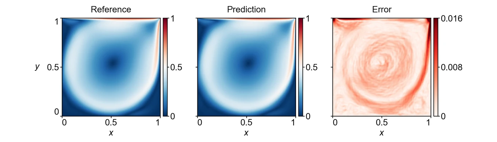

<section class="hero" style="padding-bottom:28px">

<a href="../problems.html">18 problems</a> / LDC

<h1>LDC Lid-driven cavity flow</h1>

Training time per solver

150 s

Discovered PINN solver, five seeds

0.0269 ± 0.0109

</section>
<section>

<h2>Problem definition</h2>

The steady incompressible Navier–Stokes equations for the velocity $(u,v)$ and the pressure $p$,
\[
\begin{aligned}
u\,\pd{u}{x}+v\,\pd{u}{y}&amp;=-\pd{p}{x}+\nu\left(\pdn{2}{u}{x}+\pdn{2}{u}{y}\right),\\
u\,\pd{v}{x}+v\,\pd{v}{y}&amp;=-\pd{p}{y}+\nu\left(\pdn{2}{v}{x}+\pdn{2}{v}{y}\right),\\
\pd{u}{x}+\pd{v}{y}&amp;=0,
\end{aligned}
\]
with $\nu=1/\mathit{Re}$ and $\mathit{Re}=3200$, hold in the square cavity $(x,y)\in[0,1]^2$. The lid moves with $u=1$, $v=0$ at $y=1$, and $u=v=0$ on the other three walls $x=0$, $x=1$ and $y=0$. The error is measured on $(u,v)$ at the points of a uniform $256\times256$ grid, where the predictions at the boundary points are replaced by the reference values before the error is computed. The problem is the classical cavity benchmark (<a class="cite" href="https://doi.org/10.1016/0021-9991(82)90058-4" title="High-Re Solutions for Incompressible Flow Using the Navier–Stokes Equations and a Multigrid Method" target="_blank" rel="noopener noreferrer">Ghia et al., 1982</a>) at $\mathit{Re}=3200$, and its reference solution is the one released with APTS (<a class="cite" href="https://arxiv.org/abs/2604.23528" title="When PINNs Go Wrong: Pseudo-Time Stepping against Spurious Solutions" target="_blank" rel="noopener noreferrer">Wang et al., 2026</a>).

</section>
<section>

<h2>Fields of the discovered solver</h2>
<figure class="panel">
<figcaption><strong>Supplementary Fig. 5. LDC.</strong> Speed and the magnitude of the velocity error on the scoring grid of run 1, as in Fig. 4d. The solver has a relative $L^2$ error of 0.013.</figcaption></figure>

</section>
<section id="discovery">

<h2>Discovery process</h2>

Diamonds mark where the main techniques of the discovered solver enter, listed below the chart. Hover over a round to see the predicted field and the error field of the best solver after it.

<button type="button" data-run="0" aria-pressed="true">Run 1 best 0.013</button><button type="button" data-run="1" aria-pressed="false">Run 2 best 0.016</button><button type="button" data-run="2" aria-pressed="false">Run 3 best 0.0166</button>

<i class="dot"></i>evaluated solver<i class="line"></i>best so far
<i class="dia" style="background:#F3C49C;border-color:#D29466"></i>technique as in a note<i class="dia" style="background:#E8743B"></i>adapted from a note<i class="dia" style="background:#4A443C"></i>not from the literature base

All evaluated solvers as a table

<table><thead><tr><th>Round</th><th>Candidate</th><th>Seed</th><th>Relative <i>L</i>2 error</th><th>Steps</th><th>Training (s)</th></tr></thead><tbody id="eval-rows"></tbody></table>

<script type="application/json" id="discovery-data">{"case":"ldc","runs":[{"case":"ldc","run":"ldc_1_0.01295","rounds":10,"points":[{"x":0.0,"e":0.9444145758929638,"c":"b00/b00_v01.py","r":0,"s":0,"n":133357,"t":145.5,"b":1},{"x":0.04,"e":1.014494274723164,"c":"b01/b01_v01.py","r":1,"s":0,"n":121857,"t":144.5},{"x":0.0803,"e":1.825945244302181,"c":"b01/b01_v02.py","r":1,"s":0,"n":70640,"t":144.4,"o":1},{"x":0.1203,"e":1.0776387420948097,"c":"b01/b01_v03.py","r":1,"s":0,"n":94663,"t":144.3},{"x":0.1606,"e":0.12436948094974067,"c":"b01/b01_v04.py","r":1,"s":0,"n":90733,"t":144.4,"b":1},{"x":0.2006,"e":0.7865182607181114,"c":"b01/b01_v05.py","r":1,"s":0,"n":64001,"t":144.3},{"x":0.2406,"e":0.14085949839265907,"c":"b01/b01_v06.py","r":1,"s":0,"n":127371,"t":144.4},{"x":0.2808,"e":0.18842779039285862,"c":"b01/b01_v07.py","r":1,"s":0,"n":70993,"t":144.4},{"x":0.3208,"e":0.24385391576398951,"c":"b01/b01_v08.py","r":1,"s":0,"n":90221,"t":144.4},{"x":0.4025,"e":0.1551695464083325,"c":"b01/b01_v10.py","r":1,"s":0,"n":90894,"t":144.3},{"x":0.4011,"e":0.18349386651570676,"c":"b01/b01_v09.py","r":1,"s":0,"n":89494,"t":144.4},{"x":0.4828,"e":0.10059079267696619,"c":"b01/b01_v11.py","r":1,"s":0,"n":89658,"t":144.3,"b":1},{"x":0.4814,"e":0.14040282839153234,"c":"b01/b01_v12.py","r":1,"s":0,"n":90326,"t":144.4},{"x":0.5631,"e":0.1085749450719332,"c":"b01/b01_v14.py","r":1,"s":0,"n":90130,"t":144.3},{"x":0.5614,"e":0.1711347121752497,"c":"b01/b01_v13.py","r":1,"s":0,"n":88849,"t":144.4},{"x":0.6433,"e":0.6300774905974519,"c":"b01/b01_v16.py","r":1,"s":0,"n":43344,"t":144.4},{"x":0.6417,"e":0.7052386330436058,"c":"b01/b01_v15.py","r":1,"s":0,"n":43101,"t":144.5},{"x":0.7233,"e":0.13794327701267015,"c":"b01/b01_v17.py","r":1,"s":0,"n":88991,"t":144.3},{"x":0.7219,"e":0.12770327431609657,"c":"b01/b01_v18.py","r":1,"s":0,"n":89825,"t":144.4},{"x":0.8036,"e":0.10480484683007016,"c":"b01/b01_v19.py","r":1,"s":0,"n":88915,"t":144.3},{"x":0.8022,"e":0.12660578713339185,"c":"b01/b01_v20.py","r":1,"s":0,"n":85260,"t":144.4},{"x":0.8839,"e":0.8913531508108459,"c":"b01/b01_v21.py","r":1,"s":0,"n":90795,"t":144.3},{"x":0.8822,"e":0.1440917076659946,"c":"b01/b01_v22.py","r":1,"s":0,"n":95171,"t":144.4},{"x":0.9642,"e":0.11277160403688362,"c":"b01/b01_v24.py","r":1,"s":0,"n":90033,"t":144.3},{"x":0.9625,"e":0.10464550877629651,"c":"b01/b01_v23.py","r":1,"s":0,"n":92153,"t":144.4},{"x":1.0397,"e":0.04128163893521638,"c":"b02/b02_v01.py","r":2,"s":0,"n":60111,"t":142.6,"b":1},{"x":1.1208,"e":0.12312214402740569,"c":"b02/b02_v02.py","r":2,"s":0,"n":45679,"t":142.6},{"x":1.1189,"e":0.05827953546228965,"c":"b02/b02_v03.py","r":2,"s":0,"n":59584,"t":142.7},{"x":1.2,"e":0.04372484398478185,"c":"b02/b02_v05.py","r":2,"s":0,"n":59723,"t":142.6},{"x":1.1981,"e":0.07259395722042329,"c":"b02/b02_v04.py","r":2,"s":0,"n":49758,"t":142.7},{"x":1.2794,"e":0.04603359226236067,"c":"b02/b02_v07.py","r":2,"s":0,"n":59071,"t":142.6},{"x":1.2772,"e":0.04360869177077643,"c":"b02/b02_v06.py","r":2,"s":0,"n":64761,"t":142.7},{"x":1.3586,"e":0.07437350449511815,"c":"b02/b02_v09.py","r":2,"s":0,"n":59897,"t":142.6},{"x":1.3567,"e":0.15728698203341837,"c":"b02/b02_v08.py","r":2,"s":0,"n":58637,"t":142.7},{"x":1.4378,"e":0.05840584488249369,"c":"b02/b02_v11.py","r":2,"s":0,"n":59226,"t":142.5},{"x":1.4358,"e":0.05438205516200044,"c":"b02/b02_v10.py","r":2,"s":0,"n":58910,"t":142.7},{"x":1.5172,"e":0.06562025488187011,"c":"b02/b02_v12.py","r":2,"s":0,"n":60237,"t":142.6},{"x":1.515,"e":0.09336165233271351,"c":"b02/b02_v13.py","r":2,"s":0,"n":59542,"t":142.7},{"x":1.5964,"e":0.5897120957545323,"c":"b02/b02_v15.py","r":2,"s":0,"n":62907,"t":142.4},{"x":1.5942,"e":0.08492837069449445,"c":"b02/b02_v14.py","r":2,"s":0,"n":58900,"t":142.7},{"x":1.6756,"e":0.1127697404214744,"c":"b02/b02_v17.py","r":2,"s":0,"n":58374,"t":143.0},{"x":1.6739,"e":0.13590740431008894,"c":"b02/b02_v16.py","r":2,"s":0,"n":59059,"t":143.4},{"x":1.755,"e":0.1928808664539242,"c":"b02/b02_v19.py","r":2,"s":0,"n":50744,"t":142.6},{"x":1.7531,"e":0.07112778115408101,"c":"b02/b02_v18.py","r":2,"s":0,"n":54891,"t":142.7},{"x":1.8344,"e":0.04496284119969943,"c":"b02/b02_v21.py","r":2,"s":0,"n":59937,"t":142.7},{"x":1.8325,"e":0.05369074762697852,"c":"b02/b02_v20.py","r":2,"s":0,"n":58898,"t":142.8},{"x":1.9136,"e":0.04132351196797543,"c":"b02/b02_v22.py","r":2,"s":0,"n":58443,"t":142.6},{"x":1.9117,"e":0.038550497108407224,"c":"b02/b02_v23.py","r":2,"s":0,"n":58964,"t":142.7,"b":1},{"x":1.9928,"e":0.04382986245287449,"c":"b02/b02_v24.py","r":2,"s":0,"n":58386,"t":142.5},{"x":1.9908,"e":0.03981477554264473,"c":"b02/b02_v25.py","r":2,"s":0,"n":58931,"t":142.6},{"x":2.0397,"e":0.213600124558997,"c":"b03/b03_hardbc.py","r":3,"s":0,"n":63203,"t":142.6},{"x":2.0792,"e":0.4180314519706376,"c":"b03/b03_hard3wall.py","r":3,"s":0,"n":60238,"t":142.6},{"x":2.1189,"e":5.665533513403029,"c":"b03/b03_streamfn.py","r":3,"s":0,"n":15116,"t":143.0,"o":1},{"x":2.1586,"e":0.06675518234577797,"c":"b03/b03_adact.py","r":3,"s":0,"n":58368,"t":142.6},{"x":2.1981,"e":0.08006575894562322,"c":"b03/b03_rad.py","r":3,"s":0,"n":60158,"t":142.5},{"x":2.2378,"e":0.2549155703236225,"c":"b03/b03_sobol.py","r":3,"s":0,"n":59870,"t":142.6},{"x":2.3189,"e":0.03501871366514541,"c":"b03/b03_fflow.py","r":3,"s":0,"n":59994,"t":142.6,"b":1},{"x":2.3169,"e":0.04358592337936248,"c":"b03/b03_repro.py","r":3,"s":0,"n":59122,"t":142.7},{"x":2.3983,"e":0.05601602699511564,"c":"b03/b03_ff1_4_8.py","r":3,"s":0,"n":58469,"t":142.6},{"x":2.3961,"e":0.05197208514540938,"c":"b03/b03_ff1_4_12.py","r":3,"s":0,"n":58906,"t":142.7},{"x":2.4775,"e":0.04686338402354485,"c":"b03/b03_fflow.py","r":3,"s":0,"n":58371,"t":142.6},{"x":2.4756,"e":0.05626506344863727,"c":"b03/b03_repro.py","r":3,"s":0,"n":58979,"t":142.7},{"x":2.5567,"e":0.08185273289582647,"c":"b03/b03_ff1_3_10.py","r":3,"s":0,"n":58097,"t":142.6},{"x":2.5547,"e":0.09149504392238288,"c":"b03/b03_ff1_5_10.py","r":3,"s":0,"n":58891,"t":142.7},{"x":2.6361,"e":0.14472153595792778,"c":"b03/b03_det.py","r":3,"s":0,"n":53581,"t":142.6},{"x":2.6339,"e":0.14472157029564534,"c":"b03/b03_det.py","r":3,"s":0,"n":53589,"t":142.8},{"x":2.7153,"e":0.04874213759049239,"c":"b03/b03_det2.py","r":3,"s":0,"n":58321,"t":142.6},{"x":2.7133,"e":0.04874104725129291,"c":"b03/b03_det2.py","r":3,"s":0,"n":58331,"t":142.7},{"x":2.7944,"e":0.0768791999580009,"c":"b03/b03_ph48000.py","r":3,"s":0,"n":49843,"t":142.6},{"x":2.7925,"e":0.04306220048830521,"c":"b03/b03_ph60000.py","r":3,"s":0,"n":61126,"t":142.7},{"x":2.8739,"e":0.04203556597355713,"c":"b03/b03_ph62000.py","r":3,"s":0,"n":63043,"t":142.5},{"x":2.8717,"e":0.036358921882815795,"c":"b03/b03_ph64000.py","r":3,"s":0,"n":64951,"t":142.7},{"x":2.9531,"e":0.03491911062350576,"c":"b03/b03_ph66000.py","r":3,"s":0,"n":66954,"t":142.5,"b":1},{"x":2.9508,"e":0.03511084155517814,"c":"b03/b03_ph68000.py","r":3,"s":0,"n":68792,"t":142.7},{"x":2.9906,"e":0.034925545289127564,"c":"b03/b03_ph66000.py","r":3,"s":0,"n":66993,"t":142.6},{"x":3.0397,"e":0.03492536440901191,"c":"b04/b04_repro.py","r":4,"s":0,"n":67039,"t":142.6},{"x":3.1208,"e":0.051889275909041674,"c":"b04/b04_s138.py","r":4,"s":0,"n":67000,"t":142.5},{"x":3.1189,"e":0.04690264017993449,"c":"b04/b04_s1515.py","r":4,"s":0,"n":66837,"t":142.7},{"x":3.2,"e":0.05379850673540419,"c":"b04/b04_s148.py","r":4,"s":0,"n":67060,"t":142.6},{"x":3.1981,"e":0.0341188600456748,"c":"b04/b04_s1413.py","r":4,"s":0,"n":66869,"t":142.7,"b":1},{"x":3.2794,"e":0.06939230138034845,"c":"b04/b04_s1416.py","r":4,"s":0,"n":66869,"t":142.5},{"x":3.2772,"e":0.03646042314221977,"c":"b04/b04_s1411.py","r":4,"s":0,"n":67039,"t":142.7},{"x":3.3586,"e":0.09429317119467599,"c":"b04/b04_wallfeat.py","r":4,"s":0,"n":66847,"t":142.6},{"x":3.3567,"e":0.03377201352026496,"c":"b04/b04_ph70k.py","r":4,"s":0,"n":70645,"t":142.8,"b":1},{"x":3.4378,"e":0.04121487299837369,"c":"b04/b04_ph74k.py","r":4,"s":0,"n":73222,"t":142.6},{"x":3.4358,"e":0.0398128689242511,"c":"b04/b04_ph78k.py","r":4,"s":0,"n":74145,"t":142.7},{"x":3.5172,"e":0.04206997064725994,"c":"b04/b04_ph68k.py","r":4,"s":0,"n":68750,"t":142.6},{"x":3.515,"e":0.04962545142131351,"c":"b04/b04_ph72k.py","r":4,"s":0,"n":72411,"t":142.8},{"x":3.5964,"e":0.03320292367141407,"c":"b04/b04_mem50.py","r":4,"s":0,"n":70531,"t":142.6,"b":1},{"x":3.5944,"e":0.028948644926685908,"c":"b04/b04_dens5500.py","r":4,"s":0,"n":70640,"t":142.7,"b":1},{"x":3.6756,"e":0.030296104888955167,"c":"b04/b04_dens6500.py","r":4,"s":0,"n":70602,"t":142.6},{"x":3.6736,"e":0.029864867625112892,"c":"b04/b04_dens7500.py","r":4,"s":0,"n":70533,"t":142.8},{"x":3.755,"e":0.03260728097323632,"c":"b04/b04_d55m50.py","r":4,"s":0,"n":70575,"t":142.6},{"x":3.7528,"e":0.03235748807686802,"c":"b04/b04_dens5000.py","r":4,"s":0,"n":70818,"t":142.7},{"x":3.8342,"e":0.03647978520557703,"c":"b04/b04_dens6000.py","r":4,"s":0,"n":70774,"t":142.6},{"x":3.8322,"e":0.031491743495354295,"c":"b04/b04_dens5800.py","r":4,"s":0,"n":70669,"t":142.6},{"x":3.9133,"e":0.035979683818178,"c":"b04/b04_d55_ph66.py","r":4,"s":0,"n":67006,"t":142.5},{"x":3.9114,"e":0.043673788551564965,"c":"b04/b04_d55_s1410.py","r":4,"s":0,"n":70770,"t":142.8},{"x":3.9925,"e":0.032582655851899366,"c":"b04/b04_dens5600.py","r":4,"s":0,"n":70739,"t":142.6},{"x":3.9906,"e":0.03327574060781074,"c":"b04/b04_dens5400.py","r":4,"s":0,"n":70675,"t":142.7},{"x":4.0814,"e":0.02894863809622679,"c":"b05/b05_base.py","r":5,"s":0,"n":70652,"t":142.6,"b":1},{"x":4.0792,"e":0.0373799564818386,"c":"b05/b05_base.py","r":5,"s":1,"n":70755,"t":142.7},{"x":4.1606,"e":0.037289017906242984,"c":"b05/b05_base.py","r":5,"s":2,"n":70659,"t":142.6},{"x":4.1586,"e":0.04134040673576867,"c":"b05/b05_base.py","r":5,"s":3,"n":70590,"t":142.7},{"x":4.2397,"e":0.029871140216982176,"c":"b05/b05_d7500.py","r":5,"s":0,"n":70551,"t":142.6},{"x":4.2378,"e":0.03224464780087673,"c":"b05/b05_d6500.py","r":5,"s":0,"n":70711,"t":142.7},{"x":4.3192,"e":0.037022493829569916,"c":"b05/b05_c2025.py","r":5,"s":0,"n":70668,"t":142.6},{"x":4.3169,"e":0.032718930665834874,"c":"b05/b05_c2026.py","r":5,"s":0,"n":70591,"t":142.7},{"x":4.3983,"e":0.030091501300963216,"c":"b05/b05_blw.py","r":5,"s":0,"n":70672,"t":142.6},{"x":4.3961,"e":0.029637678443041146,"c":"b05/b05_bl.py","r":5,"s":0,"n":70636,"t":142.7},{"x":4.4775,"e":0.035321465604222536,"c":"b05/b05_base.py","r":5,"s":5,"n":70636,"t":142.5},{"x":4.4756,"e":0.055808266332420954,"c":"b05/b05_base.py","r":5,"s":4,"n":70607,"t":142.6},{"x":4.5567,"e":0.10564139252380284,"c":"b05/b05_base.py","r":5,"s":6,"n":70560,"t":142.6},{"x":4.5547,"e":0.04266649606052101,"c":"b05/b05_base.py","r":5,"s":7,"n":70702,"t":142.6},{"x":4.6336,"e":0.08125583457572191,"c":"b05/b05_es.py","r":5,"s":0,"n":70150,"t":134.6},{"x":4.6297,"e":0.05523385420457999,"c":"b05/b05_es.py","r":5,"s":0,"n":70300,"t":135.8},{"x":4.7111,"e":0.041455755312651645,"c":"b05/b05_bc500.py","r":5,"s":0,"n":70743,"t":142.6},{"x":4.7089,"e":0.030028081227371113,"c":"b05/b05_d9000.py","r":5,"s":0,"n":70597,"t":142.7},{"x":4.7903,"e":0.03735600604643894,"c":"b05/b05_base.py","r":5,"s":8,"n":70566,"t":142.6},{"x":4.7883,"e":0.04022362587317296,"c":"b05/b05_base.py","r":5,"s":9,"n":70784,"t":142.8},{"x":4.8697,"e":0.091400434537121,"c":"b05/b05_base.py","r":5,"s":11,"n":70792,"t":142.6},{"x":4.8675,"e":0.03745819312541668,"c":"b05/b05_base.py","r":5,"s":10,"n":70682,"t":142.7},{"x":4.9489,"e":0.0423178107716794,"c":"b05/b05_base.py","r":5,"s":13,"n":70711,"t":142.6},{"x":4.9469,"e":0.06592679298954102,"c":"b05/b05_base.py","r":5,"s":12,"n":70528,"t":142.7},{"x":4.9864,"e":0.05749537046302712,"c":"b05/b05_base.py","r":5,"s":14,"n":70869,"t":142.5},{"x":5.0814,"e":0.12265251954382554,"c":"b06/b06_gc03.py","r":6,"s":0,"n":70391,"t":142.6},{"x":5.0792,"e":0.12567415661435427,"c":"b06/b06_gc10.py","r":6,"s":0,"n":70415,"t":142.7},{"x":5.1606,"e":0.07515091305822458,"c":"b06/b06_vw05.py","r":6,"s":0,"n":70803,"t":142.6},{"x":5.1586,"e":0.043530219604156685,"c":"b06/b06_vw10.py","r":6,"s":0,"n":70884,"t":142.6},{"x":5.2397,"e":0.9049581764502475,"c":"b06/b06_fp64h60.py","r":6,"s":0,"n":8016,"t":142.6},{"x":5.2378,"e":0.9032605856211584,"c":"b06/b06_fp64.py","r":6,"s":0,"n":7925,"t":142.7},{"x":5.3189,"e":0.10576328101282526,"c":"b06/b06_fp64.py","r":6,"s":0,"n":70084,"t":142.7},{"x":5.3169,"e":0.10152958668031632,"c":"b06/b06_fp64h60.py","r":6,"s":0,"n":60237,"t":142.8},{"x":5.3983,"e":0.03425278421116058,"c":"b06/b06_d5700.py","r":6,"s":0,"n":70849,"t":142.6},{"x":5.3964,"e":0.028926316052826147,"c":"b06/b06_base.py","r":6,"s":0,"n":70655,"t":142.7,"b":1},{"x":5.4775,"e":0.03210147356109391,"c":"b06/b06_d5300.py","r":6,"s":0,"n":70676,"t":142.5},{"x":5.4756,"e":0.03125868470297761,"c":"b06/b06_d5900.py","r":6,"s":0,"n":70710,"t":142.6},{"x":5.5567,"e":0.03836742999763747,"c":"b06/b06_h71k.py","r":6,"s":0,"n":71658,"t":142.5},{"x":5.5547,"e":0.030115170408080018,"c":"b06/b06_h69k.py","r":6,"s":0,"n":69662,"t":142.6},{"x":5.6358,"e":0.04347297965993018,"c":"b06/b06_s1414.py","r":6,"s":0,"n":70614,"t":142.5},{"x":5.6339,"e":0.0351507394391123,"c":"b06/b06_s1412.py","r":6,"s":0,"n":70638,"t":142.7},{"x":5.7153,"e":0.03095335741028821,"c":"b06/b06_d5450.py","r":6,"s":0,"n":70710,"t":142.6},{"x":5.7131,"e":0.029716084317105023,"c":"b06/b06_strat.py","r":6,"s":0,"n":70660,"t":142.7},{"x":5.7528,"e":0.032077976847851214,"c":"b06/b06_d5550.py","r":6,"s":0,"n":70741,"t":142.5},{"x":5.8339,"e":0.03203172984157699,"c":"b06/b06_strat54.py","r":6,"s":0,"n":70782,"t":142.6},{"x":5.8319,"e":0.03618772548405513,"c":"b06/b06_strat52.py","r":6,"s":0,"n":70764,"t":142.7},{"x":5.9133,"e":0.047950545676246445,"c":"b06/b06_strat_h69.py","r":6,"s":0,"n":69849,"t":142.6},{"x":5.9111,"e":0.033636026609086656,"c":"b06/b06_strat55.py","r":6,"s":0,"n":70627,"t":142.7},{"x":5.9925,"e":0.030717679974675095,"c":"b06/b06_strat2025.py","r":6,"s":0,"n":70750,"t":142.5},{"x":5.9906,"e":0.03014345480564257,"c":"b06/b06_strat_h71.py","r":6,"s":0,"n":71579,"t":142.7},{"x":6.0397,"e":0.02892632486058154,"c":"b07/b07_base.py","r":7,"s":0,"n":70701,"t":142.6},{"x":6.0792,"e":0.261632261446242,"c":"b07/b07_rba.py","r":7,"s":0,"n":70073,"t":142.6},{"x":6.1189,"e":0.16802351301035967,"c":"b07/b07_pp.py","r":7,"s":0,"n":70640,"t":142.6},{"x":6.2014,"e":0.25009334952244655,"c":"b07/b07_pir4.py","r":7,"s":0,"n":55487,"t":147.2},{"x":6.2411,"e":0.03455419077436305,"c":"b07/b07_ff64.py","r":7,"s":0,"n":70449,"t":142.6},{"x":6.2808,"e":0.11062470568092928,"c":"b07/b07_rbafz.py","r":7,"s":0,"n":70399,"t":142.6},{"x":6.3619,"e":0.07111050090147857,"c":"b07/b07_ff48.py","r":7,"s":0,"n":70579,"t":142.6},{"x":6.36,"e":0.04037090723257225,"c":"b07/b07_seed2025.py","r":7,"s":0,"n":70781,"t":142.7},{"x":6.4411,"e":0.03271923884748433,"c":"b07/b07_seed2026.py","r":7,"s":0,"n":70561,"t":142.6},{"x":6.4392,"e":0.0436046836326046,"c":"b07/b07_seed2027.py","r":7,"s":0,"n":70645,"t":142.7},{"x":6.5206,"e":0.03402844157327746,"c":"b07/b07_dc2026b.py","r":7,"s":0,"n":70540,"t":142.6},{"x":6.5183,"e":0.029909835772466288,"c":"b07/b07_dc2026a.py","r":7,"s":0,"n":70618,"t":142.6},{"x":6.5997,"e":0.03162873237467338,"c":"b07/b07_dc2029.py","r":7,"s":0,"n":70567,"t":142.6},{"x":6.5978,"e":0.03194003650734171,"c":"b07/b07_dc2028.py","r":7,"s":0,"n":70653,"t":142.7},{"x":6.6789,"e":0.030193607222784576,"c":"b07/b07_dc2030.py","r":7,"s":0,"n":70580,"t":142.6},{"x":6.6769,"e":0.041790951831783,"c":"b07/b07_dc2031.py","r":7,"s":0,"n":70734,"t":142.7},{"x":6.7581,"e":0.030647813500643106,"c":"b07/b07_dc2024a.py","r":7,"s":0,"n":70655,"t":142.6},{"x":6.7561,"e":0.03235755666450492,"c":"b07/b07_dc2024b.py","r":7,"s":0,"n":70810,"t":142.6},{"x":6.8375,"e":0.032065775009982464,"c":"b07/b07_dc2025c.py","r":7,"s":0,"n":70524,"t":142.6},{"x":6.8353,"e":0.033322128384271295,"c":"b07/b07_dc2027c.py","r":7,"s":0,"n":70650,"t":142.7},{"x":6.9167,"e":0.03612273681209907,"c":"b07/b07_dc2026c.py","r":7,"s":0,"n":70452,"t":142.6},{"x":6.9147,"e":0.03133576022691925,"c":"b07/b07_dc2032.py","r":7,"s":0,"n":70593,"t":142.7},{"x":6.9958,"e":0.04625699913527215,"c":"b07/b07_dc2026d.py","r":7,"s":0,"n":70478,"t":142.6},{"x":6.9939,"e":0.032418634832998935,"c":"b07/b07_dc2026e.py","r":7,"s":0,"n":70481,"t":142.7},{"x":7.0814,"e":0.02894863809622679,"c":"b08/b08_base.py","r":8,"s":0,"n":70650,"t":142.6},{"x":7.1342,"e":1.072327871523538,"c":"b08/b08_psiw2.py","r":8,"s":0,"n":52101,"t":142.8},{"x":7.2156,"e":0.031240795504840074,"c":"b08/b08_reglid.py","r":8,"s":0,"n":70504,"t":142.5},{"x":7.2136,"e":1.0667715275703058,"c":"b08/b08_psiw3.py","r":8,"s":0,"n":51034,"t":142.8},{"x":7.2947,"e":0.01652216130279159,"c":"b08/b08_reglid40.py","r":8,"s":0,"n":70445,"t":142.6,"b":1},{"x":7.2928,"e":0.08653697622113124,"c":"b08/b08_reglid6.py","r":8,"s":0,"n":70448,"t":142.7},{"x":7.3742,"e":0.02076571211251509,"c":"b08/b08_reglid70.py","r":8,"s":0,"n":70487,"t":142.6},{"x":7.3719,"e":0.019746720534831206,"c":"b08/b08_reglid120.py","r":8,"s":0,"n":70561,"t":142.7},{"x":7.4533,"e":0.016177361493505276,"c":"b08/b08_reglid50.py","r":8,"s":0,"n":70519,"t":142.5,"b":1},{"x":7.4514,"e":0.018767978484992797,"c":"b08/b08_reglid30.py","r":8,"s":0,"n":70433,"t":142.6},{"x":7.5325,"e":0.016654492478726024,"c":"b08/b08_rl50_d7500.py","r":8,"s":0,"n":70514,"t":142.6},{"x":7.5306,"e":0.015995934907712363,"c":"b08/b08_rl50_d4500.py","r":8,"s":0,"n":70554,"t":142.7,"b":1},{"x":7.6117,"e":0.030212864707135904,"c":"b08/b08_rl50_s16.py","r":8,"s":0,"n":70445,"t":142.6},{"x":7.6097,"e":0.017217405181546963,"c":"b08/b08_rl50_s20.py","r":8,"s":0,"n":70541,"t":142.7},{"x":7.6911,"e":0.08958064982609698,"c":"b08/b08_rl_p55_d4500.py","r":8,"s":0,"n":70535,"t":142.6},{"x":7.6889,"e":0.09195839637231967,"c":"b08/b08_rl_p45_d4500.py","r":8,"s":0,"n":70496,"t":142.7},{"x":7.7703,"e":0.016601222860426656,"c":"b08/b08_rl_p52_d4500.py","r":8,"s":0,"n":70612,"t":142.6},{"x":7.7683,"e":0.015516770166352249,"c":"b08/b08_rl_p46_d4500.py","r":8,"s":0,"n":70460,"t":142.7,"b":1},{"x":7.8494,"e":0.01631175192597213,"c":"b08/b08_rl_p44_d4500.py","r":8,"s":0,"n":70451,"t":142.6},{"x":7.8475,"e":0.015985453670392592,"c":"b08/b08_rl_p48_d4500.py","r":8,"s":0,"n":70483,"t":142.7},{"x":7.9289,"e":0.015467431375864137,"c":"b08/b08_rl_p46_d6000.py","r":8,"s":0,"n":70554,"t":142.6,"b":1},{"x":7.9267,"e":0.01572670085041084,"c":"b08/b08_rl_p46_d5000.py","r":8,"s":0,"n":70475,"t":142.8},{"x":7.9664,"e":0.01574301617748506,"c":"b08/b08_rl_p46_d6500.py","r":8,"s":0,"n":70532,"t":142.5},{"x":8.0397,"e":0.015467409537137456,"c":"b09/b09_base.py","r":9,"s":0,"n":70617,"t":142.6,"b":1},{"x":8.1208,"e":0.016291763629027078,"c":"b09/b09_tanh014.py","r":9,"s":0,"n":70536,"t":142.6},{"x":8.1189,"e":0.016512506724891383,"c":"b09/b09_tanh011.py","r":9,"s":0,"n":70437,"t":142.7},{"x":8.2,"e":0.01711129096360883,"c":"b09/b09_cmask03.py","r":9,"s":0,"n":70462,"t":142.6},{"x":8.1981,"e":0.018667228399723672,"c":"b09/b09_cmask06.py","r":9,"s":0,"n":70426,"t":142.7},{"x":8.2794,"e":0.017106962708268322,"c":"b09/b09_asymRs.py","r":9,"s":0,"n":70627,"t":142.6},{"x":8.2772,"e":0.015063294906178734,"c":"b09/b09_asymRw.py","r":9,"s":0,"n":70550,"t":142.7,"b":1},{"x":8.3586,"e":0.01641359305032838,"c":"b09/b09_asym4630.py","r":9,"s":0,"n":70488,"t":142.6},{"x":8.3567,"e":0.015076417908766139,"c":"b09/b09_asym4640.py","r":9,"s":0,"n":70494,"t":142.6},{"x":8.4378,"e":0.016086370023021712,"c":"b09/b09_asym4038.py","r":9,"s":0,"n":70476,"t":142.6},{"x":8.4358,"e":0.01456162406138675,"c":"b09/b09_asym5238.py","r":9,"s":0,"n":70510,"t":142.6,"b":1},{"x":8.5169,"e":0.016035528980775253,"c":"b09/b09_asym7038.py","r":9,"s":0,"n":70468,"t":142.6},{"x":8.515,"e":0.01429812119477504,"c":"b09/b09_asym6038.py","r":9,"s":0,"n":70450,"t":142.7,"b":1},{"x":8.5964,"e":0.015708684427010247,"c":"b09/b09_asym6034.py","r":9,"s":0,"n":70478,"t":142.6},{"x":8.5942,"e":0.016387294985879364,"c":"b09/b09_asym6042.py","r":9,"s":0,"n":70533,"t":142.7},{"x":8.6756,"e":0.014514012959759152,"c":"b09/b09_asym6438.py","r":9,"s":0,"n":70513,"t":142.6},{"x":8.6736,"e":0.013851761538460522,"c":"b09/b09_asym5638.py","r":9,"s":0,"n":70490,"t":142.7,"b":1},{"x":8.7547,"e":0.014660775945528058,"c":"b09/b09_asym5636.py","r":9,"s":0,"n":70495,"t":142.6},{"x":8.7528,"e":0.015294495330800763,"c":"b09/b09_asym5642.py","r":9,"s":0,"n":70498,"t":142.8},{"x":8.8342,"e":0.015514858082507054,"c":"b09/b09_asym5438.py","r":9,"s":0,"n":70456,"t":142.6},{"x":8.8322,"e":0.014005570803492098,"c":"b09/b09_asym5838.py","r":9,"s":0,"n":70540,"t":142.8},{"x":8.8717,"e":0.013851761877232152,"c":"b09/b09_asym5638.py","r":9,"s":0,"n":70517,"t":142.5},{"x":8.9531,"e":0.013484978488679206,"c":"b09/b09_asym5638_d7500.py","r":9,"s":0,"n":70637,"t":142.6,"b":1},{"x":8.9508,"e":0.014203066270796797,"c":"b09/b09_asym5638_d5000.py","r":9,"s":0,"n":70517,"t":142.7},{"x":8.9906,"e":0.013978930997465415,"c":"b09/b09_asym5638_d8000.py","r":9,"s":0,"n":70492,"t":142.6},{"x":9.0814,"e":0.013546630438807572,"c":"b10/b10_base.py","r":10,"s":0,"n":70603,"t":142.5},{"x":9.0792,"e":0.020954308604207748,"c":"b10/b10_warp.py","r":10,"s":0,"n":70578,"t":142.8},{"x":9.1606,"e":0.023121691124005837,"c":"b10/b10_warpa.py","r":10,"s":0,"n":70399,"t":142.6},{"x":9.1586,"e":0.017469049016712198,"c":"b10/b10_warpb.py","r":10,"s":0,"n":70301,"t":142.7},{"x":9.2397,"e":0.01412215626168229,"c":"b10/b10_n5738.py","r":10,"s":0,"n":70621,"t":142.6},{"x":9.2378,"e":0.014757650343199919,"c":"b10/b10_n5538.py","r":10,"s":0,"n":70478,"t":142.6},{"x":9.3189,"e":0.01444151173387334,"c":"b10/b10_n5637.py","r":10,"s":0,"n":70467,"t":142.6},{"x":9.3169,"e":0.014575797833743203,"c":"b10/b10_n5639.py","r":10,"s":0,"n":70526,"t":142.7},{"x":9.3983,"e":0.01461037661052027,"c":"b10/b10_h69k.py","r":10,"s":0,"n":69542,"t":142.5},{"x":9.3961,"e":0.01314279861221765,"c":"b10/b10_h71k.py","r":10,"s":0,"n":71457,"t":142.7,"b":1},{"x":9.4775,"e":0.014206656073371569,"c":"b10/b10_h72k.py","r":10,"s":0,"n":72293,"t":142.6},{"x":9.4756,"e":0.013837853243894305,"c":"b10/b10_h68k.py","r":10,"s":0,"n":68648,"t":142.6},{"x":9.5567,"e":0.01361830380781667,"c":"b10/b10_h715.py","r":10,"s":0,"n":71954,"t":142.6},{"x":9.5547,"e":0.014659967336313475,"c":"b10/b10_h705.py","r":10,"s":0,"n":70904,"t":142.8},{"x":9.6358,"e":0.01576336585516711,"c":"b10/b10_h708.py","r":10,"s":0,"n":71276,"t":142.6},{"x":9.6339,"e":0.014193350501959346,"c":"b10/b10_h712.py","r":10,"s":0,"n":71562,"t":142.7},{"x":9.7153,"e":0.013545190119630178,"c":"b10/b10_h71k_d7000.py","r":10,"s":0,"n":71351,"t":142.6},{"x":9.7131,"e":0.01342658961520712,"c":"b10/b10_h71k_d8000.py","r":10,"s":0,"n":71410,"t":142.7},{"x":9.7944,"e":0.013011339643747927,"c":"b10/b10_h71k_d7600.py","r":10,"s":0,"n":71481,"t":142.6,"b":1},{"x":9.7925,"e":0.013295550687137135,"c":"b10/b10_h71k_d7400.py","r":10,"s":0,"n":71396,"t":142.8},{"x":9.8736,"e":0.013448337194312163,"c":"b10/b10_h71k_d7700.py","r":10,"s":0,"n":71425,"t":142.5},{"x":9.8717,"e":0.01349629058963949,"c":"b10/b10_h71k_d7650.py","r":10,"s":0,"n":71376,"t":142.6},{"x":9.9114,"e":0.012955075274729444,"c":"b10/b10_h71k_d7600.py","r":10,"s":0,"n":71502,"t":142.6,"b":1},{"x":9.9925,"e":0.013277780682645995,"c":"b10/b10_h71k_d7580.py","r":10,"s":0,"n":71372,"t":142.5},{"x":9.9906,"e":0.013691102153353603,"c":"b10/b10_h71k_d7620.py","r":10,"s":0,"n":71484,"t":142.8}],"best":[[0.0,0.9444145758929638],[0.1606,0.12436948094974067],[0.4828,0.10059079267696619],[1.0397,0.04128163893521638],[1.9117,0.038550497108407224],[2.3189,0.03501871366514541],[2.9531,0.03491911062350576],[3.1981,0.0341188600456748],[3.3567,0.03377201352026496],[3.5964,0.03320292367141407],[3.5944,0.028948644926685908],[4.0814,0.02894863809622679],[5.3964,0.028926316052826147],[7.2947,0.01652216130279159],[7.4533,0.016177361493505276],[7.5306,0.015995934907712363],[7.7683,0.015516770166352249],[7.9289,0.015467431375864137],[8.0397,0.015467409537137456],[8.2772,0.015063294906178734],[8.4358,0.01456162406138675],[8.515,0.01429812119477504],[8.6736,0.013851761538460522],[8.9531,0.013484978488679206],[9.3961,0.01314279861221765],[9.7944,0.013011339643747927],[9.9114,0.012955075274729444]],"nodes":[{"x":0.1606,"e":0.12436948094974067,"c":"b01/b01_v04.py","label":"Pseudo-time stepping [130, 073]","categories":["adapted"]},{"x":1.0397,"e":0.04128163893521638,"c":"b02/b02_v01.py","label":"L-BFGS on a dense fixed set [074]","categories":["adapted"]},{"x":7.2947,"e":0.01652216130279159,"c":"b08/b08_reglid40.py","label":"Lid velocity tapered to zero at the corners","categories":["no_note"]}],"ylim":[0.008,1.6],"above":2,"round_nodes":[],"summaries":[0,1,2,3,4,5,6,7,8,9,10],"missing_code":[],"failed":2,"source":"checked against the source data of Fig. 4 b, c","frames":{"img":{"b00":["../assets/fields/ldc/ldc_1_0.01295/b00_p.webp","../assets/fields/ldc/ldc_1_0.01295/b00_e.webp"],"b01":["../assets/fields/ldc/ldc_1_0.01295/b01_p.webp","../assets/fields/ldc/ldc_1_0.01295/b01_e.webp"],"b02":["../assets/fields/ldc/ldc_1_0.01295/b02_p.webp","../assets/fields/ldc/ldc_1_0.01295/b02_e.webp"],"b03":["../assets/fields/ldc/ldc_1_0.01295/b03_p.webp","../assets/fields/ldc/ldc_1_0.01295/b03_e.webp"],"b04":["../assets/fields/ldc/ldc_1_0.01295/b04_p.webp","../assets/fields/ldc/ldc_1_0.01295/b04_e.webp"],"b08":["../assets/fields/ldc/ldc_1_0.01295/b08_p.webp","../assets/fields/ldc/ldc_1_0.01295/b08_e.webp"],"b09":["../assets/fields/ldc/ldc_1_0.01295/b09_p.webp","../assets/fields/ldc/ldc_1_0.01295/b09_e.webp"],"b10":["../assets/fields/ldc/ldc_1_0.01295/b10_p.webp","../assets/fields/ldc/ldc_1_0.01295/b10_e.webp"]},"of":["b00","b01","b02","b03","b04","b04","b04","b04","b08","b09","b10"],"info":{"b00":{"c":"b00/b00_v01.py","e":0.9444145758929638,"chk":0.944415},"b01":{"c":"b01/b01_v11.py","e":0.10059079267696619,"chk":0.100591},"b02":{"c":"b02/b02_v23.py","e":0.038550497108407224,"chk":0.03855},"b03":{"c":"b03/b03_ph66000.py","e":0.034925545289127564,"chk":0.034926},"b04":{"c":"b04/b04_dens5500.py","e":0.028948644926685908,"chk":0.028949},"b08":{"c":"b08/b08_rl_p46_d6000.py","e":0.015467431375864137,"chk":0.015467},"b09":{"c":"b09/b09_asym5638_d7500.py","e":0.013484978488679206,"chk":0.013485},"b10":{"c":"b10/b10_h71k_d7600.py","e":0.012955075274729444,"chk":0.012955}},"label":"Speed","w":140,"h":140,"wide":false,"st":false,"p":[0.0,0.892],"pc":["#053061","#2a71b2","#6bacd1","#c2ddec","#f7f6f6","#fbccb4","#e48066","#ba2832","#67001f"],"e":[0.001,1.0],"ec":["#fff5f0","#fee0d2","#fcbba1","#fc9272","#fb694a","#ee3a2c","#ca181d","#a30f15","#67000d"]}},{"case":"ldc","run":"ldc_2_0.01604","rounds":10,"points":[{"x":0.0,"e":0.9444145758929638,"c":"b00/b00_v01.py","r":0,"s":0,"n":133357,"t":145.5,"b":1},{"x":0.0397,"e":0.07094914536792049,"c":"b01/b01_scalepinn.py","r":1,"s":0,"n":84352,"t":142.5,"b":1},{"x":0.2042,"e":0.08647508677039152,"c":"b01/b01_sc_freq2.py","r":1,"s":0,"n":83570,"t":142.5},{"x":0.2022,"e":0.08765671140394,"c":"b01/b01_sc_lr.py","r":1,"s":0,"n":83717,"t":142.6},{"x":0.2833,"e":0.054968068651301515,"c":"b01/b01_sc_tau05.py","r":1,"s":0,"n":83024,"t":142.5,"b":1},{"x":0.2814,"e":0.0700510563670115,"c":"b01/b01_sc_hold.py","r":1,"s":0,"n":83105,"t":142.6},{"x":0.3625,"e":13.167224961153918,"c":"b01/b01_sc_tau01.py","r":1,"s":0,"n":82718,"t":142.5,"o":1},{"x":0.3606,"e":0.6453447027313324,"c":"b01/b01_sc_tau02.py","r":1,"s":0,"n":83157,"t":142.6},{"x":0.4417,"e":0.062432924690558216,"c":"b01/b01_sc_tau06.py","r":1,"s":0,"n":82786,"t":142.5},{"x":0.4397,"e":0.9702826692882874,"c":"b01/b01_sc_tau04.py","r":1,"s":0,"n":82874,"t":142.6},{"x":0.5208,"e":0.08584559767823971,"c":"b01/b01_sc_cluster.py","r":1,"s":0,"n":85872,"t":142.5},{"x":0.5189,"e":0.07922704902212718,"c":"b01/b01_sc_cluster_t10.py","r":1,"s":0,"n":86210,"t":142.5},{"x":0.6,"e":0.13143973831492312,"c":"b01/b01_sc_wide.py","r":1,"s":0,"n":47664,"t":142.5},{"x":0.5981,"e":0.9427563326203585,"c":"b01/b01_sc_bs2k.py","r":1,"s":0,"n":45573,"t":142.6},{"x":0.6792,"e":0.32740835779496563,"c":"b01/b01_sc_small.py","r":1,"s":0,"n":97999,"t":142.5},{"x":0.6772,"e":0.05295991148196171,"c":"b01/b01_sc_bc30.py","r":1,"s":0,"n":82791,"t":142.6,"b":1},{"x":0.7586,"e":0.03242039880573211,"c":"b01/b01_sc_bc100.py","r":1,"s":0,"n":83066,"t":142.5,"b":1},{"x":0.7564,"e":0.03962363087615301,"c":"b01/b01_sc_bc50.py","r":1,"s":0,"n":82523,"t":142.6},{"x":0.8378,"e":0.04085291818633542,"c":"b01/b01_sc_bc200.py","r":1,"s":0,"n":82918,"t":142.5},{"x":0.8356,"e":0.06814791682365895,"c":"b01/b01_sc_bc400.py","r":1,"s":0,"n":82535,"t":142.6},{"x":0.9169,"e":0.03819652931624036,"c":"b01/b01_sc_bc100_t04.py","r":1,"s":0,"n":82977,"t":142.5},{"x":0.9147,"e":0.042484483030667416,"c":"b01/b01_sc_bc100_t06.py","r":1,"s":0,"n":82946,"t":142.6},{"x":0.9544,"e":0.04120860252062907,"c":"b01/b01_sc_bc100_hold.py","r":1,"s":0,"n":83479,"t":142.5},{"x":0.9939,"e":0.03923375359973511,"c":"b01/b01_sc_bc125.py","r":1,"s":0,"n":83432,"t":142.5},{"x":1.0397,"e":0.03472088941484664,"c":"b02/b02_branch.py","r":2,"s":0,"n":83540,"t":142.6},{"x":1.0792,"e":0.03803318491135505,"c":"b02/b02_lbfgs.py","r":2,"s":0,"n":63162,"t":142.6},{"x":1.1189,"e":0.6658461688926289,"c":"b02/b02_rba.py","r":2,"s":0,"n":60565,"t":142.5},{"x":1.1583,"e":0.04923090063266279,"c":"b02/b02_adtau.py","r":2,"s":0,"n":82687,"t":142.5},{"x":1.1981,"e":0.24300607538217775,"c":"b02/b02_modmlp.py","r":2,"s":0,"n":47012,"t":142.5},{"x":1.2792,"e":0.03670140955385925,"c":"b02/b02_freq4.py","r":2,"s":0,"n":83662,"t":142.5},{"x":1.2772,"e":0.0441840085249853,"c":"b02/b02_bs512.py","r":2,"s":0,"n":137927,"t":142.5},{"x":1.3167,"e":0.1506871484007361,"c":"b02/b02_hardbc.py","r":2,"s":0,"n":75797,"t":142.5},{"x":1.3981,"e":0.10018559703622597,"c":"b02/b02_smooth4.py","r":2,"s":0,"n":83266,"t":142.5},{"x":1.3958,"e":0.26157027137529787,"c":"b02/b02_smooth16.py","r":2,"s":0,"n":83529,"t":142.6},{"x":1.4772,"e":0.023299627470128568,"c":"b02/b02_smoothq.py","r":2,"s":0,"n":82879,"t":142.5,"b":1},{"x":1.475,"e":0.025952176169395085,"c":"b02/b02_nosmooth.py","r":2,"s":0,"n":82937,"t":142.6},{"x":1.5564,"e":0.0293154393846799,"c":"b02/b02_smoothh.py","r":2,"s":0,"n":82911,"t":142.5},{"x":1.5542,"e":0.019728637898799382,"c":"b02/b02_smoothe.py","r":2,"s":0,"n":82883,"t":142.6,"b":1},{"x":1.6356,"e":0.031758278382006386,"c":"b02/b02_smooth16th.py","r":2,"s":0,"n":82987,"t":142.5},{"x":1.6336,"e":0.020627898231423053,"c":"b02/b02_smooth12th.py","r":2,"s":0,"n":82801,"t":142.6},{"x":1.7147,"e":0.027001357355506485,"c":"b02/b02_e_tau06.py","r":2,"s":0,"n":82728,"t":142.5},{"x":1.7128,"e":0.03757501299659557,"c":"b02/b02_e_tau04.py","r":2,"s":0,"n":82894,"t":142.5},{"x":1.7939,"e":0.04109178750239864,"c":"b02/b02_e_bc75.py","r":2,"s":0,"n":83035,"t":142.5},{"x":1.7919,"e":0.02579193504731388,"c":"b02/b02_e_bc150.py","r":2,"s":0,"n":82777,"t":142.6},{"x":1.8731,"e":0.023794193262833125,"c":"b02/b02_smooth10th.py","r":2,"s":0,"n":83109,"t":142.5},{"x":1.8711,"e":0.024365740798312743,"c":"b02/b02_smooth6th.py","r":2,"s":0,"n":82968,"t":142.6},{"x":1.9522,"e":0.02262578746750175,"c":"b02/b02_e_polish.py","r":2,"s":0,"n":82990,"t":142.5},{"x":1.9503,"e":0.028733436296760086,"c":"b02/b02_branch_e.py","r":2,"s":0,"n":82650,"t":142.6},{"x":1.9897,"e":0.02041821422205297,"c":"b02/b02_smooth9th.py","r":2,"s":0,"n":83644,"t":142.5},{"x":2.0814,"e":0.03283633703507504,"c":"b03/b03_cornerw.py","r":3,"s":0,"n":86470,"t":142.5},{"x":2.0792,"e":0.026185455781753915,"c":"b03/b03_huber.py","r":3,"s":0,"n":84078,"t":142.6},{"x":2.1606,"e":0.03704643416944944,"c":"b03/b03_contpatch.py","r":3,"s":0,"n":83329,"t":142.5},{"x":2.1583,"e":0.018738659896695983,"c":"b03/b03_recurric.py","r":3,"s":0,"n":83084,"t":142.6,"b":1},{"x":2.2397,"e":0.026728810038897967,"c":"b03/b03_rc_re500.py","r":3,"s":0,"n":82955,"t":142.5},{"x":2.2375,"e":0.02225163713838397,"c":"b03/b03_rc_re1500.py","r":3,"s":0,"n":82659,"t":142.6},{"x":2.3189,"e":0.02437312902107168,"c":"b03/b03_rc_warm60.py","r":3,"s":0,"n":82808,"t":142.5},{"x":2.3167,"e":0.01837930562320269,"c":"b03/b03_rc_ema.py","r":3,"s":0,"n":82066,"t":142.6,"b":1},{"x":2.3981,"e":0.017877259540612245,"c":"b03/b03_rc_lbfgs.py","r":3,"s":0,"n":68728,"t":142.7,"b":1},{"x":2.3961,"e":0.01804001803739691,"c":"b03/b03_rc_lbfgs_b.py","r":3,"s":0,"n":74539,"t":142.7},{"x":2.4772,"e":0.059655147470682464,"c":"b03/b03_rc_contw.py","r":3,"s":0,"n":82842,"t":142.5},{"x":2.4753,"e":0.016831129148642755,"c":"b03/b03_rc_lbfgs_c.py","r":3,"s":0,"n":57927,"t":142.8,"b":1},{"x":2.5567,"e":0.10331697657667184,"c":"b03/b03_rc_lbfgs_d.py","r":3,"s":0,"n":45845,"t":142.7},{"x":2.5547,"e":0.1992502870637757,"c":"b03/b03_rc_lbfgs_e.py","r":3,"s":0,"n":34279,"t":142.7},{"x":2.6358,"e":0.017663268832319046,"c":"b03/b03_rc_lbfgs_g.py","r":3,"s":0,"n":63516,"t":142.6},{"x":2.6339,"e":0.0175865256938742,"c":"b03/b03_rc_lbfgs_f.py","r":3,"s":0,"n":54710,"t":142.7},{"x":2.715,"e":0.017006263159787222,"c":"b03/b03_rc_lbfgs_ema.py","r":3,"s":0,"n":57303,"t":142.7},{"x":2.7131,"e":0.018011139371165844,"c":"b03/b03_rc_lbfgs_big.py","r":3,"s":0,"n":57575,"t":143.0},{"x":2.7944,"e":0.016717737987771732,"c":"b03/b03_rc_lbfgs_h.py","r":3,"s":0,"n":57957,"t":142.6,"b":1},{"x":2.7925,"e":0.017616753323704833,"c":"b03/b03_rc_lbfgs_i.py","r":3,"s":0,"n":57752,"t":142.7},{"x":2.8739,"e":0.018051345336229842,"c":"b03/b03_rc_cyc.py","r":3,"s":0,"n":58032,"t":143.3},{"x":2.8722,"e":0.027429336485594976,"c":"b03/b03_rc_cyc90.py","r":3,"s":0,"n":52360,"t":143.5},{"x":2.9533,"e":0.018016452729623333,"c":"b03/b03_rc_lbfgs_k.py","r":3,"s":0,"n":60923,"t":142.6},{"x":2.9514,"e":0.01725544833859216,"c":"b03/b03_rc_lbfgs_j.py","r":3,"s":0,"n":58445,"t":142.7},{"x":2.9911,"e":0.017821869622666794,"c":"b03/b03_rc_lbfgs_l.py","r":3,"s":0,"n":58461,"t":142.7},{"x":3.135,"e":0.01794408902002501,"c":"b04/b04_repro.py","r":4,"s":0,"n":58414,"t":142.6},{"x":3.1331,"e":0.02463904799906117,"c":"b04/b04_laaf.py","r":4,"s":0,"n":54315,"t":142.7},{"x":3.2142,"e":0.01744435431843623,"c":"b04/b04_mem32.py","r":4,"s":0,"n":58160,"t":142.6},{"x":3.2122,"e":0.01764047771313757,"c":"b04/b04_mem64.py","r":4,"s":0,"n":58472,"t":142.7},{"x":3.2936,"e":1.0093655546081146,"c":"b04/b04_sf_bc300.py","r":4,"s":0,"n":49202,"t":142.6},{"x":3.2917,"e":1.050205992549557,"c":"b04/b04_sf.py","r":4,"s":0,"n":49388,"t":142.8},{"x":3.3728,"e":0.016985666329531066,"c":"b04/b04_m32_int6.py","r":4,"s":0,"n":58408,"t":142.6},{"x":3.3708,"e":0.018600009129146205,"c":"b04/b04_m32_a96.py","r":4,"s":0,"n":55925,"t":142.7},{"x":3.4519,"e":0.016683723667144903,"c":"b04/b04_m32_int4.py","r":4,"s":0,"n":59021,"t":142.6,"b":1},{"x":3.45,"e":0.016803766667084233,"c":"b04/b04_m32_int5.py","r":4,"s":0,"n":58983,"t":142.6},{"x":3.5314,"e":0.01704445084686527,"c":"b04/b04_m32_int2.py","r":4,"s":0,"n":59887,"t":142.6},{"x":3.5292,"e":0.016704367109925393,"c":"b04/b04_m32_int3.py","r":4,"s":0,"n":59204,"t":142.7},{"x":3.6106,"e":0.01724985754491199,"c":"b04/b04_m48_int4.py","r":4,"s":0,"n":58872,"t":142.6},{"x":3.6086,"e":0.017395432922339013,"c":"b04/b04_m24_int4.py","r":4,"s":0,"n":58833,"t":142.7},{"x":3.6897,"e":0.01736290290679551,"c":"b04/b04_m32_int35.py","r":4,"s":0,"n":58613,"t":142.6},{"x":3.6878,"e":0.016216565883342682,"c":"b04/b04_m32_int45.py","r":4,"s":0,"n":58274,"t":142.7,"b":1},{"x":3.7692,"e":0.01644140684175953,"c":"b04/b04_m32_int4b.py","r":4,"s":0,"n":58649,"t":142.6},{"x":3.7669,"e":0.0202988099687472,"c":"b04/b04_m40_int4.py","r":4,"s":0,"n":58285,"t":142.7},{"x":3.8483,"e":0.01733021763071581,"c":"b04/b04_m32_int4c.py","r":4,"s":0,"n":58891,"t":142.6},{"x":3.8464,"e":0.016035980062841994,"c":"b04/b04_m32_int45b.py","r":4,"s":0,"n":58527,"t":142.7,"b":1},{"x":3.9275,"e":0.016985000453834206,"c":"b04/b04_m32_int45c.py","r":4,"s":0,"n":58618,"t":142.6},{"x":3.9256,"e":0.017645858104156004,"c":"b04/b04_m32_int5b.py","r":4,"s":0,"n":58368,"t":142.7},{"x":3.965,"e":0.017615098012078167,"c":"b04/b04_m32_int45d.py","r":4,"s":0,"n":59264,"t":142.6},{"x":4.0397,"e":0.40032756687350085,"c":"b05/b05_spinn.py","r":5,"s":0,"n":126570,"t":142.6},{"x":4.1208,"e":0.6096461078687149,"c":"b05/b05_spinn_r256.py","r":5,"s":0,"n":107514,"t":142.6},{"x":4.1189,"e":0.36709112616002865,"c":"b05/b05_spinn_mod.py","r":5,"s":0,"n":99003,"t":142.8},{"x":4.2003,"e":0.1519579005494146,"c":"b05/b05_ff_hi.py","r":5,"s":0,"n":50419,"t":142.6},{"x":4.1981,"e":0.11196486876708348,"c":"b05/b05_ff.py","r":5,"s":0,"n":50234,"t":142.7},{"x":4.2794,"e":0.01742935117364767,"c":"b05/b05_control.py","r":5,"s":0,"n":59339,"t":142.6},{"x":4.2775,"e":0.8532577858853334,"c":"b05/b05_lbfgs64.py","r":5,"s":0,"n":5145,"t":142.8},{"x":4.3169,"e":0.06341829143237467,"c":"b05/b05_lbfgs64b.py","r":5,"s":0,"n":58454,"t":142.6},{"x":4.3983,"e":0.02476532863238175,"c":"b05/b05_lidreg_w.py","r":5,"s":0,"n":59113,"t":142.6},{"x":4.3964,"e":0.025320631150867166,"c":"b05/b05_lidreg.py","r":5,"s":0,"n":59233,"t":142.7},{"x":4.4775,"e":0.03959967623875301,"c":"b05/b05_contc02.py","r":5,"s":0,"n":59025,"t":142.6},{"x":4.4756,"e":0.025817713364305033,"c":"b05/b05_contc03.py","r":5,"s":0,"n":59108,"t":142.8},{"x":4.5569,"e":0.023063124724295954,"c":"b05/b05_tsc055.py","r":5,"s":0,"n":58775,"t":142.6},{"x":4.5547,"e":0.028994561126992287,"c":"b05/b05_tsc045.py","r":5,"s":0,"n":58959,"t":142.7},{"x":4.6361,"e":0.017612490146868744,"c":"b05/b05_int40.py","r":5,"s":0,"n":58965,"t":142.6},{"x":4.6342,"e":0.017422244539617895,"c":"b05/b05_int50.py","r":5,"s":0,"n":58635,"t":142.8},{"x":4.7153,"e":0.017740521486067258,"c":"b05/b05_int40.py","r":5,"s":0,"n":58649,"t":142.6},{"x":4.7133,"e":0.01704538494276889,"c":"b05/b05_control.py","r":5,"s":0,"n":58568,"t":142.7},{"x":4.7947,"e":0.01673796143726757,"c":"b05/b05_int50.py","r":5,"s":0,"n":58298,"t":142.6},{"x":4.7925,"e":0.01712501901852002,"c":"b05/b05_control.py","r":5,"s":0,"n":58468,"t":142.7},{"x":4.8739,"e":0.01799608458347472,"c":"b05/b05_control.py","r":5,"s":0,"n":58376,"t":142.6},{"x":4.8719,"e":0.017248823861809023,"c":"b05/b05_int50.py","r":5,"s":0,"n":58272,"t":142.7},{"x":4.9531,"e":0.01732309275386379,"c":"b05/b05_control.py","r":5,"s":0,"n":58817,"t":142.6},{"x":4.9511,"e":0.01730164430409612,"c":"b05/b05_int40.py","r":5,"s":0,"n":58653,"t":142.8},{"x":4.9908,"e":0.01803858513910275,"c":"b05/b05_int50.py","r":5,"s":0,"n":59299,"t":142.6},{"x":5.0397,"e":0.01645879770733708,"c":"b06/b06_rspol.py","r":6,"s":0,"n":59696,"t":142.6},{"x":5.0792,"e":0.017742203331763226,"c":"b06/b06_tsonn.py","r":6,"s":0,"n":59418,"t":142.7},{"x":5.1189,"e":0.06611493500915697,"c":"b06/b06_tsonn_a70.py","r":6,"s":0,"n":41875,"t":142.7},{"x":5.1586,"e":0.044639000665379215,"c":"b06/b06_bramp.py","r":6,"s":0,"n":49609,"t":142.6},{"x":5.2397,"e":0.01802128521236628,"c":"b06/b06_rspol_m64.py","r":6,"s":0,"n":59135,"t":142.6},{"x":5.2378,"e":0.019328773811728647,"c":"b06/b06_rspol.py","r":6,"s":0,"n":58639,"t":142.7},{"x":5.3192,"e":312.7763954069185,"c":"b06/b06_cheappt.py","r":6,"s":0,"n":62619,"t":142.6,"o":1},{"x":5.3169,"e":0.07016120185790943,"c":"b06/b06_gpinn.py","r":6,"s":0,"n":57728,"t":143.0},{"x":5.3983,"e":0.017129412206142565,"c":"b06/b06_parent.py","r":6,"s":0,"n":58928,"t":142.6},{"x":5.3964,"e":0.02963098553398962,"c":"b06/b06_rwf.py","r":6,"s":0,"n":58878,"t":142.8},{"x":5.4778,"e":0.017295538069936382,"c":"b06/b06_rs100.py","r":6,"s":0,"n":58529,"t":142.7},{"x":5.4756,"e":0.01755145242131178,"c":"b06/b06_rs400.py","r":6,"s":0,"n":58716,"t":142.7},{"x":5.5569,"e":0.021179939037314095,"c":"b06/b06_rs_a90.py","r":6,"s":0,"n":52712,"t":142.7},{"x":5.555,"e":0.016843340421147567,"c":"b06/b06_rs_a95.py","r":6,"s":0,"n":55772,"t":142.7},{"x":5.6361,"e":0.017428242807742585,"c":"b06/b06_rs_a110.py","r":6,"s":0,"n":63875,"t":142.6},{"x":5.6342,"e":0.017603538008773907,"c":"b06/b06_rs_a105.py","r":6,"s":0,"n":61065,"t":142.7},{"x":5.7156,"e":0.018600290147099255,"c":"b06/b06_draw2.py","r":6,"s":0,"n":58345,"t":142.6},{"x":5.7133,"e":0.017000039811451952,"c":"b06/b06_draw1.py","r":6,"s":0,"n":58328,"t":142.7},{"x":5.7947,"e":0.016883436754186736,"c":"b06/b06_draw3.py","r":6,"s":0,"n":58445,"t":142.7},{"x":5.7928,"e":0.017247124894316453,"c":"b06/b06_draw4.py","r":6,"s":0,"n":58260,"t":142.9},{"x":5.8742,"e":0.017488607028630178,"c":"b06/b06_draw6.py","r":6,"s":0,"n":58246,"t":142.6},{"x":5.8719,"e":0.016936948373354684,"c":"b06/b06_draw5.py","r":6,"s":0,"n":58299,"t":142.7},{"x":5.9533,"e":0.01763414472516803,"c":"b06/b06_draw8.py","r":6,"s":0,"n":58196,"t":142.6},{"x":5.9511,"e":0.017280643270805064,"c":"b06/b06_draw7.py","r":6,"s":0,"n":58269,"t":142.7},{"x":5.9908,"e":0.01752923911110659,"c":"b06/b06_draw9.py","r":6,"s":0,"n":58863,"t":142.6},{"x":6.0397,"e":0.017611814649259584,"c":"b07/b07_parent.py","r":7,"s":0,"n":59567,"t":142.6},{"x":6.0792,"e":0.03659654793750945,"c":"b07/b07_smoothanneal.py","r":7,"s":0,"n":59607,"t":142.6},{"x":6.1606,"e":0.022113920720230777,"c":"b07/b07_sm_dec.py","r":7,"s":0,"n":59051,"t":142.7},{"x":6.1586,"e":0.02055712912339267,"c":"b07/b07_sm_inc.py","r":7,"s":0,"n":59045,"t":142.7},{"x":6.2397,"e":0.021103681744520292,"c":"b07/b07_eps.py","r":7,"s":0,"n":58710,"t":142.6},{"x":6.2378,"e":0.062373016425852267,"c":"b07/b07_w144.py","r":7,"s":0,"n":44208,"t":142.7},{"x":6.3192,"e":0.0213713366903327,"c":"b07/b07_b2.py","r":7,"s":0,"n":58570,"t":142.6},{"x":6.3169,"e":0.023943851624573506,"c":"b07/b07_lr1e3.py","r":7,"s":0,"n":58730,"t":142.7},{"x":6.3983,"e":0.030258872566913158,"c":"b07/b07_d5.py","r":7,"s":0,"n":48193,"t":142.6},{"x":6.3967,"e":0.01835919599055727,"c":"b07/b07_notail.py","r":7,"s":0,"n":80661,"t":144.6},{"x":6.4781,"e":0.04801140470682231,"c":"b07/b07_bs768.py","r":7,"s":0,"n":71093,"t":142.6},{"x":6.4761,"e":0.07594340094964006,"c":"b07/b07_bs1536.py","r":7,"s":0,"n":42666,"t":142.7},{"x":6.5572,"e":0.017125189250741663,"c":"b07/b07_draw1.py","r":7,"s":0,"n":58553,"t":142.6},{"x":6.5553,"e":0.01722224797874507,"c":"b07/b07_draw2.py","r":7,"s":0,"n":58517,"t":142.7},{"x":6.6367,"e":0.016761191617463086,"c":"b07/b07_draw4.py","r":7,"s":0,"n":58163,"t":142.6},{"x":6.6344,"e":0.017247124894316453,"c":"b07/b07_draw3.py","r":7,"s":0,"n":58260,"t":142.7},{"x":6.7158,"e":0.01818171481861743,"c":"b07/b07_draw5.py","r":7,"s":0,"n":58338,"t":142.6},{"x":6.7139,"e":0.016090289241306014,"c":"b07/b07_draw6.py","r":7,"s":0,"n":58100,"t":142.7},{"x":6.795,"e":0.01633245902224092,"c":"b07/b07_draw7.py","r":7,"s":0,"n":58275,"t":142.6},{"x":6.7931,"e":0.017247124894316453,"c":"b07/b07_draw8.py","r":7,"s":0,"n":58260,"t":142.7},{"x":6.8744,"e":0.0171124208990435,"c":"b07/b07_draw9.py","r":7,"s":0,"n":58262,"t":142.6},{"x":6.8722,"e":0.017357590288452133,"c":"b07/b07_draw10.py","r":7,"s":0,"n":58183,"t":142.7},{"x":6.9536,"e":0.016641663746950242,"c":"b07/b07_draw11.py","r":7,"s":0,"n":58363,"t":142.6},{"x":6.9517,"e":0.0170029425278441,"c":"b07/b07_draw12.py","r":7,"s":0,"n":58145,"t":142.7},{"x":6.9911,"e":0.017460699591425936,"c":"b07/b07_draw13.py","r":7,"s":0,"n":58814,"t":142.6},{"x":7.0397,"e":0.05727596941224501,"c":"b08/b08_gncg.py","r":8,"s":0,"n":59136,"t":142.6},{"x":7.1625,"e":0.01765114371250673,"c":"b08/b08_parent.py","r":8,"s":0,"n":58982,"t":142.6},{"x":7.2439,"e":0.01765724747648514,"c":"b08/b08_draw1.py","r":8,"s":0,"n":59092,"t":142.6},{"x":7.3253,"e":0.017303636011891332,"c":"b08/b08_draw3.py","r":8,"s":0,"n":58848,"t":142.6},{"x":7.3233,"e":0.017936357758191905,"c":"b08/b08_draw2.py","r":8,"s":0,"n":58762,"t":142.7},{"x":7.4044,"e":0.017217962843012437,"c":"b08/b08_draw5.py","r":8,"s":0,"n":58171,"t":142.7},{"x":7.4025,"e":0.017393107858836045,"c":"b08/b08_draw4.py","r":8,"s":0,"n":58241,"t":142.7},{"x":7.4839,"e":0.017124558175689423,"c":"b08/b08_draw7.py","r":8,"s":0,"n":58335,"t":142.7},{"x":7.4819,"e":0.017024412986822862,"c":"b08/b08_draw6.py","r":8,"s":0,"n":58235,"t":142.8},{"x":7.5631,"e":0.01705305314115973,"c":"b08/b08_draw8.py","r":8,"s":0,"n":58492,"t":142.7},{"x":7.5611,"e":0.017024849524518052,"c":"b08/b08_draw9.py","r":8,"s":0,"n":58279,"t":142.7},{"x":7.6425,"e":0.016783013614983397,"c":"b08/b08_draw11.py","r":8,"s":0,"n":58297,"t":142.6},{"x":7.6403,"e":0.017569366484147718,"c":"b08/b08_draw10.py","r":8,"s":0,"n":58250,"t":142.7},{"x":7.7217,"e":0.017070126027306502,"c":"b08/b08_draw12.py","r":8,"s":0,"n":58278,"t":142.6},{"x":7.7197,"e":0.016452346999382535,"c":"b08/b08_draw13.py","r":8,"s":0,"n":58112,"t":142.7},{"x":7.8008,"e":0.017534142771006612,"c":"b08/b08_draw15.py","r":8,"s":0,"n":58223,"t":142.6},{"x":7.7989,"e":0.01661679579030071,"c":"b08/b08_draw14.py","r":8,"s":0,"n":58222,"t":142.7},{"x":7.8803,"e":0.01689852154129291,"c":"b08/b08_draw16.py","r":8,"s":0,"n":58125,"t":142.6},{"x":7.8781,"e":0.01641254248068571,"c":"b08/b08_draw17.py","r":8,"s":0,"n":58084,"t":142.7},{"x":7.9594,"e":0.01714828610668809,"c":"b08/b08_draw18.py","r":8,"s":0,"n":58256,"t":142.7},{"x":7.9575,"e":0.01695460608565564,"c":"b08/b08_draw19.py","r":8,"s":0,"n":58321,"t":142.7},{"x":7.9969,"e":0.016980815980365434,"c":"b08/b08_draw20.py","r":8,"s":0,"n":58864,"t":142.6},{"x":8.1839,"e":0.3543327411879031,"c":"b09/b09_fast128.py","r":9,"s":0,"n":71299,"t":142.6},{"x":8.1819,"e":0.016732894716541772,"c":"b09/b09_ctrl.py","r":9,"s":0,"n":58428,"t":142.7},{"x":8.2631,"e":0.35701286317940756,"c":"b09/b09_fast144.py","r":9,"s":0,"n":56345,"t":142.6},{"x":8.2611,"e":0.32886446479843573,"c":"b09/b09_fast160.py","r":9,"s":0,"n":53239,"t":142.7},{"x":8.3256,"e":0.3466995374333347,"c":"b09/b09_fast_adam.py","r":9,"s":0,"n":57000,"t":82.3},{"x":8.3117,"e":0.016669328343568445,"c":"b09/b09_full_adam.py","r":9,"s":0,"n":57000,"t":99.3},{"x":8.3928,"e":0.07257068574612513,"c":"b09/b09_w144b.py","r":9,"s":0,"n":44323,"t":142.6},{"x":8.3908,"e":0.06312381174519115,"c":"b09/b09_w144a.py","r":9,"s":0,"n":44093,"t":142.7},{"x":8.4722,"e":0.02773001871249733,"c":"b09/b09_lid.py","r":9,"s":0,"n":58651,"t":142.7},{"x":8.47,"e":0.022537576850882774,"c":"b09/b09_lid2.py","r":9,"s":0,"n":58718,"t":142.7},{"x":8.5364,"e":0.028805711170274566,"c":"b09/b09_cap50000.py","r":9,"s":0,"n":50000,"t":88.3},{"x":8.5214,"e":0.01813822275640933,"c":"b09/b09_cap55000.py","r":9,"s":0,"n":55000,"t":96.7},{"x":8.5911,"e":0.0170264641297911,"c":"b09/b09_cap60000.py","r":9,"s":0,"n":57199,"t":100.5},{"x":8.5772,"e":0.017071651848295455,"c":"b09/b09_cap63000.py","r":9,"s":0,"n":56755,"t":100.5},{"x":8.6575,"e":0.021520827609136994,"c":"b09/b09_longadam85000.py","r":9,"s":0,"n":80231,"t":138.5},{"x":8.6542,"e":0.01985556339251729,"c":"b09/b09_longadam75000.py","r":9,"s":0,"n":80525,"t":138.5},{"x":8.7233,"e":0.016424656307808105,"c":"b09/b09_cap56000.py","r":9,"s":0,"n":56000,"t":98.2},{"x":8.7097,"e":0.01772286011002028,"c":"b09/b09_cap58000.py","r":9,"s":0,"n":58000,"t":101.6},{"x":8.7803,"e":0.017587327176201872,"c":"b09/b09_cap59000.py","r":9,"s":0,"n":59000,"t":103.5},{"x":8.7683,"e":0.017898128044867637,"c":"b09/b09_cap61000.py","r":9,"s":0,"n":61000,"t":107.1},{"x":8.8353,"e":0.02288250677521295,"c":"b09/b09_cap52000.py","r":9,"s":0,"n":52000,"t":91.5},{"x":8.82,"e":0.017047525079442228,"c":"b09/b09_cap54000.py","r":9,"s":0,"n":54000,"t":94.8},{"x":8.8889,"e":0.018731793412368785,"c":"b09/b09_cap55500.py","r":9,"s":0,"n":55500,"t":97.9},{"x":8.875,"e":0.017937699791613762,"c":"b09/b09_cap56500.py","r":9,"s":0,"n":56500,"t":99.7},{"x":8.9439,"e":0.016424656307808105,"c":"b09/b09_cap56000b.py","r":9,"s":0,"n":56000,"t":98.6},{"x":8.9306,"e":0.017375532253693555,"c":"b09/b09_cap57500.py","r":9,"s":0,"n":57500,"t":101.2},{"x":8.9561,"e":0.018854404112367322,"c":"b09/b09_cap53000.py","r":9,"s":0,"n":53000,"t":92.9},{"x":8.9958,"e":0.017365821322346854,"c":"b09/b09_cap56_tail.py","r":9,"s":0,"n":57352,"t":142.6},{"x":9.0686,"e":0.016424656307808105,"c":"b10/b10_control.py","r":10,"s":0,"n":56000,"t":96.9},{"x":9.0664,"e":0.5695675246088664,"c":"b10/b10_omgpsi.py","r":10,"s":0,"n":67164,"t":142.4},{"x":9.1478,"e":0.5669298972759553,"c":"b10/b10_op_bc300.py","r":10,"s":0,"n":67195,"t":142.5},{"x":9.1456,"e":1.4198824875351959,"c":"b10/b10_op_kin20.py","r":10,"s":0,"n":67227,"t":142.6},{"x":9.2269,"e":0.5446031096081329,"c":"b10/b10_op_w160.py","r":10,"s":0,"n":50468,"t":142.5},{"x":9.2247,"e":0.5374229333343826,"c":"b10/b10_op_w192.py","r":10,"s":0,"n":41901,"t":142.6},{"x":9.3061,"e":0.030009520505432846,"c":"b10/b10_fovv.py","r":10,"s":0,"n":244355,"t":142.5},{"x":9.3042,"e":0.08791659295993258,"c":"b10/b10_fovv_w10.py","r":10,"s":0,"n":247455,"t":142.6},{"x":9.3853,"e":0.022403092366139996,"c":"b10/b10_fovv_dec.py","r":10,"s":0,"n":241081,"t":142.5},{"x":9.3833,"e":0.026711913480502947,"c":"b10/b10_fovv_w192.py","r":10,"s":0,"n":157559,"t":142.6},{"x":9.4644,"e":0.03648572002727539,"c":"b10/b10_fovv_dw.py","r":10,"s":0,"n":156488,"t":142.5},{"x":9.4625,"e":0.024587553810445403,"c":"b10/b10_fovv_drw.py","r":10,"s":0,"n":244854,"t":142.5},{"x":9.5436,"e":0.033121309629663566,"c":"b10/b10_fovv_tau03.py","r":10,"s":0,"n":244232,"t":142.5},{"x":9.5417,"e":0.023283817164592338,"c":"b10/b10_fovv_dec250.py","r":10,"s":0,"n":241329,"t":142.6},{"x":9.6228,"e":0.023707678206759918,"c":"b10/b10_fovv_tau07.py","r":10,"s":0,"n":244041,"t":142.5},{"x":9.6208,"e":0.02028104255403589,"c":"b10/b10_fovv_bc150.py","r":10,"s":0,"n":242030,"t":142.6},{"x":9.7019,"e":0.021152420022285123,"c":"b10/b10_fovv_bc300.py","r":10,"s":0,"n":244352,"t":142.5},{"x":9.7,"e":0.028092289670485923,"c":"b10/b10_fovv_bc200.py","r":10,"s":0,"n":240248,"t":142.6},{"x":9.7811,"e":0.020450393213799746,"c":"b10/b10_fovv_bc150b.py","r":10,"s":0,"n":245201,"t":142.5},{"x":9.7792,"e":0.020208207727158194,"c":"b10/b10_fovv_bs2k.py","r":10,"s":0,"n":157092,"t":142.6},{"x":9.8606,"e":0.022027884950542687,"c":"b10/b10_fovv_tail115.py","r":10,"s":0,"n":196058,"t":142.6},{"x":9.8583,"e":0.027447929500198386,"c":"b10/b10_fovv_tail.py","r":10,"s":0,"n":206858,"t":142.7},{"x":9.9397,"e":0.02115096349467367,"c":"b10/b10_fovv_lr15.py","r":10,"s":0,"n":244959,"t":142.5},{"x":9.9375,"e":0.031019024374770554,"c":"b10/b10_fovv_lr3.py","r":10,"s":0,"n":240896,"t":142.5},{"x":9.9772,"e":0.023317600535910168,"c":"b10/b10_fovv_ta4.py","r":10,"s":0,"n":247274,"t":142.5}],"best":[[0.0,0.9444145758929638],[0.0397,0.07094914536792049],[0.2833,0.054968068651301515],[0.6772,0.05295991148196171],[0.7586,0.03242039880573211],[1.4772,0.023299627470128568],[1.5542,0.019728637898799382],[2.1583,0.018738659896695983],[2.3167,0.01837930562320269],[2.3981,0.017877259540612245],[2.4753,0.016831129148642755],[2.7944,0.016717737987771732],[3.4519,0.016683723667144903],[3.6878,0.016216565883342682],[3.8464,0.016035980062841994]],"nodes":[],"ylim":[0.008908877812689996,1.6],"above":2,"round_nodes":[{"round":1,"label":"Scale-PINN sequential correction [126]","categories":["adapted"]},{"round":3,"label":"Re continuation [033, 080] + L-BFGS [074, 108]","categories":["as_in_note","adapted"]}],"summaries":[0,1,2,3,4,5,6,7,8,9,10],"missing_code":[],"failed":0,"source":null,"frames":{"img":{"b00":["../assets/fields/ldc/ldc_2_0.01604/b00_p.webp","../assets/fields/ldc/ldc_2_0.01604/b00_e.webp"],"b01":["../assets/fields/ldc/ldc_2_0.01604/b01_p.webp","../assets/fields/ldc/ldc_2_0.01604/b01_e.webp"],"b02":["../assets/fields/ldc/ldc_2_0.01604/b02_p.webp","../assets/fields/ldc/ldc_2_0.01604/b02_e.webp"],"b03":["../assets/fields/ldc/ldc_2_0.01604/b03_p.webp","../assets/fields/ldc/ldc_2_0.01604/b03_e.webp"],"b04":["../assets/fields/ldc/ldc_2_0.01604/b04_p.webp","../assets/fields/ldc/ldc_2_0.01604/b04_e.webp"]},"of":["b00","b01","b02","b03","b04","b04","b04","b04","b04","b04","b04"],"info":{"b00":{"c":"b00/b00_v01.py","e":0.9444145758929638,"chk":0.944415},"b01":{"c":"b01/b01_sc_bc100.py","e":0.03242039880573211,"chk":0.03242},"b02":{"c":"b02/b02_smoothe.py","e":0.019728637898799382,"chk":0.019729},"b03":{"c":"b03/b03_rc_lbfgs_h.py","e":0.016717737987771732,"chk":0.016718},"b04":{"c":"b04/b04_m32_int45b.py","e":0.016035980062841994,"chk":0.016036}},"label":"Speed","w":140,"h":140,"wide":false,"st":false,"p":[0.0,0.892],"pc":["#053061","#2a71b2","#6bacd1","#c2ddec","#f7f6f6","#fbccb4","#e48066","#ba2832","#67001f"],"e":[0.001,1.0],"ec":["#fff5f0","#fee0d2","#fcbba1","#fc9272","#fb694a","#ee3a2c","#ca181d","#a30f15","#67000d"]}},{"case":"ldc","run":"ldc_3_0.01664","rounds":10,"points":[{"x":0.0,"e":0.9444145758929638,"c":"b00/b00_v01.py","r":0,"s":0,"n":133357,"t":145.5,"b":1},{"x":0.0403,"e":1.088548117803747,"c":"b01/b01_curr_mmlp.py","r":1,"s":0,"n":15956,"t":144.6},{"x":0.0803,"e":0.8536992422986844,"c":"b01/b01_soap_curr.py","r":1,"s":0,"n":21701,"t":144.4,"b":1},{"x":0.1203,"e":0.8586464786324356,"c":"b01/b01_soap_wall.py","r":1,"s":0,"n":21839,"t":144.4},{"x":0.1606,"e":3.2474308453253955,"c":"b01/b01_soap_pts.py","r":1,"s":0,"n":14946,"t":144.5,"o":1},{"x":0.2231,"e":0.7974501566561064,"c":"b01/b01_soap_hold.py","r":1,"s":0,"n":21602,"t":144.4,"b":1},{"x":0.305,"e":0.757667170059232,"c":"b01/b01_soap_rampend.py","r":1,"s":0,"n":21264,"t":144.5,"b":1},{"x":0.3033,"e":0.8235784522606269,"c":"b01/b01_soap_wide.py","r":1,"s":0,"n":14196,"t":144.5},{"x":0.3853,"e":0.7687140960395694,"c":"b01/b01_smallbatch.py","r":1,"s":0,"n":29732,"t":144.4},{"x":0.3836,"e":0.7330162419484129,"c":"b01/b01_rampfull.py","r":1,"s":0,"n":21196,"t":144.5,"b":1},{"x":0.4653,"e":0.9300151169503501,"c":"b01/b01_histart.py","r":1,"s":0,"n":21270,"t":144.4},{"x":0.4639,"e":0.804266614863666,"c":"b01/b01_rampsqrt.py","r":1,"s":0,"n":21275,"t":144.5},{"x":0.5442,"e":0.7626665618355853,"c":"b01/b01_anchor.py","r":1,"s":0,"n":20074,"t":144.5},{"x":0.5456,"e":0.7544910668349217,"c":"b01/b01_anchor_hi.py","r":1,"s":0,"n":20107,"t":144.5},{"x":0.6258,"e":0.874322454973779,"c":"b01/b01_ff5.py","r":1,"s":0,"n":21102,"t":144.4},{"x":0.6244,"e":0.820011472207029,"c":"b01/b01_ff3.py","r":1,"s":0,"n":21139,"t":144.5},{"x":0.7061,"e":0.8457643802086091,"c":"b01/b01_lrhi.py","r":1,"s":0,"n":21381,"t":144.4},{"x":0.7047,"e":0.7245169979802342,"c":"b01/b01_ff1.py","r":1,"s":0,"n":21088,"t":144.5,"b":1},{"x":0.7864,"e":0.7037643225630023,"c":"b01/b01_lostart.py","r":1,"s":0,"n":21293,"t":144.4,"b":1},{"x":0.785,"e":0.7436908791697739,"c":"b01/b01_ff05.py","r":1,"s":0,"n":21025,"t":144.5},{"x":0.8667,"e":0.7035109332772356,"c":"b01/b01_start15.py","r":1,"s":0,"n":21161,"t":144.5,"b":1},{"x":0.8653,"e":0.6966880944058325,"c":"b01/b01_start25.py","r":1,"s":0,"n":21191,"t":144.5,"b":1},{"x":0.9469,"e":0.6944557933914125,"c":"b01/b01_start20.py","r":1,"s":0,"n":21294,"t":144.4,"b":1},{"x":0.9456,"e":0.7007826427274241,"c":"b01/b01_start30.py","r":1,"s":0,"n":21239,"t":144.5},{"x":0.9856,"e":0.6410598769635458,"c":"b01/b01_final.py","r":1,"s":0,"n":21587,"t":144.4,"b":1},{"x":1.0403,"e":0.8146642846027308,"c":"b02/b02_streamfn.py","r":2,"s":0,"n":6362,"t":144.5},{"x":1.0803,"e":0.5101128491540076,"c":"b02/b02_pts.py","r":2,"s":0,"n":19744,"t":144.5,"b":1},{"x":1.1619,"e":0.3597266496466815,"c":"b02/b02_pts_cf40.py","r":2,"s":0,"n":19178,"t":144.4,"b":1},{"x":1.1606,"e":0.43513596062965926,"c":"b02/b02_pts_cf50.py","r":2,"s":0,"n":19137,"t":144.6},{"x":1.2422,"e":0.37135624156064645,"c":"b02/b02_pts_cf20.py","r":2,"s":0,"n":19119,"t":144.5},{"x":1.2408,"e":0.3743268769447235,"c":"b02/b02_pts_cf30.py","r":2,"s":0,"n":18916,"t":144.6},{"x":1.3211,"e":0.38207998623017203,"c":"b02/b02_pts_early.py","r":2,"s":0,"n":18987,"t":144.5},{"x":1.3228,"e":0.26307092654975245,"c":"b02/b02_pts_inner.py","r":2,"s":0,"n":18838,"t":144.5,"b":1},{"x":1.4031,"e":0.23708280007314225,"c":"b02/b02_pts_k20.py","r":2,"s":0,"n":19212,"t":144.4,"b":1},{"x":1.4014,"e":0.1102781615355885,"c":"b02/b02_pts_k40.py","r":2,"s":0,"n":18972,"t":144.5,"b":1},{"x":1.4831,"e":0.3091346995008799,"c":"b02/b02_pts_k120.py","r":2,"s":0,"n":19084,"t":144.4},{"x":1.4817,"e":0.20404614543563576,"c":"b02/b02_pts_k80.py","r":2,"s":0,"n":19239,"t":144.5},{"x":1.5633,"e":0.19383061507263732,"c":"b02/b02_pts_k30.py","r":2,"s":0,"n":18929,"t":144.5},{"x":1.5619,"e":0.10999833241280561,"c":"b02/b02_pts_k50.py","r":2,"s":0,"n":19018,"t":144.5,"b":1},{"x":1.6436,"e":0.15952722554315243,"c":"b02/b02_pts_k40cf50.py","r":2,"s":0,"n":19116,"t":144.4},{"x":1.6422,"e":0.12258982893277079,"c":"b02/b02_pts_k40cf30.py","r":2,"s":0,"n":19093,"t":144.5},{"x":1.7239,"e":0.13667228334639508,"c":"b02/b02_pts_lrfast.py","r":2,"s":0,"n":18973,"t":144.5},{"x":1.7225,"e":0.0926812358331258,"c":"b02/b02_pts_bc192.py","r":2,"s":0,"n":18997,"t":144.5,"b":1},{"x":1.8042,"e":0.1341278613318574,"c":"b02/b02_pts_bc384.py","r":2,"s":0,"n":18883,"t":144.5},{"x":1.8028,"e":0.10630784806805685,"c":"b02/b02_pts_int3k.py","r":2,"s":0,"n":14261,"t":144.6},{"x":1.8844,"e":0.10974538431749133,"c":"b02/b02_pts_bc256.py","r":2,"s":0,"n":19000,"t":144.5},{"x":1.8831,"e":0.13645173022068116,"c":"b02/b02_pts_k50bc192.py","r":2,"s":0,"n":18533,"t":144.6},{"x":1.965,"e":0.14549442210806343,"c":"b02/b02_pts_lam50.py","r":2,"s":0,"n":18745,"t":144.5},{"x":1.9633,"e":0.12302807640168995,"c":"b02/b02_pts_bc160.py","r":2,"s":0,"n":18918,"t":144.5},{"x":2.0817,"e":0.10407038170482355,"c":"b03/b03_repro.py","r":3,"s":0,"n":18825,"t":144.4},{"x":2.0803,"e":0.11924890347919385,"c":"b03/b03_lbfgs.py","r":3,"s":0,"n":12320,"t":144.7},{"x":2.1622,"e":0.2418489479588812,"c":"b03/b03_hardbc40.py","r":3,"s":0,"n":19884,"t":144.4},{"x":2.1606,"e":0.14869637491202778,"c":"b03/b03_hardbc.py","r":3,"s":0,"n":19799,"t":144.4},{"x":2.2422,"e":0.0948739331134895,"c":"b03/b03_ema.py","r":3,"s":0,"n":17413,"t":144.5},{"x":2.2408,"e":0.08951131756686898,"c":"b03/b03_ema2.py","r":3,"s":0,"n":17177,"t":144.6,"b":1},{"x":2.3228,"e":0.09632072013383379,"c":"b03/b03_ema3.py","r":3,"s":0,"n":17082,"t":144.5},{"x":2.3211,"e":0.1074313256025537,"c":"b03/b03_ema4.py","r":3,"s":0,"n":16615,"t":144.6},{"x":2.4031,"e":0.045629315133398414,"c":"b03/b03_ema_wall.py","r":3,"s":0,"n":16792,"t":144.5,"b":1},{"x":2.4014,"e":0.13758095634054524,"c":"b03/b03_ema_wall2.py","r":3,"s":0,"n":16821,"t":144.6},{"x":2.4833,"e":0.0972030482990512,"c":"b03/b03_ew_f25.py","r":3,"s":0,"n":16761,"t":144.5},{"x":2.4817,"e":0.10492552561711425,"c":"b03/b03_ew_f45.py","r":3,"s":0,"n":16832,"t":144.6},{"x":2.5636,"e":0.08533168617364496,"c":"b03/b03_ew_m10.py","r":3,"s":0,"n":16881,"t":144.5},{"x":2.5619,"e":0.08635395523133897,"c":"b03/b03_ew_rep.py","r":3,"s":0,"n":16761,"t":144.6},{"x":2.6439,"e":0.12986178736143308,"c":"b03/b03_ew_late.py","r":3,"s":0,"n":17528,"t":144.5},{"x":2.6422,"e":0.11061860957184533,"c":"b03/b03_ew_late2.py","r":3,"s":0,"n":17220,"t":144.6},{"x":2.7242,"e":0.14870751697986645,"c":"b03/b03_ew_lin.py","r":3,"s":0,"n":16839,"t":144.5},{"x":2.7228,"e":0.08984906120919928,"c":"b03/b03_ew_r2.py","r":3,"s":0,"n":16735,"t":144.5},{"x":2.8044,"e":0.11683157463443465,"c":"b03/b03_ew_r3.py","r":3,"s":0,"n":16721,"t":144.5},{"x":2.8031,"e":0.14438797287130886,"c":"b03/b03_ew_m10b.py","r":3,"s":0,"n":16840,"t":144.6},{"x":2.8847,"e":0.10515342897114392,"c":"b03/b03_ema2b.py","r":3,"s":0,"n":17121,"t":144.5},{"x":2.8833,"e":0.09414176766657353,"c":"b03/b03_ew_m10c.py","r":3,"s":0,"n":16830,"t":144.6},{"x":2.965,"e":0.0785910744458613,"c":"b03/b03_ew_r5.py","r":3,"s":0,"n":16699,"t":144.5},{"x":2.9636,"e":0.060099512418992154,"c":"b03/b03_ew_r4.py","r":3,"s":0,"n":16582,"t":144.6},{"x":3.04,"e":0.11481265707543226,"c":"b04/b04_stepsched.py","r":4,"s":0,"n":17392,"t":144.5},{"x":3.2053,"e":0.10025763264863091,"c":"b04/b04_stepsched.py","r":4,"s":0,"n":16735,"t":144.5},{"x":3.2039,"e":0.07769574151334324,"c":"b04/b04_ema65.py","r":4,"s":0,"n":17101,"t":144.6},{"x":3.2856,"e":0.11490454942546419,"c":"b04/b04_ema75.py","r":4,"s":0,"n":17444,"t":144.5},{"x":3.2842,"e":0.09375718701259685,"c":"b04/b04_ema70.py","r":4,"s":0,"n":17226,"t":144.6},{"x":3.3658,"e":0.48607077276419175,"c":"b04/b04_rba.py","r":4,"s":0,"n":17683,"t":144.5},{"x":3.3644,"e":0.4446786843678133,"c":"b04/b04_fixset.py","r":4,"s":0,"n":17781,"t":144.6},{"x":3.4461,"e":0.07238982086261286,"c":"b04/b04_rad.py","r":4,"s":0,"n":17631,"t":144.5},{"x":3.4447,"e":0.1024373435716162,"c":"b04/b04_rad_ctrl.py","r":4,"s":0,"n":17601,"t":144.6},{"x":3.5264,"e":0.08177955011297035,"c":"b04/b04_rad_f100.py","r":4,"s":0,"n":17486,"t":144.5},{"x":3.525,"e":0.07113524407285228,"c":"b04/b04_rad_c05.py","r":4,"s":0,"n":17581,"t":144.6},{"x":3.6069,"e":0.07111551609030296,"c":"b04/b04_rad_k2c0.py","r":4,"s":0,"n":17612,"t":144.5},{"x":3.6053,"e":0.06233428027775017,"c":"b04/b04_rad_c025.py","r":4,"s":0,"n":17528,"t":144.6},{"x":3.6872,"e":0.0595254179755564,"c":"b04/b04_rad_c01.py","r":4,"s":0,"n":17635,"t":144.5},{"x":3.6856,"e":0.07010282029867054,"c":"b04/b04_rad_c025.py","r":4,"s":0,"n":17592,"t":144.6},{"x":3.7675,"e":0.09529918781385409,"c":"b04/b04_rad_c005.py","r":4,"s":0,"n":17515,"t":144.5},{"x":3.7658,"e":0.1075873238455909,"c":"b04/b04_rad_c0.py","r":4,"s":0,"n":17611,"t":144.6},{"x":3.8478,"e":0.0508531710498568,"c":"b04/b04_rad_wf50.py","r":4,"s":0,"n":17547,"t":144.5},{"x":3.8461,"e":0.06942870785878806,"c":"b04/b04_rad_c015.py","r":4,"s":0,"n":17641,"t":144.6},{"x":3.9281,"e":0.07033452008562338,"c":"b04/b04_rad_wf65.py","r":4,"s":0,"n":17565,"t":144.5},{"x":3.9264,"e":0.05655841289882981,"c":"b04/b04_rad_wf50.py","r":4,"s":0,"n":17595,"t":144.6},{"x":3.9667,"e":0.07521630121173124,"c":"b04/b04_rad_m05.py","r":4,"s":0,"n":18062,"t":144.5},{"x":4.0817,"e":0.05010527862746291,"c":"b05/b05_repro.py","r":5,"s":0,"n":17851,"t":144.5},{"x":4.0803,"e":0.16834466313356675,"c":"b05/b05_msff.py","r":5,"s":0,"n":16361,"t":144.5},{"x":4.1622,"e":0.07698342843953157,"c":"b05/b05_msff3.py","r":5,"s":0,"n":16206,"t":144.5},{"x":4.1606,"e":0.04334685691212441,"c":"b05/b05_ens.py","r":5,"s":0,"n":17779,"t":144.6,"b":1},{"x":4.2425,"e":0.04322249758464476,"c":"b05/b05_ens_b.py","r":5,"s":0,"n":17636,"t":144.5,"b":1},{"x":4.2408,"e":0.06342208432533118,"c":"b05/b05_ens_c.py","r":5,"s":0,"n":17687,"t":144.6},{"x":4.3211,"e":0.05280499855837035,"c":"b05/b05_ens_wide.py","r":5,"s":0,"n":17713,"t":144.6},{"x":4.3228,"e":0.040747323748430236,"c":"b05/b05_ens_wide_b.py","r":5,"s":0,"n":17747,"t":144.6,"b":1},{"x":4.4031,"e":0.05279739876847279,"c":"b05/b05_ens_wide_c.py","r":5,"s":0,"n":17667,"t":144.6},{"x":4.4017,"e":0.05070755936774779,"c":"b05/b05_ens_dense.py","r":5,"s":0,"n":17737,"t":144.8},{"x":4.4833,"e":0.04322636669886179,"c":"b05/b05_ens_d.py","r":5,"s":0,"n":17664,"t":144.6},{"x":4.4819,"e":0.043227719287219565,"c":"b05/b05_ens_e.py","r":5,"s":0,"n":17667,"t":144.6},{"x":4.5622,"e":0.06394947276843523,"c":"b05/b05_ens_k50.py","r":5,"s":0,"n":17733,"t":144.6},{"x":4.5639,"e":0.06268366872347014,"c":"b05/b05_ens_wf60.py","r":5,"s":0,"n":17614,"t":144.5},{"x":4.6425,"e":0.0732312315427525,"c":"b05/b05_ens.py","r":5,"s":1,"n":17654,"t":144.6},{"x":4.6442,"e":0.07760878688941986,"c":"b05/b05_ens.py","r":5,"s":2,"n":17641,"t":144.5},{"x":4.7244,"e":0.08798874027435878,"c":"b05/b05_repro.py","r":5,"s":2,"n":17549,"t":144.5},{"x":4.7228,"e":0.07778024263429868,"c":"b05/b05_repro.py","r":5,"s":1,"n":17501,"t":144.6},{"x":4.8881,"e":0.09390765880064914,"c":"b05/b05_repro.py","r":5,"s":3,"n":17621,"t":144.5},{"x":4.8864,"e":0.09033200773707474,"c":"b05/b05_ens.py","r":5,"s":4,"n":17608,"t":144.6},{"x":4.8833,"e":0.09352571199219287,"c":"b05/b05_repro.py","r":5,"s":4,"n":17520,"t":144.5},{"x":4.885,"e":0.0758021216563119,"c":"b05/b05_ens.py","r":5,"s":3,"n":17527,"t":144.5},{"x":4.9653,"e":0.05173592192101435,"c":"b05/b05_repro.py","r":5,"s":5,"n":17573,"t":144.5},{"x":4.9636,"e":0.060668645671156575,"c":"b05/b05_ens.py","r":5,"s":5,"n":17618,"t":144.6},{"x":5.04,"e":0.05185489906166785,"c":"b06/b06_cyc.py","r":6,"s":0,"n":18161,"t":144.5},{"x":5.2053,"e":0.03752095140365749,"c":"b06/b06_cyc2.py","r":6,"s":0,"n":17576,"t":144.5,"b":1},{"x":5.2039,"e":0.04497631071859512,"c":"b06/b06_laaf.py","r":6,"s":0,"n":14995,"t":144.6},{"x":5.2856,"e":0.036422006299756185,"c":"b06/b06_cyc3.py","r":6,"s":0,"n":17635,"t":144.5,"b":1},{"x":5.2842,"e":0.0375045664436864,"c":"b06/b06_cyc2.py","r":6,"s":0,"n":17615,"t":144.6},{"x":5.3658,"e":0.038941580814366245,"c":"b06/b06_cyc4.py","r":6,"s":0,"n":17564,"t":144.5},{"x":5.3644,"e":0.0387973689343718,"c":"b06/b06_cyc5.py","r":6,"s":0,"n":17781,"t":144.6},{"x":5.4447,"e":0.03690245250222808,"c":"b06/b06_cyc6.py","r":6,"s":0,"n":17618,"t":144.6},{"x":5.4461,"e":0.03667227403451176,"c":"b06/b06_cyc3.py","r":6,"s":0,"n":17692,"t":144.5},{"x":5.5264,"e":0.06248464231035047,"c":"b06/b06_cyc_s1.py","r":6,"s":1,"n":17623,"t":144.5},{"x":5.525,"e":0.08599160773838069,"c":"b06/b06_cyc_s2.py","r":6,"s":2,"n":17701,"t":144.5},{"x":5.6053,"e":0.076521384587813,"c":"b06/b06_cyc_s3.py","r":6,"s":3,"n":17541,"t":144.6},{"x":5.6067,"e":0.04531172842179985,"c":"b06/b06_cyc7.py","r":6,"s":0,"n":17621,"t":144.5},{"x":5.6872,"e":0.08407401677642153,"c":"b06/b06_cyc8.py","r":6,"s":2,"n":17596,"t":144.6},{"x":5.6856,"e":0.0358626828589256,"c":"b06/b06_cyc8.py","r":6,"s":0,"n":17645,"t":144.6,"b":1},{"x":5.7658,"e":0.07728948486137854,"c":"b06/b06_cyc8.py","r":6,"s":3,"n":17630,"t":144.6},{"x":5.7675,"e":0.06297280689610533,"c":"b06/b06_cyc8.py","r":6,"s":1,"n":17601,"t":144.6},{"x":5.8461,"e":0.034697410660488606,"c":"b06/b06_cyc8.py","r":6,"s":0,"n":17661,"t":144.6,"b":1},{"x":5.8478,"e":0.07415778721977632,"c":"b06/b06_cyc8.py","r":6,"s":4,"n":17698,"t":144.5},{"x":5.9281,"e":0.05832267745081292,"c":"b06/b06_cyc8.py","r":6,"s":0,"n":17556,"t":144.5},{"x":5.9267,"e":0.058883623742513005,"c":"b06/b06_cyc8.py","r":6,"s":5,"n":17526,"t":144.6},{"x":5.9667,"e":0.05963739184257811,"c":"b06/b06_cyc8.py","r":6,"s":0,"n":18179,"t":144.5},{"x":6.0803,"e":0.09729048609362818,"c":"b07/b07_pirate6.py","r":7,"s":0,"n":10521,"t":144.6},{"x":6.0819,"e":0.036333826538327625,"c":"b07/b07_repro.py","r":7,"s":0,"n":17835,"t":144.5},{"x":6.1603,"e":0.038454609378737466,"c":"b07/b07_det.py","r":7,"s":0,"n":16800,"t":137.5},{"x":6.1586,"e":0.05166635473284087,"c":"b07/b07_pirate4.py","r":7,"s":0,"n":15597,"t":144.5},{"x":6.2392,"e":0.040593492882020375,"c":"b07/b07_det2.py","r":7,"s":0,"n":17200,"t":140.0},{"x":6.2378,"e":0.02625422007983308,"c":"b07/b07_pool.py","r":7,"s":0,"n":17601,"t":144.5,"b":1},{"x":6.3181,"e":0.05275593799199915,"c":"b07/b07_pool32.py","r":7,"s":0,"n":17392,"t":144.6},{"x":6.3194,"e":0.02767078085652092,"c":"b07/b07_pool_r.py","r":7,"s":0,"n":17580,"t":144.5},{"x":6.3997,"e":0.029853848704471362,"c":"b07/b07_c05.py","r":7,"s":0,"n":17492,"t":144.5},{"x":6.3983,"e":0.04013130047205554,"c":"b07/b07_wf60.py","r":7,"s":0,"n":17510,"t":144.5},{"x":6.4786,"e":0.041706078891115134,"c":"b07/b07_p24c2.py","r":7,"s":0,"n":17553,"t":144.6},{"x":6.48,"e":0.03964837213870965,"c":"b07/b07_p20.py","r":7,"s":0,"n":17539,"t":144.5},{"x":6.5589,"e":0.047826105759493524,"c":"b07/b07_pool.py","r":7,"s":1,"n":17501,"t":144.5},{"x":6.5603,"e":0.02484358690350181,"c":"b07/b07_m06.py","r":7,"s":0,"n":17465,"t":144.5,"b":1},{"x":6.6406,"e":0.022535201980252783,"c":"b07/b07_m05.py","r":7,"s":0,"n":17564,"t":144.5,"b":1},{"x":6.6392,"e":0.02677796901755385,"c":"b07/b07_m04.py","r":7,"s":0,"n":17508,"t":144.6},{"x":6.7208,"e":0.06656652079987392,"c":"b07/b07_m05.py","r":7,"s":1,"n":17545,"t":144.5},{"x":6.7194,"e":0.06631757165987097,"c":"b07/b07_wf60m05.py","r":7,"s":0,"n":17598,"t":144.6},{"x":6.7997,"e":0.07181442347668562,"c":"b07/b07_m06.py","r":7,"s":1,"n":17519,"t":144.6},{"x":6.8011,"e":0.022555386340244215,"c":"b07/b07_m05.py","r":7,"s":0,"n":17455,"t":144.5},{"x":6.88,"e":0.04914840718969512,"c":"b07/b07_m05c15.py","r":7,"s":1,"n":17455,"t":144.6},{"x":6.8817,"e":0.020872944672146173,"c":"b07/b07_m05c15.py","r":7,"s":0,"n":17455,"t":144.5,"b":1},{"x":6.9619,"e":0.019124913661002125,"c":"b07/b07_m05c15.py","r":7,"s":0,"n":17501,"t":144.5,"b":1},{"x":6.9603,"e":0.022376633977989654,"c":"b07/b07_m05c20.py","r":7,"s":0,"n":17481,"t":144.6},{"x":7.0403,"e":0.017839584357827853,"c":"b08/b08_repro.py","r":8,"s":0,"n":18099,"t":144.5,"b":1},{"x":7.1219,"e":0.11720389898146456,"c":"b08/b08_corner10.py","r":8,"s":0,"n":17694,"t":144.5},{"x":7.1206,"e":0.09543357224727116,"c":"b08/b08_corner.py","r":8,"s":0,"n":17587,"t":144.6},{"x":7.2022,"e":0.08598290777585929,"c":"b08/b08_bs3k_p24.py","r":8,"s":0,"n":13735,"t":144.5},{"x":7.2008,"e":0.03150498364866563,"c":"b08/b08_pack3.py","r":8,"s":0,"n":17578,"t":144.6},{"x":7.2825,"e":0.04171980715468086,"c":"b08/b08_cont3.py","r":8,"s":0,"n":17597,"t":144.5},{"x":7.2811,"e":0.038483998697035206,"c":"b08/b08_cont6.py","r":8,"s":0,"n":17459,"t":144.6},{"x":7.3628,"e":0.06741377933703281,"c":"b08/b08_tcorner.py","r":8,"s":0,"n":17505,"t":144.6},{"x":7.3614,"e":0.0772118148856247,"c":"b08/b08_tcorner_b.py","r":8,"s":0,"n":17479,"t":144.6},{"x":7.4433,"e":0.06511681941242946,"c":"b08/b08_ropinn.py","r":8,"s":0,"n":17004,"t":144.6},{"x":7.4417,"e":0.1020624858071666,"c":"b08/b08_ropinn_b.py","r":8,"s":0,"n":16997,"t":144.6},{"x":7.5222,"e":0.019832845046571963,"c":"b08/b08_cyc700.py","r":8,"s":0,"n":17551,"t":144.7},{"x":7.5236,"e":0.020230356282422035,"c":"b08/b08_cyc350.py","r":8,"s":0,"n":17471,"t":144.6},{"x":7.6025,"e":0.04612649030097344,"c":"b08/b08_repro.py","r":8,"s":0,"n":17535,"t":144.6},{"x":7.6039,"e":0.017686223586271203,"c":"b08/b08_median.py","r":8,"s":0,"n":17431,"t":144.5,"b":1},{"x":7.6842,"e":0.017679185705455753,"c":"b08/b08_medA.py","r":8,"s":0,"n":17466,"t":144.5,"b":1},{"x":7.6828,"e":0.017680414741903613,"c":"b08/b08_medB.py","r":8,"s":0,"n":17501,"t":144.6},{"x":7.7644,"e":0.01725962879028297,"c":"b08/b08_mean2.py","r":8,"s":0,"n":17584,"t":144.5,"b":1},{"x":7.7631,"e":0.017679547373548304,"c":"b08/b08_medC.py","r":8,"s":0,"n":17472,"t":144.6},{"x":7.8447,"e":0.019133725382807255,"c":"b08/b08_mean3.py","r":8,"s":0,"n":17473,"t":144.5},{"x":7.8433,"e":0.019120101684658202,"c":"b08/b08_mean4.py","r":8,"s":0,"n":17519,"t":144.6},{"x":7.925,"e":0.01912737533420004,"c":"b08/b08_mean5.py","r":8,"s":0,"n":17447,"t":144.5},{"x":7.9236,"e":0.019127038475935654,"c":"b08/b08_mean6.py","r":8,"s":0,"n":17444,"t":144.6},{"x":7.9639,"e":0.04931143386585577,"c":"b08/b08_mean7.py","r":8,"s":0,"n":18104,"t":144.5},{"x":8.04,"e":0.017229391157081757,"c":"b09/b09_repro.py","r":9,"s":0,"n":18107,"t":144.5,"b":1},{"x":8.1206,"e":0.016823507633112474,"c":"b09/b09_trim.py","r":9,"s":0,"n":17532,"t":144.6,"b":1},{"x":8.1219,"e":0.019322232540266947,"c":"b09/b09_cyc350.py","r":9,"s":0,"n":17627,"t":144.6},{"x":8.2022,"e":0.01669597929831146,"c":"b09/b09_trim85.py","r":9,"s":0,"n":17461,"t":144.5,"b":1},{"x":8.2008,"e":0.020825611527446622,"c":"b09/b09_trim60.py","r":9,"s":0,"n":17640,"t":144.6},{"x":8.2825,"e":0.01822782989621172,"c":"b09/b09_peak8.py","r":9,"s":0,"n":17480,"t":144.5},{"x":8.2811,"e":0.017067107339866612,"c":"b09/b09_trim90.py","r":9,"s":0,"n":17611,"t":144.6},{"x":8.3628,"e":0.0494879223758721,"c":"b09/b09_repro.py","r":9,"s":1,"n":17512,"t":144.5},{"x":8.3614,"e":0.05351728992598666,"c":"b09/b09_trim85.py","r":9,"s":1,"n":17501,"t":144.6},{"x":8.4431,"e":0.016639622788282137,"c":"b09/b09_trim85c.py","r":9,"s":0,"n":17547,"t":144.5,"b":1},{"x":8.4417,"e":0.021157612146634933,"c":"b09/b09_trim85b.py","r":9,"s":0,"n":17561,"t":144.6},{"x":8.5236,"e":0.01931369814561926,"c":"b09/b09_wtrim8.py","r":9,"s":0,"n":17488,"t":144.5},{"x":8.5219,"e":0.02114929586901973,"c":"b09/b09_wtrim.py","r":9,"s":0,"n":17511,"t":144.6},{"x":8.6022,"e":0.0173685183886892,"c":"b09/b09_densew.py","r":9,"s":0,"n":17629,"t":144.7},{"x":8.6039,"e":0.017605568519960434,"c":"b09/b09_dense.py","r":9,"s":0,"n":17685,"t":144.6},{"x":8.6842,"e":0.01669298972224762,"c":"b09/b09_trim85.py","r":9,"s":0,"n":17449,"t":144.5},{"x":8.6828,"e":0.01767810783262118,"c":"b09/b09_densew.py","r":9,"s":0,"n":17557,"t":144.7},{"x":8.7644,"e":0.016673459549275946,"c":"b09/b09_trim85.py","r":9,"s":0,"n":17521,"t":144.5},{"x":8.7631,"e":0.0176836913529454,"c":"b09/b09_densew.py","r":9,"s":0,"n":17519,"t":144.6},{"x":8.8447,"e":0.01677378576060838,"c":"b09/b09_trim85b.py","r":9,"s":0,"n":17406,"t":144.5},{"x":8.8433,"e":0.01668064646574419,"c":"b09/b09_trim85c.py","r":9,"s":0,"n":17511,"t":144.6},{"x":8.9236,"e":0.021173630731694277,"c":"b09/b09_trim85.py","r":9,"s":0,"n":17549,"t":144.6},{"x":8.925,"e":0.016680067082687988,"c":"b09/b09_trim85b.py","r":9,"s":0,"n":17512,"t":144.5},{"x":8.9639,"e":0.018697817698708635,"c":"b09/b09_trim85c.py","r":9,"s":0,"n":18069,"t":144.5},{"x":9.0803,"e":0.02103449587984674,"c":"b10/b10_repro.py","r":10,"s":0,"n":17661,"t":144.5},{"x":9.0817,"e":0.14256943003913272,"c":"b10/b10_fo.py","r":10,"s":0,"n":32081,"t":144.5},{"x":9.1606,"e":0.029355606321364653,"c":"b10/b10_pf5.py","r":10,"s":0,"n":15834,"t":144.6},{"x":9.1619,"e":0.01730789300587189,"c":"b10/b10_pf20.py","r":10,"s":0,"n":18525,"t":144.5},{"x":9.2408,"e":0.016694450928286052,"c":"b10/b10_repro.py","r":10,"s":0,"n":17445,"t":144.6},{"x":9.2425,"e":0.01730915939563294,"c":"b10/b10_pf20.py","r":10,"s":0,"n":18521,"t":144.5},{"x":9.3228,"e":0.016694153823408317,"c":"b10/b10_repro.py","r":10,"s":0,"n":17447,"t":144.5},{"x":9.3211,"e":0.03241282323549966,"c":"b10/b10_pf20.py","r":10,"s":0,"n":18441,"t":144.6},{"x":9.4031,"e":0.01709758203892081,"c":"b10/b10_repro.py","r":10,"s":0,"n":17444,"t":144.6},{"x":9.4017,"e":0.03241977468382136,"c":"b10/b10_pf20.py","r":10,"s":0,"n":18450,"t":144.6},{"x":9.4819,"e":0.017422101675031387,"c":"b10/b10_deta.py","r":10,"s":0,"n":16920,"t":139.1},{"x":9.4803,"e":0.04184364610545236,"c":"b10/b10_det.py","r":10,"s":0,"n":17416,"t":144.5},{"x":9.5622,"e":0.016680067082687988,"c":"b10/b10_repro.py","r":10,"s":0,"n":17512,"t":144.5},{"x":9.5606,"e":0.01663460176633882,"c":"b10/b10_repb.py","r":10,"s":0,"n":17551,"t":144.6,"b":1},{"x":9.6408,"e":0.016771442410254238,"c":"b10/b10_repro.py","r":10,"s":0,"n":17418,"t":144.6},{"x":9.6425,"e":0.016698429307621308,"c":"b10/b10_repb.py","r":10,"s":0,"n":17482,"t":144.5},{"x":9.7228,"e":0.016693309568926316,"c":"b10/b10_repro.py","r":10,"s":0,"n":17490,"t":144.5},{"x":9.7211,"e":0.051871191119738994,"c":"b10/b10_repb.py","r":10,"s":0,"n":17551,"t":144.6},{"x":9.8031,"e":0.04330285149962345,"c":"b10/b10_repb.py","r":10,"s":0,"n":17512,"t":144.5},{"x":9.8014,"e":0.021200640806168552,"c":"b10/b10_repro.py","r":10,"s":0,"n":17531,"t":144.6},{"x":9.8833,"e":0.016772442179914686,"c":"b10/b10_repro.py","r":10,"s":0,"n":17413,"t":144.5},{"x":9.8819,"e":0.017067107339866612,"c":"b10/b10_repb.py","r":10,"s":0,"n":17575,"t":144.6},{"x":9.9622,"e":0.04325565100880535,"c":"b10/b10_repro.py","r":10,"s":0,"n":17433,"t":144.6},{"x":9.9636,"e":0.016689879196070567,"c":"b10/b10_repb.py","r":10,"s":0,"n":17495,"t":144.5}],"best":[[0.0,0.9444145758929638],[0.0803,0.8536992422986844],[0.2231,0.7974501566561064],[0.305,0.757667170059232],[0.3836,0.7330162419484129],[0.7047,0.7245169979802342],[0.7864,0.7037643225630023],[0.8667,0.7035109332772356],[0.8653,0.6966880944058325],[0.9469,0.6944557933914125],[0.9856,0.6410598769635458],[1.0803,0.5101128491540076],[1.1619,0.3597266496466815],[1.3228,0.26307092654975245],[1.4031,0.23708280007314225],[1.4014,0.1102781615355885],[1.5619,0.10999833241280561],[1.7225,0.0926812358331258],[2.2408,0.08951131756686898],[2.4031,0.045629315133398414],[4.1606,0.04334685691212441],[4.2425,0.04322249758464476],[4.3228,0.040747323748430236],[5.2053,0.03752095140365749],[5.2856,0.036422006299756185],[5.6856,0.0358626828589256],[5.8461,0.034697410660488606],[6.2378,0.02625422007983308],[6.5603,0.02484358690350181],[6.6406,0.022535201980252783],[6.8817,0.020872944672146173],[6.9619,0.019124913661002125],[7.0403,0.017839584357827853],[7.6039,0.017686223586271203],[7.6842,0.017679185705455753],[7.7644,0.01725962879028297],[8.04,0.017229391157081757],[8.1206,0.016823507633112474],[8.2022,0.01669597929831146],[8.4431,0.016639622788282137],[9.5606,0.01663460176633882]],"nodes":[],"ylim":[0.00924144542574379,1.6],"above":1,"round_nodes":[{"round":1,"label":"SOAP [130] + Re continuation","categories":["as_in_note","no_note"]},{"round":2,"label":"Pseudo-time, inner iterations [130, 073]","categories":["adapted"]},{"round":5,"label":"Snapshot ensembles","categories":["no_note"]},{"round":7,"label":"Finer near-wall RAD sampling [051, 086]","categories":["adapted"]}],"summaries":[0,1,2,3,4,5,6,7,8,9,10],"missing_code":[],"failed":0,"source":null,"frames":{"img":{"b00":["../assets/fields/ldc/ldc_3_0.01664/b00_p.webp","../assets/fields/ldc/ldc_3_0.01664/b00_e.webp"],"b01":["../assets/fields/ldc/ldc_3_0.01664/b01_p.webp","../assets/fields/ldc/ldc_3_0.01664/b01_e.webp"],"b02":["../assets/fields/ldc/ldc_3_0.01664/b02_p.webp","../assets/fields/ldc/ldc_3_0.01664/b02_e.webp"],"b03":["../assets/fields/ldc/ldc_3_0.01664/b03_p.webp","../assets/fields/ldc/ldc_3_0.01664/b03_e.webp"],"b05":["../assets/fields/ldc/ldc_3_0.01664/b05_p.webp","../assets/fields/ldc/ldc_3_0.01664/b05_e.webp"],"b06":["../assets/fields/ldc/ldc_3_0.01664/b06_p.webp","../assets/fields/ldc/ldc_3_0.01664/b06_e.webp"],"b07":["../assets/fields/ldc/ldc_3_0.01664/b07_p.webp","../assets/fields/ldc/ldc_3_0.01664/b07_e.webp"],"b08":["../assets/fields/ldc/ldc_3_0.01664/b08_p.webp","../assets/fields/ldc/ldc_3_0.01664/b08_e.webp"],"b09":["../assets/fields/ldc/ldc_3_0.01664/b09_p.webp","../assets/fields/ldc/ldc_3_0.01664/b09_e.webp"],"b10":["../assets/fields/ldc/ldc_3_0.01664/b10_p.webp","../assets/fields/ldc/ldc_3_0.01664/b10_e.webp"]},"of":["b00","b01","b02","b03","b03","b05","b06","b07","b08","b09","b10"],"info":{"b00":{"c":"b00/b00_v01.py","e":0.9444145758929638,"chk":0.944415},"b01":{"c":"b01/b01_final.py","e":0.6410598769635458,"chk":0.64106},"b02":{"c":"b02/b02_pts_bc192.py","e":0.0926812358331258,"chk":0.092681},"b03":{"c":"b03/b03_ema_wall.py","e":0.045629315133398414,"chk":0.045629},"b05":{"c":"b05/b05_ens_wide_b.py","e":0.040747323748430236,"chk":0.040747},"b06":{"c":"b06/b06_cyc3.py","e":0.03667227403451176,"chk":0.036672},"b07":{"c":"b07/b07_m05c15.py","e":0.019124913661002125,"chk":0.019125},"b08":{"c":"b08/b08_mean2.py","e":0.01725962879028297,"chk":0.01726},"b09":{"c":"b09/b09_trim85b.py","e":0.016680067082687988,"chk":0.01668},"b10":{"c":"b10/b10_repb.py","e":0.016689879196070567,"chk":0.01669}},"label":"Speed","w":140,"h":140,"wide":false,"st":false,"p":[0.0,0.892],"pc":["#053061","#2a71b2","#6bacd1","#c2ddec","#f7f6f6","#fbccb4","#e48066","#ba2832","#67001f"],"e":[0.001,1.0],"ec":["#fff5f0","#fee0d2","#fcbba1","#fc9272","#fb694a","#ee3a2c","#ca181d","#a30f15","#67000d"]}}],"initial":0}</script>

</section>
<section>

<h2>Error against four state-of-the-art methods</h2>

Mean over five seeds with the range. The discovery run is a single training. Hatched bars use twice the training time (300 s).

</section>
<section>

<h2>Files</h2>

Discovered PINN solver

The solver of Table 1, from discovery run <code>ldc_1_0.01295</code> (<code>blocks/b10/b10_h71k_d7600.py</code>).

<a class="dl" href="../files/solvers/ldc.py">ldc.py</a> view or save

<nav class="pager"><a href="wavems.html">&larr; Wave-HM</a><a href="../problems.html">All problems</a><a href="bfs.html">BFS &rarr;</a></nav>

</section>

