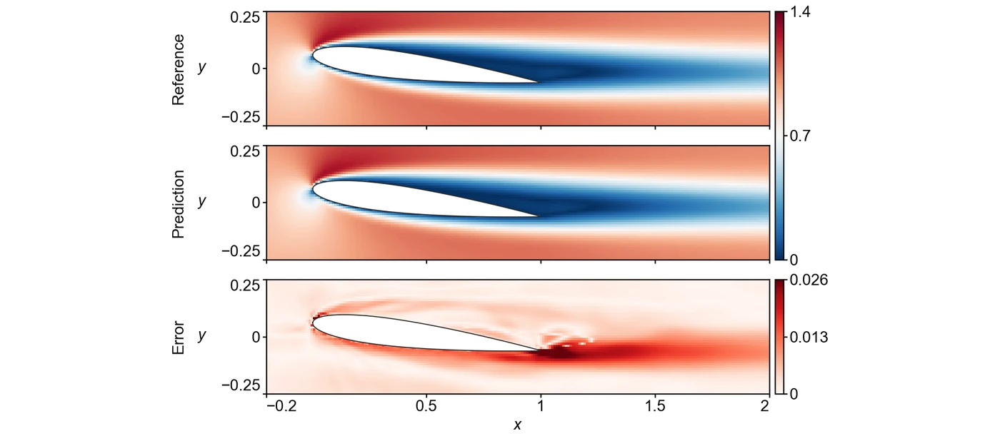

<section class="hero" style="padding-bottom:28px">

<a href="../problems.html">18 problems</a> / NACA

<h1>NACA NACA0012 airfoil flow</h1>

Training time per solver

180 s

Discovered PINN solver, five seeds

0.0129 ± 0.0012

</section>
<section>

<h2>Problem definition</h2>

The steady incompressible Navier–Stokes equations for the velocity $(u,v)$ and the pressure $p$,
\[
\begin{aligned}
u\,\pd{u}{x}+v\,\pd{u}{y}&amp;=-\pd{p}{x}+\nu\left(\pdn{2}{u}{x}+\pdn{2}{u}{y}\right),\\
u\,\pd{v}{x}+v\,\pd{v}{y}&amp;=-\pd{p}{y}+\nu\left(\pdn{2}{v}{x}+\pdn{2}{v}{y}\right),\\
\pd{u}{x}+\pd{v}{y}&amp;=0,
\end{aligned}
\]
with $\nu=1/\mathit{Re}$ and $\mathit{Re}=1000$, hold in the box $[-3,5]\times[-2,2]$ outside a NACA0012 airfoil at an angle of attack $\alpha=7^\circ$. The airfoil has unit chord and the half-thickness
\[
y_t(s)=5\tau\left(0.2969\sqrt{s}-0.1260\,s-0.3516\,s^2+0.2843\,s^3-0.1015\,s^4\right),\qquad s\in[0,1],
\]
with the thickness ratio $\tau=0.12$. Its surface is the curve $\bigl(s,\pm y_t(s)\bigr)$ turned nose up by $\alpha$ about the point $(0.5,0)$,
\[
x=0.5+(s-0.5)\cos\alpha\pm y_t(s)\sin\alpha,\qquad y=-(s-0.5)\sin\alpha\pm y_t(s)\cos\alpha.
\]
The no-slip condition $u=v=0$ holds on the airfoil surface and the free-stream condition $u=1$, $v=0$ on the four sides of the box. The error is measured on the velocity magnitude $V=\sqrt{u^2+v^2}$ at the 10,454 points of a uniform grid with spacing 0.01 that lie in the fluid and in the window $[-0.2,2]\times[-0.25,0.25]$ around the airfoil. The reference solution is the one released with Scale-PINN (<a class="cite" href="https://arxiv.org/abs/2602.19475" title="Scale-PINN: Learning Efficient Physics-Informed Neural Networks through Sequential Correction" target="_blank" rel="noopener noreferrer">Chiu et al., 2026</a>), which computes it with a finite-volume solver and imposes $u=1$, $v=0$ only at the inlet $x=-3$, with $p=0$ at the outlet $x=5$ and the slip condition $\partial u/\partial y=0$, $v=0$ at $y=\pm2$.

</section>
<section>

<h2>Fields of the discovered solver</h2>
<figure class="panel">
<figcaption><strong>Supplementary Fig. 8. NACA.</strong> Velocity magnitude $V$ and its absolute error at the 10,454 scoring points around the airfoil. The solver has a relative $L^2$ error of 0.0078.</figcaption></figure>

</section>
<section id="discovery">

<h2>Discovery process</h2>

Diamonds mark where the main techniques of the discovered solver enter, listed below the chart. Hover over a round to see the predicted field and the error field of the best solver after it.

<i class="dot"></i>evaluated solver<i class="line"></i>best so far
<i class="dia" style="background:#F3C49C;border-color:#D29466"></i>technique as in a note<i class="dia" style="background:#E8743B"></i>adapted from a note<i class="dia" style="background:#4A443C"></i>not from the literature base

All evaluated solvers as a table

<table><thead><tr><th>Round</th><th>Candidate</th><th>Seed</th><th>Relative <i>L</i>2 error</th><th>Steps</th><th>Training (s)</th></tr></thead><tbody id="eval-rows"></tbody></table>

</section>
<section>

<h2>Error against four state-of-the-art methods</h2>

Mean over five seeds with the range. The discovery run is a single training. Hatched bars use twice the training time (360 s).

</section>
<section>

<h2>Files</h2>

Discovered PINN solver

The solver of Table 1, from discovery run <code>naca_1_0.007671</code> (<code>blocks/b08/b08_v0_champ.py</code>).

<a class="dl" href="../files/solvers/naca.py">naca.py</a> view or save

<nav class="pager"><a href="heatlt.html">&larr; Heat-LT</a><a href="../problems.html">All problems</a><a href="smoke.html">Smoke &rarr;</a></nav>

</section>

