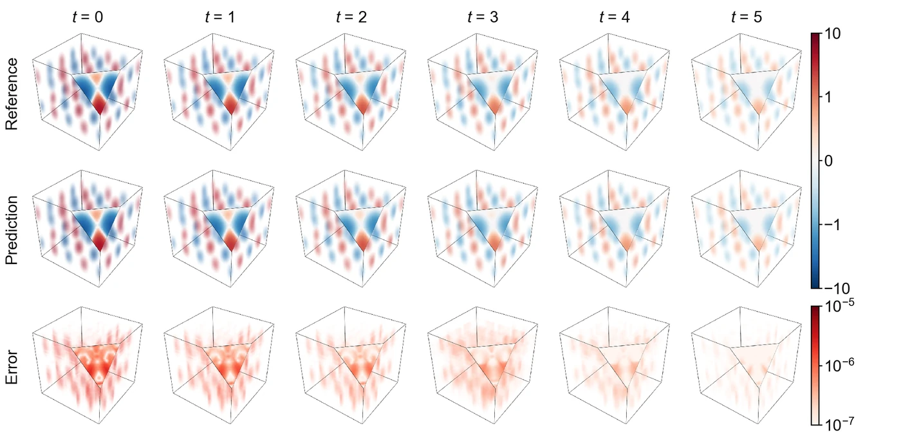

<section class="hero" style="padding-bottom:28px">

<a href="../problems.html">18 problems</a> / NS4D

<h1>NS4D 3D unsteady Navier–Stokes</h1>

Training time per solver

300 s

Discovered PINN solver, five seeds

(2.82 ± 0.11) × 10−7

</section>
<section>

<h2>Problem definition</h2>

The three-dimensional unsteady incompressible Navier–Stokes equations are written in vorticity form for the velocity $(u,v,w)$ as a function of $(t,x,y,z)$. The vorticity is the curl of the velocity,
\[
\omega_x=\pd{w}{y}-\pd{v}{z},\qquad \omega_y=\pd{u}{z}-\pd{w}{x},\qquad \omega_z=\pd{v}{x}-\pd{u}{y},
\]
and the vorticity transport and continuity equations are
\[
\begin{aligned}
\pd{\omega_x}{t}+u\,\pd{\omega_x}{x}+v\,\pd{\omega_x}{y}+w\,\pd{\omega_x}{z}&amp;=\omega_x\,\pd{u}{x}+\omega_y\,\pd{u}{y}+\omega_z\,\pd{u}{z}+\nu\left(\pdn{2}{\omega_x}{x}+\pdn{2}{\omega_x}{y}+\pdn{2}{\omega_x}{z}\right)+f_x,\\
\pd{\omega_y}{t}+u\,\pd{\omega_y}{x}+v\,\pd{\omega_y}{y}+w\,\pd{\omega_y}{z}&amp;=\omega_x\,\pd{v}{x}+\omega_y\,\pd{v}{y}+\omega_z\,\pd{v}{z}+\nu\left(\pdn{2}{\omega_y}{x}+\pdn{2}{\omega_y}{y}+\pdn{2}{\omega_y}{z}\right)+f_y,\\
\pd{\omega_z}{t}+u\,\pd{\omega_z}{x}+v\,\pd{\omega_z}{y}+w\,\pd{\omega_z}{z}&amp;=\omega_x\,\pd{w}{x}+\omega_y\,\pd{w}{y}+\omega_z\,\pd{w}{z}+\nu\left(\pdn{2}{\omega_z}{x}+\pdn{2}{\omega_z}{y}+\pdn{2}{\omega_z}{z}\right)+f_z,\\
\pd{u}{x}+\pd{v}{y}+\pd{w}{z}&amp;=0,
\end{aligned}
\]
with $\nu=0.05$ and the forcing
\[
f_x=-6\,e^{-18\nu t}\sin(4y)\sin(2z),\quad f_y=-6\,e^{-18\nu t}\sin(4x)\sin(2z),\quad f_z=6\,e^{-18\nu t}\sin(4x)\sin(4y).
\]
They hold on $(t,x,y,z)\in[0,5]\times[0,2\pi]^3$ with periodic boundary conditions of period $2\pi$ in each spatial direction,
\[
\pdn{n}{q}{x}(t,0,y,z)=\pdn{n}{q}{x}(t,2\pi,y,z),\qquad q\in\{u,v,w\},\ n=0,1,2,\ldots,
\]
and likewise in $y$ and $z$. The solver predicts the velocity and obtains the vorticity as its curl, so the viscous terms contain third derivatives of the velocity. The problem has the exact solution
\[
\begin{aligned}
u&amp;=2\,e^{-9\nu t}\cos(2x)\sin(2y)\sin z, &amp;\qquad \omega_x&amp;=-3\,e^{-9\nu t}\sin(2x)\cos(2y)\cos z,\\
v&amp;=-e^{-9\nu t}\sin(2x)\cos(2y)\sin z, &amp;\qquad \omega_y&amp;=6\,e^{-9\nu t}\cos(2x)\sin(2y)\cos z,\\
w&amp;=-2\,e^{-9\nu t}\sin(2x)\sin(2y)\cos z, &amp;\qquad \omega_z&amp;=-6\,e^{-9\nu t}\cos(2x)\cos(2y)\sin z,
\end{aligned}
\]
and the initial condition is this solution at $t=0$. The error is the mean of the relative $L^2$ errors of $\omega_x$, $\omega_y$ and $\omega_z$, each computed separately, $\varepsilon=\bigl(\varepsilon_{\omega_x}+\varepsilon_{\omega_y}+\varepsilon_{\omega_z}\bigr)/3$, at the $20^4=160{,}000$ points of a uniform grid over $[0,5]\times[0,2\pi]^3$ that includes the end points of each interval, where the reference values are those of the exact solution. The problem follows SPINN (<a class="cite" href="https://doi.org/10.52202/075280-1032" title="Separable Physics-Informed Neural Networks" target="_blank" rel="noopener noreferrer">Cho et al., 2023</a>).

</section>
<section>

<h2>Fields of the discovered solver</h2>
<figure class="panel">
<figcaption><strong>Supplementary Fig. 15. NS4D.</strong> The vorticity component $\omega_z$ and its absolute error in $[0,2\pi]^3$ at $t=0$, $1$, $2$, $3$, $4$ and $5$, drawn as transparent cubes. The scoring grid has 20 points in each direction, so the solver is evaluated again on $41^3$ points at each time, where the reference is the exact solution. The exact vorticity decays as $e^{-0.45t}$, and so does the error, so both colour scales are logarithmic, and values of $|\omega_z|$ below 0.1 are white. The solver has an error of $2.7\times10^{-7}$, the mean of the relative $L^2$ errors of the three components.</figcaption></figure>
<figure class="panel" style="margin-top:16px"><video controls loop muted playsinline preload="metadata" poster="../assets/media/field_ns4d_poster.webp?v=5540c4f8" width="1486" height="516">
<source src="../assets/media/field_ns4d.mp4?v=f346a571" type="video/mp4"></video>
<figcaption><strong>Animation.</strong> Reference solution, discovered PINN solver and absolute error of the vorticity component <i>ω</i><i>z</i> on the plane <i>z</i> = π, from <i>t</i> = 0 to 5.</figcaption></figure>

</section>
<section id="discovery">

<h2>Discovery process</h2>

Diamonds mark where the main techniques of the discovered solver enter, listed below the chart. Hover over a round to see the predicted field and the error field of the best solver after it.

<i class="dot"></i>evaluated solver<i class="line"></i>best so far
<i class="dia" style="background:#F3C49C;border-color:#D29466"></i>technique as in a note<i class="dia" style="background:#E8743B"></i>adapted from a note<i class="dia" style="background:#4A443C"></i>not from the literature base

All evaluated solvers as a table

<table><thead><tr><th>Round</th><th>Candidate</th><th>Seed</th><th>Relative <i>L</i>2 error</th><th>Steps</th><th>Training (s)</th></tr></thead><tbody id="eval-rows"></tbody></table>

</section>
<section>

<h2>Error against four state-of-the-art methods</h2>

Mean over five seeds with the range. The discovery run is a single training. Hatched bars use twice the training time (600 s).

</section>
<section>

<h2>Files</h2>

Discovered PINN solver

The solver of Table 1, from discovery run <code>ns4d_1_2.659e-07</code> (<code>blocks/b05/b05_p1d.py</code>).

<a class="dl" href="../files/solvers/ns4d.py">ns4d.py</a> view or save

<nav class="pager"><a href="ks.html">&larr; KS</a><a href="../problems.html">All problems</a><a href="cyl2.html">Cyl-LT &rarr;</a></nav>

</section>

