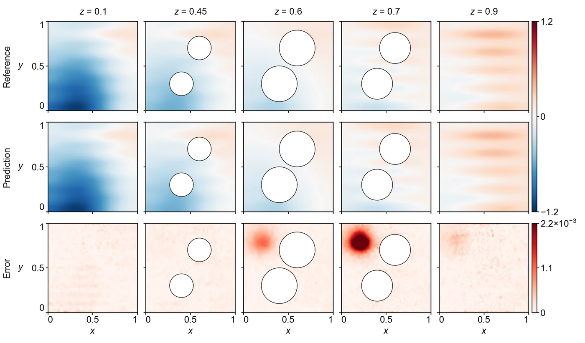

<section class="hero" style="padding-bottom:28px">

<a href="../problems.html">18 problems</a> / Poisson-CG

<h1>Poisson-CG Poisson, complex geometry</h1>

Training time per solver

60 s

Discovered PINN solver, five seeds

(9.96 ± 0.11) × 10−4

</section>
<section>

<h2>Problem definition</h2>

The field $u(x,y,z)$ satisfies the screened Poisson equation
\[
-\left(\pdn{2}{u}{x}+\pdn{2}{u}{y}+\pdn{2}{u}{z}\right)+k(z)^2\,u=f(x,y,z)
\]
in the unit cube with two balls of radius 0.2 removed,
\[
\Omega=\Bigl\{(x,y,z)\in[0,1]^3\Bigm|(x-x_j)^2+(y-y_j)^2+(z-z_j)^2&gt;0.2^2,\ j=1,2\Bigr\},
\]
where the centres of the balls are $(x_1,y_1,z_1)=(0.4,0.3,0.6)$ and $(x_2,y_2,z_2)=(0.6,0.7,0.6)$.
The screening wavenumber jumps across the plane $z=0.5$,
\[
k(z)=\begin{cases}8, &amp; z&lt;0.5,\\ 10, &amp; z\ge 0.5,\end{cases}
\]
and the source is
\[
f(x,y,z)=20\,e^{\sin(\pi x)+\sin(10\pi y)+\sin(5\pi z)}\,\frac{x^2+y^2+z^2-1}{x^2+y^2+z^2+1}+100\sin(\pi x)\sin(10\pi y)\sin(5\pi z).
\]
The homogeneous Neumann condition $\pd{u}{n}=0$ holds on the whole boundary of $\Omega$, the six faces of the cube and the two spheres, where $n$ is the outward normal. The problem is Poisson3d-CG of PINNacle (<a class="cite" href="https://doi.org/10.52202/079017-2442" title="PINNacle: A Comprehensive Benchmark of Physics-Informed Neural Networks for Solving PDEs" target="_blank" rel="noopener noreferrer">Hao et al., 2024</a>), and its reference solution is the one released with PINNacle, which computes it with the finite-element solver of COMSOL Multiphysics 6.0. The error is measured on $u$ at the 65,202 nodes of the finite-element mesh of this solution.

</section>
<section>

<h2>Fields of the discovered solver</h2>
<figure class="panel">
<figcaption><strong>Supplementary Fig. 1. Poisson-CG.</strong> The field $u$ on the planes $z=0.1$, $0.45$, $0.6$, $0.7$ and $0.9$. The solver has a relative $L^2$ error of $9.6\times10^{-4}$.</figcaption></figure>

</section>
<section id="discovery">

<h2>Discovery process</h2>

Diamonds mark where the main techniques of the discovered solver enter, listed below the chart. Hover over a round to see the predicted field and the error field of the best solver after it.

<i class="dot"></i>evaluated solver<i class="line"></i>best so far
<i class="dia" style="background:#F3C49C;border-color:#D29466"></i>technique as in a note<i class="dia" style="background:#E8743B"></i>adapted from a note<i class="dia" style="background:#4A443C"></i>not from the literature base

All evaluated solvers as a table

<table><thead><tr><th>Round</th><th>Candidate</th><th>Seed</th><th>Relative <i>L</i>2 error</th><th>Steps</th><th>Training (s)</th></tr></thead><tbody id="eval-rows"></tbody></table>

</section>
<section>

<h2>Error against four state-of-the-art methods</h2>

Mean over five seeds with the range. The discovery run is a single training. Hatched bars use twice the training time (120 s).

</section>
<section>

<h2>Files</h2>

Discovered PINN solver

The solver of Table 1, from discovery run <code>poissoncg_1_0.0009592</code> (<code>blocks/b04/b04_lr6.py</code>).

<a class="dl" href="../files/solvers/poissoncg.py">poissoncg.py</a> view or save

<nav class="pager"><a href="wing3d.html">&larr; Wing3D</a><a href="../problems.html">All problems</a><a href="ib.html">IB &rarr;</a></nav>

</section>

