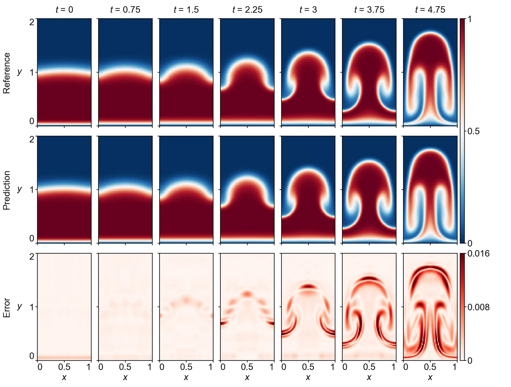

<section class="hero" style="padding-bottom:28px">

<a href="../problems.html">18 problems</a> / RT

<h1>RT Rayleigh–Taylor instability</h1>

Training time per solver

480 s

Discovered PINN solver, five seeds

0.00618 ± 0.00119

</section>
<section>

<h2>Problem definition</h2>

The Boussinesq equations for the velocity $(u,v)$, the pressure $p$ and the temperature $T$, which enters the vertical momentum equation as a buoyancy force,
\[
\begin{aligned}
\pd{u}{t}+u\,\pd{u}{x}+v\,\pd{u}{y}&amp;=-\pd{p}{x}+\sqrt{\frac{\mathrm{Pr}}{\mathrm{Ra}}}\left(\pdn{2}{u}{x}+\pdn{2}{u}{y}\right),\\
\pd{v}{t}+u\,\pd{v}{x}+v\,\pd{v}{y}&amp;=-\pd{p}{y}+\sqrt{\frac{\mathrm{Pr}}{\mathrm{Ra}}}\left(\pdn{2}{v}{x}+\pdn{2}{v}{y}\right)+T,\\
\pd{u}{x}+\pd{v}{y}&amp;=0,\\
\pd{T}{t}+u\,\pd{T}{x}+v\,\pd{T}{y}&amp;=\frac{1}{\sqrt{\mathrm{Pr}\,\mathrm{Ra}}}\left(\pdn{2}{T}{x}+\pdn{2}{T}{y}\right),
\end{aligned}
\]
with the Prandtl number $\mathrm{Pr}=0.71$ and the Rayleigh number $\mathrm{Ra}=10^6$, so $\sqrt{\mathrm{Pr}/\mathrm{Ra}}=8.426150\times10^{-4}$ and $1/\sqrt{\mathrm{Pr}\,\mathrm{Ra}}=1.186782\times10^{-3}$, hold on $(t,x,y)\in[0,4.75]\times[0,1]\times[0,2]$. The fields are periodic in $x$ with period 1,
\[
\pdn{n}{q}{x}(t,0,y)=\pdn{n}{q}{x}(t,1,y),\qquad q\in\{u,v,p,T\},\ n=0,1,2,\ldots,
\]
and $u=v=T=0$ on the bottom and top walls $y=0$ and $y=2$. The initial fields $u(0,x,y)$, $v(0,x,y)$ and $T(0,x,y)$ are the reference solution at $t=0$ on a non-uniform $100\times200$ grid, in which a layer with $T\approx1$ lies below a layer with $T\approx0$ and a perturbed interface near $y=1$ separates them. The error is measured on $T$ at the 20 times $t=0,0.25,\ldots,4.75$ on the same grid. The problem is the interval $[1.01,5.76]$ of the Rayleigh–Taylor flow released with APTS (<a class="cite" href="https://arxiv.org/abs/2604.23528" title="When PINNs Go Wrong: Pseudo-Time Stepping against Spurious Solutions" target="_blank" rel="noopener noreferrer">Wang et al., 2026</a>), shifted to start at $t=0$, and its reference solution is that flow, which APTS computes with the Julia package IncompressibleNavierStokes.jl.

</section>
<section>

<h2>Fields of the discovered solver</h2>
<figure class="panel">
<figcaption><strong>Supplementary Fig. 17. RT.</strong> Temperature $T$ and its absolute error at $t=0$, $0.75$, $1.5$, $2.25$, $3$, $3.75$ and $4.75$ on the scoring grid. The solver has a relative $L^2$ error of 0.0043.</figcaption></figure>
<figure class="panel" style="margin-top:16px"><video controls loop muted playsinline preload="metadata" poster="../assets/media/field_rt_poster.webp?v=c2cc440b" width="1276" height="676">
<source src="../assets/media/field_rt.mp4?v=ce4e42fb" type="video/mp4"></video>
<figcaption><strong>Animation.</strong> Reference solution, discovered PINN solver and absolute error of the temperature <i>T</i>, from <i>t</i> = 0 to 4.75.</figcaption></figure>

</section>
<section id="discovery">

<h2>Discovery process</h2>

Diamonds mark where the main techniques of the discovered solver enter, listed below the chart. Hover over a round to see the predicted field and the error field of the best solver after it.

<i class="dot"></i>evaluated solver<i class="line"></i>best so far
<i class="dia" style="background:#F3C49C;border-color:#D29466"></i>technique as in a note<i class="dia" style="background:#E8743B"></i>adapted from a note<i class="dia" style="background:#4A443C"></i>not from the literature base

All evaluated solvers as a table

<table><thead><tr><th>Round</th><th>Candidate</th><th>Seed</th><th>Relative <i>L</i>2 error</th><th>Steps</th><th>Training (s)</th></tr></thead><tbody id="eval-rows"></tbody></table>

</section>
<section>

<h2>Error against four state-of-the-art methods</h2>

Mean over five seeds with the range. The discovery run is a single training. Hatched bars use twice the training time (960 s).

</section>
<section>

<h2>Files</h2>

Discovered PINN solver

The solver of Table 1, from discovery run <code>rt_1_0.004299</code> (<code>blocks/b07/b07_pc50.py</code>).

<a class="dl" href="../files/solvers/rt.py">rt.py</a> view or save

<nav class="pager"><a href="cyl2.html">&larr; Cyl-LT</a><a href="../problems.html">All problems</a><a href="wing3d.html">Wing3D &rarr;</a></nav>

</section>

