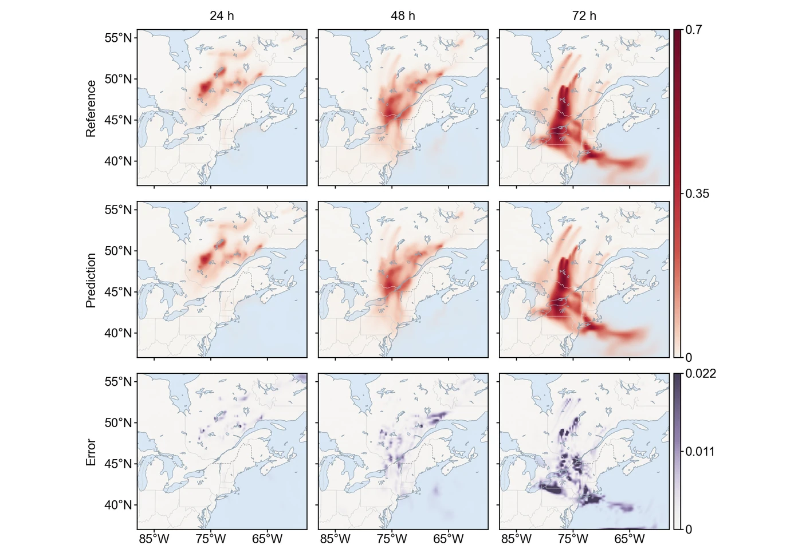

<section class="hero" style="padding-bottom:28px">

<a href="../problems.html">18 problems</a> / Smoke

<h1>Smoke Wildfire smoke transport</h1>

Training time per solver

180 s

Discovered PINN solver, five seeds

0.0637 ± 0.0002

</section>
<section>

<h2>Problem definition</h2>

The advection-diffusion equation for the normalized, vertically integrated smoke burden $u(t,x,y)$,
\[
\pd{u}{t}+a\,\pd{u}{x}+b\,\pd{u}{y}+c\,u=D_x\,\pdn{2}{u}{x}+D_y\,\pdn{2}{u}{y}+f,
\]
holds on $(t,x,y)\in[0,1]^3$. These normalized coordinates span the 72 hours from 4 to 7 June 2023, during the wildfires in Quebec, and the region from $88^\circ$W to $58^\circ$W and from $37^\circ$N to $56^\circ$N. The coefficients $a(t,x,y)$ and $b(t,x,y)$ are the normalized wind components, $c(t,x,y)$ is the divergence of the wind and $f(t,x,y)$ is the emission flux. They come from ERA5 reanalysis winds (<a class="cite" href="https://doi.org/10.1002/qj.3803" title="The ERA5 Global Reanalysis" target="_blank" rel="noopener noreferrer">Hersbach et al., 2020</a>) and GFAS fire emissions (<a class="cite" href="https://doi.org/10.5194/bg-9-527-2012" title="Biomass Burning Emissions Estimated with a Global Fire Assimilation System Based on Observed Fire Radiative Power" target="_blank" rel="noopener noreferrer">Kaiser et al., 2012</a>) on a grid of 73 times, 241 longitudes and 153 latitudes, and are evaluated between grid points by trilinear interpolation. The diffusion coefficients are $D_x=9.831690\times10^{-4}$ and $D_y=1.161416\times10^{-3}$, so advection dominates, with a P\'eclet number of order $10^3$. The Dirichlet condition $u=0$ holds on the four sides, and the initial condition is $u(0,x,y)=0$, so the source $f$ builds the whole plume.

We compute the reference solution with a conservative finite-volume scheme on the $241\times153$ cells whose centres are the points of the coefficient grid, in NumPy. The scheme uses the winds at 850 hPa, linear in time between hourly frames, and the daily emissions, with MUSCL reconstruction and the van Leer limiter, dimensional splitting, explicit advection in sub-steps at a Courant number of 0.4, explicit diffusion and zero values in ghost cells outside the region. Doubling the resolution in each direction changes the final field by a relative error of 0.036. The solution is normalized by its maximum, and the error is measured on $u$ at every second point of the coefficient grid in each direction, $37\times121\times77=344{,}729$ points in all. Since the zero values lie in the ghost cells, the reference values on the sides are those of the outermost cells and reach 4% of the maximum on the side $y=0$.

</section>
<section>

<h2>Fields of the discovered solver</h2>
<figure class="panel">
<figcaption><strong>Supplementary Fig. 9. Smoke.</strong> The normalized smoke burden $u$ at 24, 48 and 72 hours on the maps and the square-root colour scale of Fig. 3a, and the absolute error on the same maps. The solver has a relative $L^2$ error of 0.063.</figcaption></figure>
<figure class="panel" style="margin-top:16px"><video controls loop muted playsinline preload="metadata" poster="../assets/media/field_smoke_poster.webp?v=08ad758d" width="1558" height="516">
<source src="../assets/media/field_smoke.mp4?v=cac119dd" type="video/mp4"></video>
<figcaption><strong>Animation.</strong> Reference solution, discovered PINN solver and absolute error of the normalized smoke burden <i>u</i>, over the 72 hours.</figcaption></figure>

</section>
<section id="discovery">

<h2>Discovery process</h2>

Diamonds mark where the main techniques of the discovered solver enter, listed below the chart. Hover over a round to see the predicted field and the error field of the best solver after it.

<i class="dot"></i>evaluated solver<i class="line"></i>best so far
<i class="dia" style="background:#F3C49C;border-color:#D29466"></i>technique as in a note<i class="dia" style="background:#E8743B"></i>adapted from a note<i class="dia" style="background:#4A443C"></i>not from the literature base

All evaluated solvers as a table

<table><thead><tr><th>Round</th><th>Candidate</th><th>Seed</th><th>Relative <i>L</i>2 error</th><th>Steps</th><th>Training (s)</th></tr></thead><tbody id="eval-rows"></tbody></table>

</section>
<section>

<h2>Error against four state-of-the-art methods</h2>

Mean over five seeds with the range. The discovery run is a single training. Hatched bars use twice the training time (360 s).

</section>
<section>

<h2>Files</h2>

Discovered PINN solver

The solver of Table 1, from discovery run <code>smoke_1_0.06326</code> (<code>blocks/b10/b10_lr35.py</code>).

<a class="dl" href="../files/solvers/smoke.py">smoke.py</a> view or save

<nav class="pager"><a href="naca.html">&larr; NACA</a><a href="../problems.html">All problems</a><a href="cyl.html">Cyl &rarr;</a></nav>

</section>

