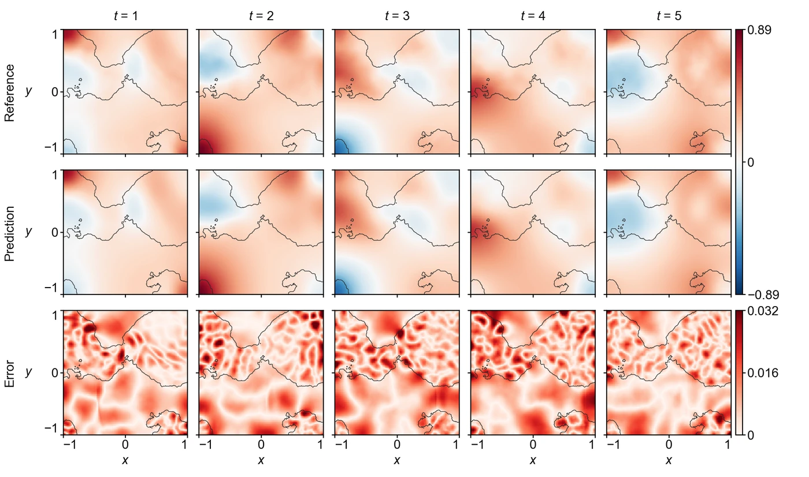

<section class="hero" style="padding-bottom:28px">

<a href="../problems.html">18 problems</a> / Wave-HM

<h1>Wave-HM Wave, heterogeneous media</h1>

Training time per solver

100 s

Discovered PINN solver, five seeds

0.0992 ± 0.0756

</section>
<section>

<h2>Problem definition</h2>

The wave equation for $u(t,x,y)$ in a heterogeneous medium,
\[
\pdn{2}{u}{t}=c(x,y)\left(\pdn{2}{u}{x}+\pdn{2}{u}{y}\right),
\]
holds on $(t,x,y)\in[0,5]\times[-1,1]^2$. The coefficient $c(x,y)$ is given on a uniform $256\times256$ grid over $[-1,1]^2$, where it takes the values 1 and 12, and is evaluated between grid points by bilinear interpolation. The wave speed $\sqrt{c}$ thus changes by a factor of $\sqrt{12}\approx3.46$ across the interfaces between the two materials. The homogeneous Neumann conditions
\[
\pd{u}{x}(t,\pm1,y)=0,\qquad \pd{u}{y}(t,x,\pm1)=0
\]
hold on the four sides, and the initial conditions are
\[
u(0,x,y)=\exp\left(-\frac{(x+0.5)^2+y^2}{2\cdot0.3^2}\right),\qquad \pd{u}{t}(0,x,y)=0.
\]
The error is measured on $u$ at the 51 times $t=0,0.1,\ldots,5$ on a uniform $129\times129$ grid over $[-1,1]^2$. The problem is Wave2d-CG of PINNacle (<a class="cite" href="https://doi.org/10.52202/079017-2442" title="PINNacle: A Comprehensive Benchmark of Physics-Informed Neural Networks for Solving PDEs" target="_blank" rel="noopener noreferrer">Hao et al., 2024</a>). We compute its reference solution, because a solution with the coefficient field released with PINNacle differs from the solution released with it by a relative error of about 1 under every orientation of the field. We integrate the equation with the leapfrog scheme and the five-point Laplacian on a uniform grid of $4097\times4097$ points, with 125,450 time steps and mirrored ghost points for the Neumann conditions, in double precision with JAX, and the scoring grid takes every 32nd point of it. Refining the grid from $2049\times2049$ to $4097\times4097$ points changes the solution by a relative error of $5.4\times10^{-4}$.

</section>
<section>

<h2>Fields of the discovered solver</h2>
<figure class="panel">
<figcaption><strong>Supplementary Fig. 4. Wave-HM.</strong> The field $u$ at $t=1$, $2$, $3$, $4$ and $5$ on the scoring grid. Lines mark the interfaces at which the coefficient $c$ jumps between 1 and 12. The solver has a relative $L^2$ error of 0.046.</figcaption></figure>
<figure class="panel" style="margin-top:16px"><video controls loop muted playsinline preload="metadata" poster="../assets/media/field_wavems_poster.webp?v=b235270e" width="1486" height="516">
<source src="../assets/media/field_wavems.mp4?v=309334e4" type="video/mp4"></video>
<figcaption><strong>Animation.</strong> Reference solution, discovered PINN solver and absolute error of the field <i>u</i>, from <i>t</i> = 0 to 5.</figcaption></figure>

</section>
<section id="discovery">

<h2>Discovery process</h2>

Diamonds mark where the main techniques of the discovered solver enter, listed below the chart. Hover over a round to see the predicted field and the error field of the best solver after it.

<i class="dot"></i>evaluated solver<i class="line"></i>best so far
<i class="dia" style="background:#F3C49C;border-color:#D29466"></i>technique as in a note<i class="dia" style="background:#E8743B"></i>adapted from a note<i class="dia" style="background:#4A443C"></i>not from the literature base

All evaluated solvers as a table

<table><thead><tr><th>Round</th><th>Candidate</th><th>Seed</th><th>Relative <i>L</i>2 error</th><th>Steps</th><th>Training (s)</th></tr></thead><tbody id="eval-rows"></tbody></table>

</section>
<section>

<h2>Error against four state-of-the-art methods</h2>

Mean over five seeds with the range. The discovery run is a single training. Hatched bars use twice the training time (200 s).

</section>
<section>

<h2>Files</h2>

Discovered PINN solver

The solver of Table 1, from discovery run <code>wavems_1_0.04592</code> (<code>blocks/b10/b10_f08.py</code>).

<a class="dl" href="../files/solvers/wavems.py">wavems.py</a> view or save

<nav class="pager"><a href="kdv.html">&larr; KdV</a><a href="../problems.html">All problems</a><a href="ldc.html">LDC &rarr;</a></nav>

</section>

