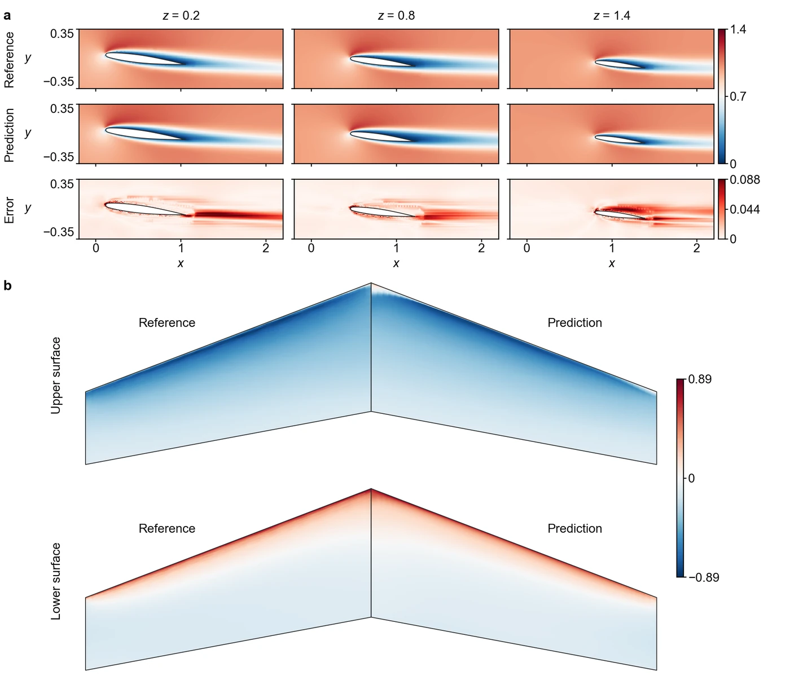

<section class="hero" style="padding-bottom:28px">

<a href="../problems.html">18 problems</a> / Wing3D

<h1>Wing3D Flow over a 3D wing</h1>

Training time per solver

480 s

Discovered PINN solver, five seeds

0.0321 ± 0.0044

</section>
<section>

<h2>Problem definition</h2>

The three-dimensional steady incompressible Navier–Stokes equations for the velocity $(u,v,w)$ and the pressure $p$,
\[
\begin{aligned}
u\,\pd{u}{x}+v\,\pd{u}{y}+w\,\pd{u}{z}&amp;=-\pd{p}{x}+\nu\left(\pdn{2}{u}{x}+\pdn{2}{u}{y}+\pdn{2}{u}{z}\right),\\
u\,\pd{v}{x}+v\,\pd{v}{y}+w\,\pd{v}{z}&amp;=-\pd{p}{y}+\nu\left(\pdn{2}{v}{x}+\pdn{2}{v}{y}+\pdn{2}{v}{z}\right),\\
u\,\pd{w}{x}+v\,\pd{w}{y}+w\,\pd{w}{z}&amp;=-\pd{p}{z}+\nu\left(\pdn{2}{w}{x}+\pdn{2}{w}{y}+\pdn{2}{w}{z}\right),\\
\pd{u}{x}+\pd{v}{y}+\pd{w}{z}&amp;=0,
\end{aligned}
\]
with $\nu=1/\mathit{Re}$ and $\mathit{Re}=1000$, hold in the box $[-1.5,3.5]\times[-2,2]\times[0,3.5]$ outside a finite wing at an angle of attack of $7^\circ$. Lengths are in units of the root chord, and $x$, $y$ and $z$ are the chordwise, lift and spanwise directions. The wing is the ONERA M6 wing (<a class="cite" href="https://scholar.google.com/scholar?q=%22Pressure+Distributions+on+the+ONERA-M6-Wing+at+Transonic+Mach+Numbers%22" title="Pressure Distributions on the ONERA-M6-Wing at Transonic Mach Numbers" target="_blank" rel="noopener noreferrer">Schmitt and Charpin, 1979</a>), swept and tapered, with a root chord of 1 whose leading edge lies at $x=0$, a tip chord of 0.56252, a leading-edge sweep of $30^\circ$, a thickness of 9.7% of the chord and a rounded tip that reaches $z=1.50323$. It is turned nose up by $7^\circ$ about the spanwise axis through $x=0.5$, $y=0$. Only the half $z\ge0$ is modelled, with the root section on the symmetry plane $z=0$. The wing surface is given as a set of points and the fluid region by a signed distance function. The boundary conditions are
\[
\begin{aligned}
&amp;u=v=w=0 &amp;&amp;\text{on the wing surface},\\
&amp;u=1,\quad v=w=0 &amp;&amp;\text{at the inlet } x=-1.5 \text{ and the far-field faces } y=\pm2,\ z=3.5,\\
&amp;p=0 &amp;&amp;\text{at the outlet } x=3.5,\\
&amp;w=0,\quad \pd{u}{z}=\pd{v}{z}=0 &amp;&amp;\text{on the symmetry plane } z=0.
\end{aligned}
\]
The error is measured on the velocity magnitude $V=\sqrt{u^2+v^2+w^2}$ at the 388,475 points of a uniform grid with spacing 0.02 that lie in the fluid and in the window $[-0.2,2.2]\times[-0.35,0.35]\times[0,1.8]$ around the wing. We compute the reference solution with ANSYS Fluent 2021 R2 in double precision, using the coupled pressure-velocity solver with pseudo-transient iterations and second-order discretizations of pressure and momentum, on a poly-hexcore mesh of 492,298 cells whose size grows from 0.002 on the wing to 0.25 in the far field and is at most 0.03 in the wake. After 1,500 iterations, the scaled residual is $4.4\times10^{-7}$ for continuity and below $10^{-10}$ for momentum. The cell values are averaged to the mesh nodes and interpolated within the cells onto the scoring grid. Inside the box $[1.45,2.5]\times[-0.5,0.5]\times[0,1.9]$, which holds 32% of the scoring points, a solution by COMSOL Multiphysics 5.6 on three meshes of up to 1.76 million elements, with boundary values from the Fluent solution on the faces of the box, differs from the reference by a relative error of 0.0071 in $V$. On the planes $z=0$ and $z=0.02$, the averaging over the polyhedral cells next to the symmetry plane makes the reference vary from one cell to the next.

</section>
<section>

<h2>Fields of the discovered solver</h2>
<figure class="panel">
<figcaption><strong>Supplementary Fig. 18. Wing3D.</strong> <strong>a</strong>, Velocity magnitude $V$ and its absolute error on the sections $z=0.2$, $0.8$ and $1.4$, with the outline of the wing section. <strong>b</strong>, Pressure coefficient $C_p=2p$ 0.003 off the upper and lower surfaces, seen from above with the leading edge up and the span stretched 1.5 times, the reference on the left half of the wing and the solver on the right half. Its relative $L^2$ error is 0.20 on the upper and 0.13 on the lower surface. In both, the solver is evaluated again and the reference is sampled from the CFD solution as at the scoring points. The solver has a relative $L^2$ error of 0.021.</figcaption></figure>

</section>
<section id="discovery">

<h2>Discovery process</h2>

Diamonds mark where the main techniques of the discovered solver enter, listed below the chart. Hover over a round to see the predicted field and the error field of the best solver after it.

<i class="dot"></i>evaluated solver<i class="line"></i>best so far
<i class="dia" style="background:#F3C49C;border-color:#D29466"></i>technique as in a note<i class="dia" style="background:#E8743B"></i>adapted from a note<i class="dia" style="background:#4A443C"></i>not from the literature base

All evaluated solvers as a table

<table><thead><tr><th>Round</th><th>Candidate</th><th>Seed</th><th>Relative <i>L</i>2 error</th><th>Steps</th><th>Training (s)</th></tr></thead><tbody id="eval-rows"></tbody></table>

</section>
<section>

<h2>Error against four state-of-the-art methods</h2>

Mean over five seeds with the range. The discovery run is a single training. Hatched bars use twice the training time (960 s).

</section>
<section>

<h2>Files</h2>

Discovered PINN solver

The solver of Table 1, from discovery run <code>wing3d_1_0.02078</code> (<code>blocks/b04/b04_relr.py</code>).

<a class="dl" href="../files/solvers/wing3d.py">wing3d.py</a> view or save

<nav class="pager"><a href="rt.html">&larr; RT</a><a href="../problems.html">All problems</a><a href="poissoncg.html">Poisson-CG &rarr;</a></nav>

</section>

